# drag-lint

[](https://github.com/Alexl-git/Delphi-RAG-Lint/releases)
[](LICENSE)

> **Alpha / work in progress.** This is an early alpha under active, daily
> development -- expect rough edges, unfinished corners, and breaking changes
> between versions. It is shared early so the Delphi community can try it and
> shape it. **Feedback and suggestions are very welcome** -- please open an
> [Issue](https://github.com/Alexl-git/Delphi-RAG-Lint/issues) with ideas, bugs,
> or "I wish it could...". Not yet recommended for unattended/production use.

A symbol-aware retrieval + lint + refactoring + IDE-integration tool for Delphi.
Pure Object Pascal at runtime -- no Python, Node, or Rust. No cloud AI.

**Use it as:** CLI tool &middot; LSP server (Zed / VS Code) &middot; MCP server (Claude / Cursor) &middot; RAD Studio 13 plugin.

**Driving it from an AI agent? See [docs/AI-USAGE.md](docs/AI-USAGE.md)** -- copy-paste instructions so your AI uses drag-lint over CLI or MCP (and reads ~10-60x fewer tokens than opening whole units).

> **What it does today, and what is coming -- the feature list.**
> A single readable document covering every capability by area (indexing, search,
> analysis, linting, diagnostics, documentation, refactoring, AI integration, IDE
> integration, reporting and the Component Converter), plus **what changed in this
> release** and an **upcoming roadmap** of everything currently planned.
> [Features](docs/wiki/Features.md) (generated from the feature registry), and Word, [`docs/drag-lint-features-2026-09-16.docx`](docs/drag-lint-features-2026-09-16.docx).
> Every count in it is read from the shipping build, not from the previous edition.

Built on [`tree-sitter-delphi13`](https://github.com/Alexl-git/tree-sitter-delphi13)
(sibling project) and a vendored Pascal binding for libtree-sitter.

> **Background reading -- why that foundation.**
> **["Three Ways to Read Delphi"](docs/PARSING-LAYERS.md)** compares a raw lexer,
> DelphiAST and tree-sitter as three answers to one question: *what should happen
> when the source does not fit?* Covers the conditional-compilation fork, byte-exact
> round-trip fidelity, and three case studies -- including where a hand-written AST
> still wins.
> Also as styled HTML -- [`docs/PARSING-LAYERS.html`](docs/PARSING-LAYERS.html)
> ([rendered](https://htmlpreview.github.io/?https://github.com/Alexl-git/Delphi-RAG-Lint/blob/main/docs/PARSING-LAYERS.html))
> -- and Word, [`docs/PARSING-LAYERS.docx`](docs/PARSING-LAYERS.docx).

**Companion:** [`Delphi-RAG-Lint-Graph`](https://github.com/Alexl-git/Delphi-RAG-Lint-Graph)
-- a standalone VCL viewer (Win64) that turns this index into an interactive symbol
graph: UML class boxes, a **Code Flow View** that renders your DocInsight comments,
a **Where-Used** caller list, search with Back/Forward history, and **editor-sync**
(the graph follows the active unit in RAD Studio). Click-to-jump back into the IDE.

---

## Screenshots

### Out-of-process compiler intelligence, inside the IDE
Live diagnostics come from compiling your buffer in a **spawned** process -- even
unsaved code -- so the IDE never freezes. The Structure panel and a dockable code
graph sit beside the editor.

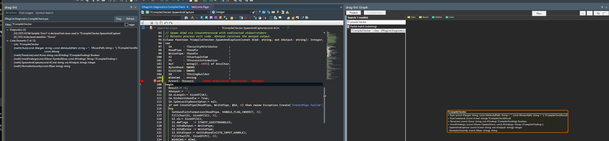

### Your DocInsight `///` comments, in Help Insight
`<summary>` and `<remarks>` render natively in the IDE's Help Insight tooltip.

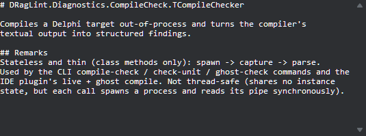

### Code Flow View
Trace a routine's calls as a flowchart -- each box carries its DocInsight summary
(here `TCompileChecker.Run`).

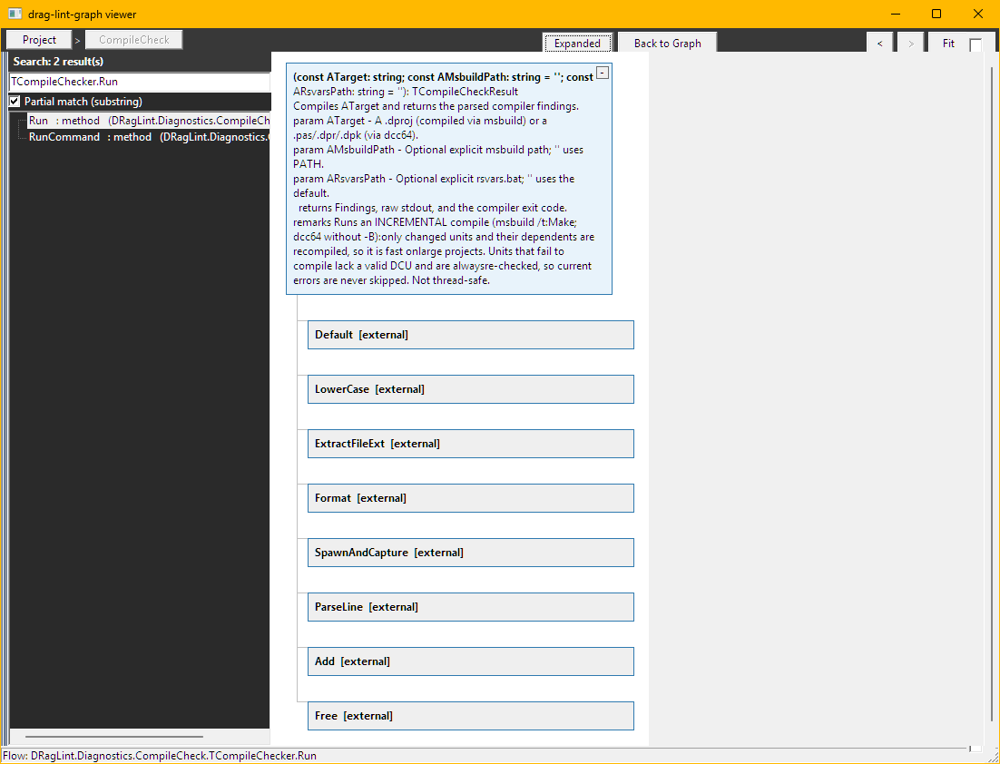

### UML class view, with doc on hover
Search a type to see its members (visibility glyphs + full signatures); hover a
member for its DocInsight doc.

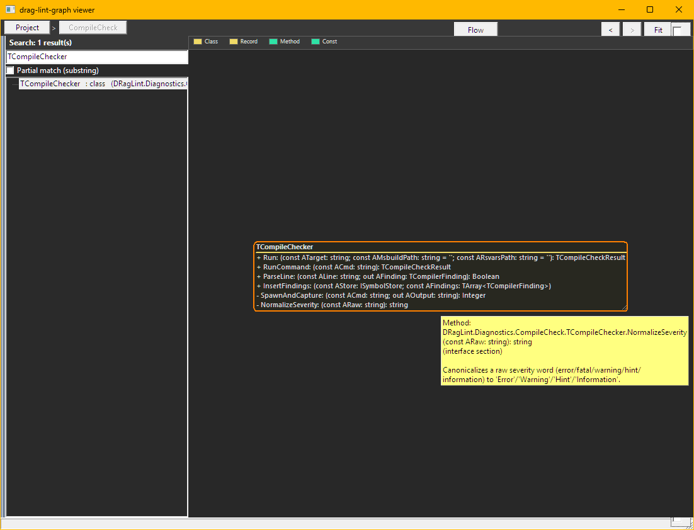

### Where Used
A precise, clickable list of a symbol's callers -- 7 callers of
`ResolveActiveIndexDbs` -- beside its unit's call graph.

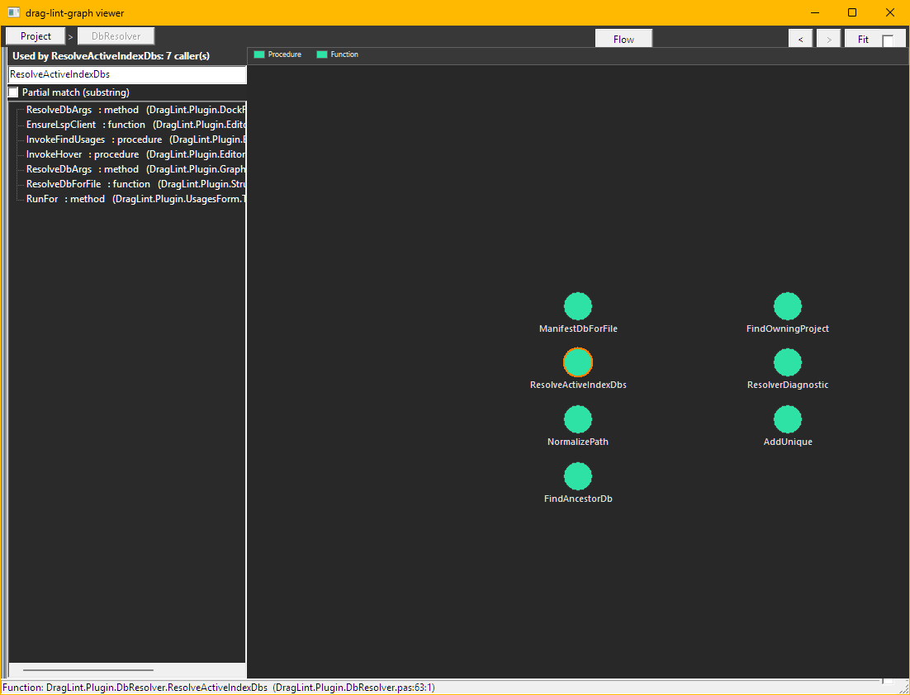

### AST-exact symbol query (CLI)
`drag-lint query --name TCompileChecker --json` returns every match with kind,
qualified name, section, file and precise line/impl ranges -- no comment or
string-literal noise.

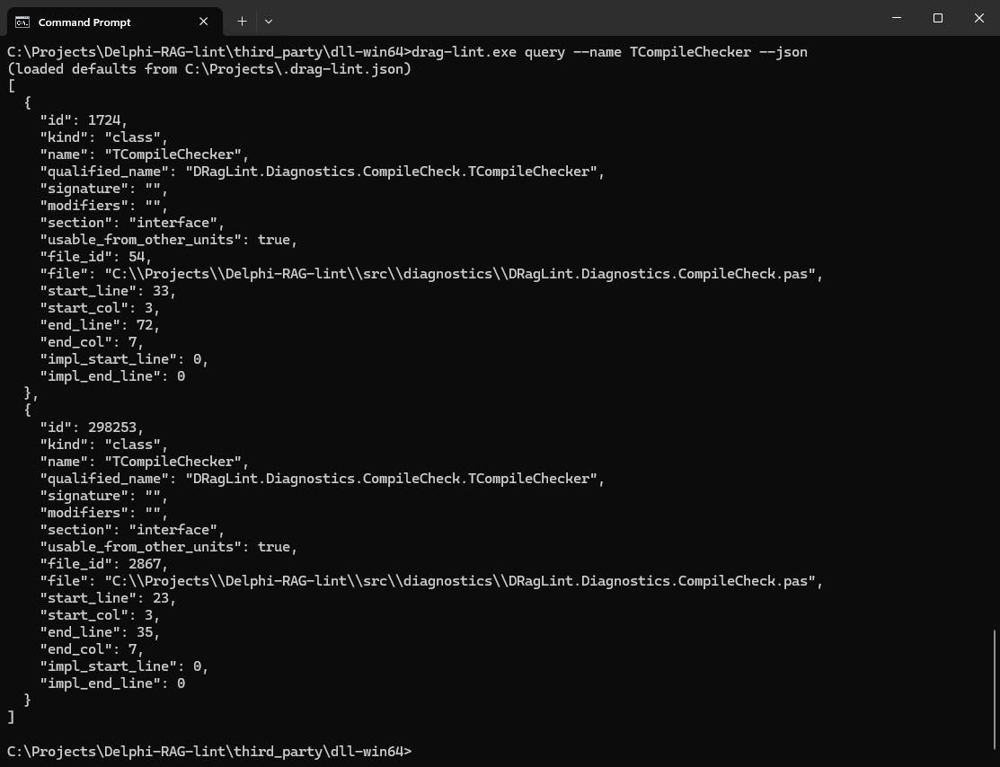

### Find callers, with source context (CLI)
`drag-lint query find-callers` lists every caller (7 here) with the surrounding
source lines.

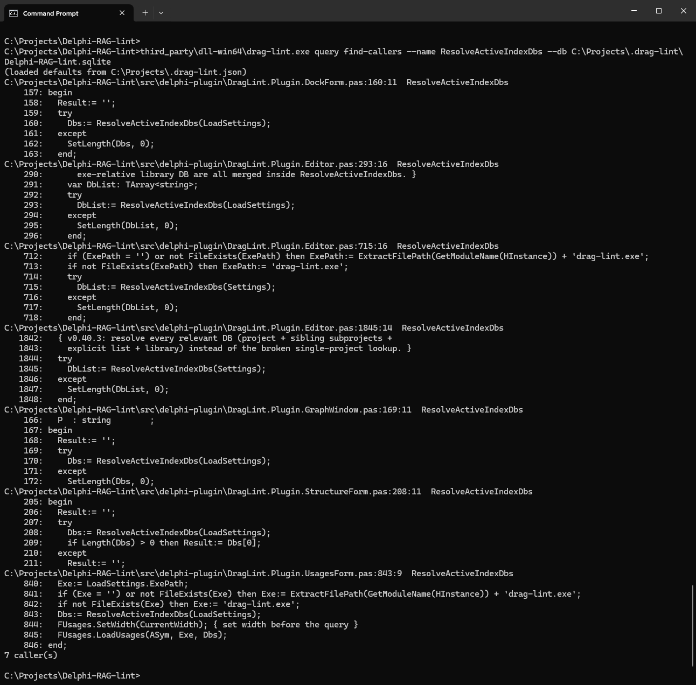

### Semantic compile-check from the CLI
`drag-lint check-unit` compiles a unit in its project's context and reports
findings (here: clean).

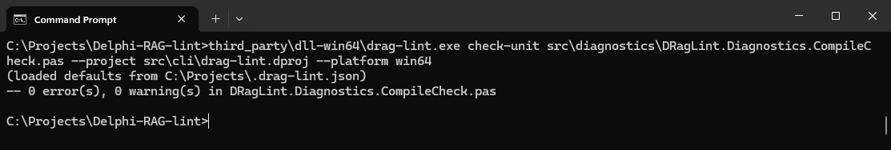

---

## Diagrams and charts

**Ask the index a question about one symbol, get a clickable chart back.**
Twenty-five formal questions -- `butterfly`, `who-calls`, `what-it-calls`,
`who-writes`, `who-reads`, `change-impact`, `tested-by`, `effects`,
`touches-tables`, `class-surface`, `hierarchy`, `deps`, `cycles`, `wiring`,
`lifecycle`, `event-wiring`, `architecture`, `protocol-trace`,
`crosses-boundary`, `shown-where`, `exception-paths`, `consumers`,
`feeds-from`, `lands-where` and `round-trip` (one grid field, client -> pipe ->
server -> SQL and back).

**From RAD Studio:** put the caret on the symbol and pick the question from
**drag-lint > Reports**. The menu groups the questions by what you select
(routine, field or grid column, type, unit, project, table), resolves the
symbol under the caret to its full name, and runs the report in the
background. The chart opens in your browser; the text answer is copied to the
clipboard (and shown in a small IDE window) as a DocInsight `/// <remarks>`
block you can paste above the declaration -- it carries no autodoc marker, so
Auto Document leaves it alone. The same submenu holds **Forms for testers
(CSV)...**, a spreadsheet of every form and how to reach it. See
[IDE Menu Reference](https://github.com/Alexl-git/Delphi-RAG-Lint/wiki/IDE-Menu-Reference).

**From a terminal or an AI agent:** `drag-lint ask <id> --target <name>
--project <x.dproj> [--open]` -- it finds the indexes itself and prints the
answer as text. Every question is answered in-process by the engine; no
PowerShell is needed (pictures need Graphviz).

drag-lint is not a model: every chart comes from a formal call, and every row in
it is a fact from the index with a file and a line. Each answer is a bundle --
`graph.svg` whose rows link back to the source (`draglint://open`: a click is received by
`drag-lint-open.exe`, which hands it to the IDE plugin, once `drag-lint protocol register` has made
the link clickable -- see
[Click-to-source links](#click-to-source-links-draglint)), PNG and PDF exports of the same layout, a browser shell, a
`meta.json` that fingerprints the index and records the command that regenerates
the chart, and a ready-to-paste DocInsight `<remarks>` reference. Full reference,
one page per question: **[Diagrams and Charts](https://github.com/Alexl-git/Delphi-RAG-Lint/wiki/Diagrams-and-Charts)**.

The three charts below are drag-lint's own code, produced by the engine's
`drag-lint ask` verb against a copy of its self-index at v1.17.0-alpha. (The PowerShell
emitters under `charts\src` remain in the repository only as an internal parity reference.)

### change-impact -- one function feeds closure, parse and lint

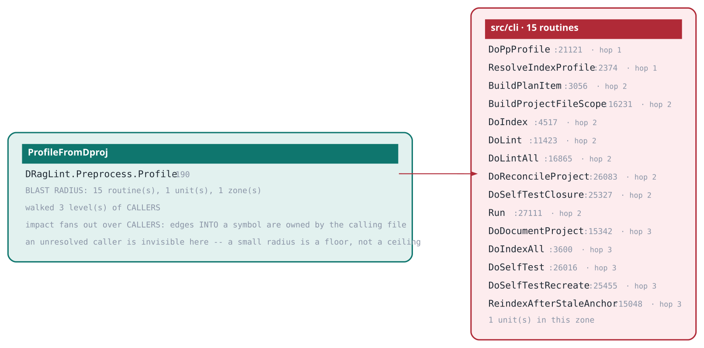

Question `change-impact`, target `DRagLint.Preprocess.Profile.ProfileFromDproj`,
depth 3. **15 routines** reach it: `pp-profile` and the index-profile resolver
directly, then the project closure (`BuildProjectFileScope`), `index`, `lint`,
`lint-all`, `reconcile-project` and `document` for a project. This is why reading
the platform PropertyGroups in that one function moved the extractor version.
Produced by `drag-lint ask change-impact --target DRagLint.Preprocess.Profile.ProfileFromDproj --depth 3 --cap 16`
(with every row shown).

### deps -- where the linter sits in the layering

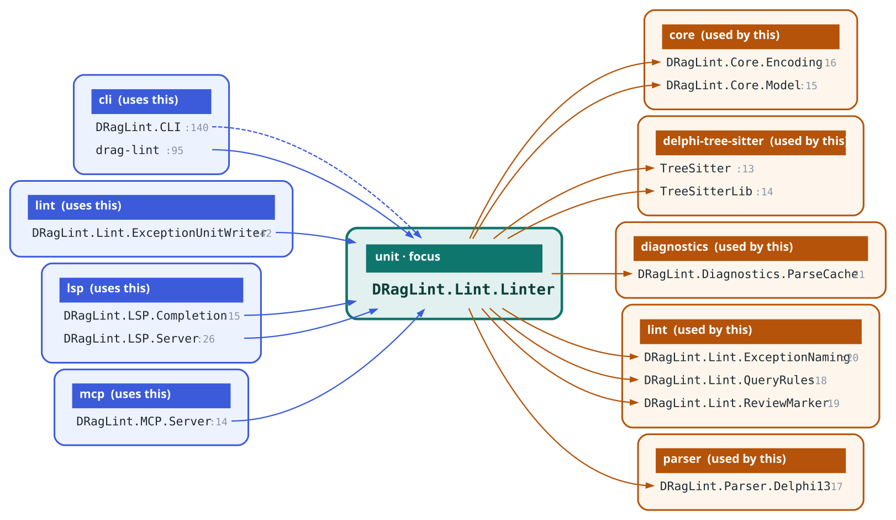

Question `deps`, target `DRagLint.Lint.Linter`. **6 units use it** (the CLI and
its program file, two LSP units, the MCP server, one lint unit); **it uses 9**
(core, parser, diagnostics, tree-sitter and three lint units). Boxes are `src\`
folders; a dashed edge is an implementation-section `uses`. Produced by
`drag-lint ask deps --target DRagLint.Lint.Linter`. The
whole-project `architecture` question on the same index draws 129 units in 23
zones with 598 internal edges -- correct, and too dense for a page, which is why
the one-unit view is shown here.

### butterfly -- the enum-value binding entry point

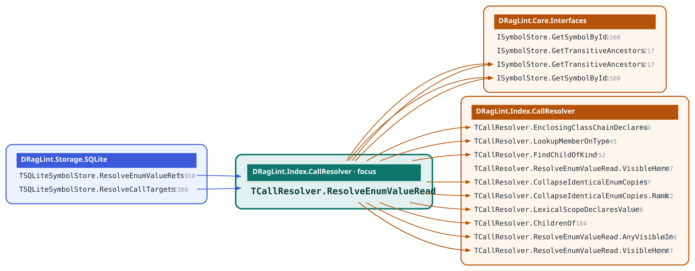

Question `butterfly`, target
`DRagLint.Index.CallResolver.TCallResolver.ResolveEnumValueRead`, depth 2.
**2 callers** (the store's enum-value and call-target resolve passes) and
**14 callee rows** (scope checks, the identical-copy collapse, the symbol-store
lookups). Produced by
`drag-lint ask butterfly --target DRagLint.Index.CallResolver.TCallResolver.ResolveEnumValueRead --depth 2`.

---

## Quick start

### Common questions -> command

The fastest command for each question people actually ask. This table is also the
first thing `drag-lint --help` prints, and it lives in `docs/AI-USAGE.md` too;
the three must agree (see the DOCS-IN-SYNC rule in `CLAUDE.md`).

| Question | Command |
|---|---|
| What is in this unit? | `drag-lint outline --in <U.pas> --db <db>` |
| Is this report still true? | `drag-lint compare --in <U.pas> --line <L>` |
| Which unit declares `X`? | `drag-lint find-unit --name X --in <U.pas> --db <db>` |
| Where is `X`, what is its signature? | `drag-lint query --name X --db <db>` |
| Who calls `X`? | `drag-lint query find-callers --name X --db <db>` |
| Change `X` without reading the file | `drag-lint context --task "modify <Unit.TType.X>" --db <db> --format markdown` |
| Is unit `U` part of project `P`? | `drag-lint query --name U --db <P.sqlite> --exact` |
| What are the members of a type? | `drag-lint surface --qname <Unit.TType> --db <db>` |
| Where does a DOC COMMENT say this? | `drag-lint query find --doc-contains "<phrase>" --db <db>` |
| Which DECLARATIONS say this? | `drag-lint query find --decl-contains "stored IsFontStored" --kind property --db <db>` |
| Where is this message / caption / SQL? | `drag-lint query --text "<phrase>" --db <db>` |
| Find by meaning / doc prose (name unknown)? | `drag-lint query --concept "<words>" --db <db>` |
| Which files reference unit `U`? | `drag-lint query unit-usage --unit U --db <db>` |
| Which database covers this file? | `drag-lint resolve-dbs --in <U.pas>` |
| What is wrong with this file? | `drag-lint lint <U.pas>` |
| ...with the whole project? | `drag-lint lint-all --db <db>` |
| Record that a finding was reviewed | `drag-lint allow <U.pas> --fix-line <L> --fix-rule <id> --apply` |
| Repair what the linter can repair | `drag-lint lint-all --db <db> --fix` (preview), then `--fix --apply` |

> **An explicit `--db` must exist.** If any path you pass is not there, the verb
> names it (with its position, `--db #2 of 3`) on stderr and exits 2 -- it never
> answers from the databases that happened to open. A narrowed answer is
> indistinguishable from a complete one. Omit `--db` and the manifest resolver
> supplies the set, dropping absent files itself. With `--project`, a reader
> resolved through the consumer DB list opens the project's OWN index (its exact
> manifest section, else `<project dir>\_D-RAG\<base>.sqlite`) plus the platform
> library -- no sibling project's DB. Two readers are exceptions: `outline --in
> F --project P` also opens the DBs that hold or folder-match `F` (siblings
> included), and `lint`'s `dl:shared` check opens the sibling projects a shared
> unit declares, on purpose. `index` (given `--project` or a `.dpr`/`.dproj`) and
> `refresh-findings` write to that own index and refuse when two sections claim
> the project; `compile-check` caches only into an explicit `--db` or the
> project's unique manifest section. A `"db"` in `.drag-lint.json` counts as an
> explicit `--db`.
>
> **Output encoding (every verb, stdout and stderr).** The default is 7-bit ASCII:
> each non-ASCII UTF-16 code unit is written `\uXXXX` (lower-case hex; a character
> outside the BMP is its surrogate pair), which inside `--json` is the JSON escape
> itself, so a JSON reader gets the exact string back; in text output it is
> reversible unless the original held a literal backslash-`u`-four-hex sequence.
> ASCII output is byte-for-byte what it always was. `--output-encoding utf8` or
> `utf16` writes UTF-8 / UTF-16LE instead (no BOM); `"outputEncoding": "utf8"` in
> `.drag-lint.json` sets it when the command line does not; any other value is an
> argument error (exit 3). Files a verb writes (`--output`, reports) obey it too. When an ascii run turns non-ASCII characters into `\uXXXX` escapes it prints ONE stderr warning naming the count and how to switch (`--output-encoding utf8`, or `"outputEncoding"` in `.drag-lint.json`); a JSON file written with `--output` then also carries a leading `"lossy_output": N`.
> Non-ANSI characters in paths are stored in the index intact (they were `?`
> before 2026-10-26).

> **Exit codes of the read-only verbs follow grep -- `1` is an ANSWER.** `0` = answered with
> results; `1` = answered, EMPTY or NOT FOUND (`query`, `query find-callers` -- `--json` prints
> `[]` --, `ancestors`, `descendants`, `context`, `call-path`, `reverse-calltree`); `2` = usage
> error, an unknown `callgraph --format`, or a `--db` that is missing or at an OLD SCHEMA (also a
> manifest-resolved list whose every database is stale) -- nothing was answered; `3` = FATAL,
> including a stdout pipe the reader closed early (`| head`), so a truncated run never reads as
> clean. `lint` / `lint-all` use the opposite polarity: `1` = findings survived (`--fail-on`).


**The traps, because each one turns a correct command into a silent zero:**

* `find-callers` matches the **bare member name**. `--name TFoo.Bar` returns 0;
  `--name Bar` returns the call sites.
* `find-callers` also reports interface dispatch (RB-5): a method reached only THROUGH an interface method it implements
  lists those sites as a separate `via <IFoo.Bar> dispatch` group; `--json` rows gain `via` (the interface method),
  `via_kind` (`interface`) and, when the `implements` edge is ambiguous, `via_edge`, all placed before `resolution`.
  `impact` lists an interface method's implementors (`--format json`: `implementors`, `via_dispatch` [of via, kind, sites]),
  `context` adds `## Callers via interface dispatch` sections (JSON: a `via_dispatch` array of `{via, kind, sites}`), and `call-path` follows an interface method to its implementors.
* `find-unit` for an **RTL / VCL / third-party** symbol needs the **platform
  library** database (`resolve-dbs --platform win64`), not a project DB - a
  project DB holds only that project's own units.
* `query --name U --exact` against a **project** DB answers MEMBERSHIP in both
  directions: a project DB is exactly the compile closure, so a miss is a real
  answer, not a lookup failure.
* `query unit-usage` without `--in` answers the project-wide question (which files
  reference the unit, and which merely IMPORT it); with `--in` it answers about one
  file. Its candidate set is the uses graph, since in Delphi you cannot name an
  export without a uses entry. For an RTL/VCL/third-party unit whose exports live
  in the platform library index, the project DB alone still answers the
  project-wide form: you get the importer list with the `uses` line, and an
  explicit note that reference counts were NOT computed -- never `DEAD IMPORT`,
  which without the export surface would be an artefact rather than a fact. Pass
  the library DB as a second `--db` for the breakdown. The `--in` form still
  exits 2, because "which of U's exports does this file use" is unanswerable
  without U's exports.
* `query --text` searches **string literals, DFM, SQL and COMMENT PROSE** -- `//`,
  `{ }`, `(* *)` and `///`. It still does NOT search source text (identifiers,
  declarations); use `query find --decl-contains` for a declaring line.
  Narrow with `--kind literal|const|resourcestring|format|comment|doc|dfm-prop|sql-exception`;
  `--kind literal` reproduces the behaviour from before comments were indexed.
* `lint <file>` is a strict **subset** of `lint-all`: project-wide rules
  (unused-public-symbol, unused-unit-in-uses, the uses-edge and duplicate-global
  rules) can only fire in `lint-all`. Never report "clean" from a per-file run.
* `context` wants the **fully qualified** name - `Unit.TType.Member`. It is about
  60x leaner than reading the source files; add `--full-surface` only when the
  task is about a form's components, DFM or event wiring.
* A `note: N of M indexed file(s) changed since this index was built` line means
  **reindex first**. The answer may be stale.
  The note is on **stderr**, never inside a JSON document. The object envelopes of
  `reverse-calltree`, `butterfly`, `callgraph`, `sql`, `schema` and `deps-report`
  also carry `"stale": true|false` and `"stale_files": <n>`, so a consumer can
  surface staleness without reading stderr (`stale` is `false` for an index too
  old to carry the freshness stamp, exactly as the note is silent then).

Add `--json` to any query for machine-readable output.

### Standalone CLI

1. Download the [latest release](https://github.com/Alexl-git/Delphi-RAG-Lint/releases)
   (`drag-lint.exe` + `tree-sitter*.dll`).
2. Put them in the same directory.
3. Index a Delphi project:
   ```
   drag-lint index --project C:\Projects\MyApp\MyApp.dproj --db myapp.sqlite
   ```
4. Query symbols:
   ```
   drag-lint query --name TFoo --db myapp.sqlite
   drag-lint surface --qname Unit.TFoo --db myapp.sqlite
   drag-lint impact --qname Unit.TFoo.DoBar --db myapp.sqlite
   ```

### Scan type and mode: two independent axes

**Scan TYPE is declared by the target, not by a flag:**

| Target | Type | What lands in the DB |
|---|---|---|
| `.dpr` / `.dproj` | **Project** | exactly the **compile closure** - the project's members, the project-local units they use transitively, each unit's sibling `.dfm`, the `{$I}` include files, and the project file. Units resolved through a Delphi **Library/Browsing** path are excluded (they belong to the library index), and loose unreferenced files in the project folder are excluded. |
| a folder | **Library** | every scannable file under the tree (subject to excludes). |

The project row means `index --project <file>` or a manifest `include` naming the
project file. A POSITIONAL `index <file.dproj>` is not a closure scan: it refreshes
only that one file, with no project defines, into the project's own database.

**A project DB belongs to one project.** A project-scoped run (`--project`, or a
positional `.dpr`/`.dproj`) into a DB whose `project_tag` names a DIFFERENT project
is refused (exit 2, naming both and suggesting `resolve-dbs --project <x>`), leaving
the DB byte-identical; `--rebuild` proceeds with a NOTE, replacing the other closure
wholesale. An untagged DB (fresh, folder-built, or pre-1.18) is accepted. (1.31.2)

**MODE is chosen per run, independently of type:**

| Mode | Meaning |
|---|---|
| `--recompile` (default) | incremental - only content-changed files are re-parsed, then the resolve passes re-run. |
| `--rebuild` | from scratch. A safety valve, not a correctness requirement: on the same input both modes converge to identical content. |

Prefer **one DB per project**: a project DB answers questions about that project
exactly. A question that spans projects needs several `--db` flags -
`drag-lint resolve-dbs --platform <p>` lists every configured DB, and
`resolve-dbs --project <x.dproj>` / `--in <x.pas>` resolves a single target.

**The first `--db` is the primary; every later one is an extra store.** The
primary answers the query and is the only store contributing *resolved* call
edges - extras are searched by *name* for callers and used-in units. So the DB
that owns the code under the question goes first, the platform library after it.
The rule is the same for `document`, `lint-all`, `lint-project` and the
exporters, so one `--db` list works across verbs: a block written by
`document --db P --db L` is accepted by `lint-all --db P --db L`.

### Indexing the Delphi RTL/VCL libraries

To build one index over everything Delphi itself knows about - the IDE's
**Library** and **Browsing** search paths, read straight from the registry,
deduplicated, with `$(BDS)` / `$(Platform)` macros expanded - use the
`--scan-libraries-*` flags (no project or path needed):

```
drag-lint index --scan-libraries-win --db Library.sqlite   # Win32 + Win64 (default)
drag-lint index --scan-libraries-all --db Library.sqlite   # every registered platform
```

- **`--scan-libraries-win`** covers the IDE's native targets (Win32 + Win64).
  Because the RTL / VCL / FMX `.pas` source is shared across platforms, this
  already captures essentially all library source. (Its older spelling is listed
  under "Flag aliases:" in `drag-lint --help`.)
- **`--scan-libraries-all`** enumerates **every** platform subkey under
  `...\BDS\37.0\Library` (Android*, iOS*, Linux64, OSX*, Win64x, ...). On top of
  the Win set it pulls in the platform-specific source trees - `source\rtl\posix`,
  `source\rtl\ios`, `posix\osx` - so symbols like `Posix.*`, `iOSapi.*`,
  `Macapi.*` and `Androidapi.*` resolve too.

Both probe HKCU + HKLM in both the 32- and 64-bit registry views and fold the
results into a single deduplicated folder set. Add `--dry-run` to print the
resolved folder list without indexing.

### I installed new 3rd-party components. How to rebuild the library index

When you install a new third-party package (DevExpress, TMS, Raize, Async
Professional, ...), its component installer registers its source/DCU folders on
the IDE's **Library** and **Browsing** search paths. The library index does
**not** update itself - it is a snapshot of those paths from the last scan, so
symbols from the new components stay unresolved until you rebuild it.

**1. Confirm what's missing (optional but quick).** `library-drift` lists every
registry root that is not yet in the index and exits non-zero if there's drift -
run it right after installing to see the new folders:

```
drag-lint library-drift                       # active platform
drag-lint library-drift --platform win64      # a specific platform
```

Any `MISSING: <path>` line is a component folder the current index doesn't cover.

**2. Rebuild the library index.** Pick whichever matches how your indexes are
managed:

- **This repo's managed indexes (recommended here).** The `Library` section of
  the named-DB manifest (`third_party/dll-win64/drag-lint.json`) has
  `"source": "registry-libraries"` and rebuilds both platform DBs
  (`C:\Projects\.drag-lint\library-Win32.sqlite` /
  `library-Win64.sqlite`) straight from the registry. Rebuild **only** that
  section - no need to touch the project indexes:

  ```
  drag-lint index --all --only Library            # both platforms, from the manifest
  drag-lint index --all --only Library --dry-run  # preview: prints the two target DBs first
  ```

- **A standalone library DB (no manifest).** Re-run the same `--scan-libraries-*`
  scan that first built it, pointing at the same `--db` file (it is rebuilt in
  place):

  ```
  drag-lint index --scan-libraries-win --db Library.sqlite   # Win32 + Win64
  drag-lint index --scan-libraries-all --db Library.sqlite   # every registered platform
  ```

**3. Verify.** Re-run `library-drift` - it should now report **0 missing** (exit
0). If a folder still shows as `MISSING`, the component didn't register that path
on the IDE search paths; add it under **Tools -> Options -> Language -> Delphi ->
Library** (Library or Browsing path) for the right platform, then rebuild again.
A root listed as `EXCLUDED BY CONFIG` (JSON `excludedRoots`) is pruned by the
section's `exclude` globs (e.g. `"Win64"`) and is not counted as drift.

Notes:

- **Close nothing / rebuild anytime** - this is a CLI (`.exe`) scan; RAD Studio
  can stay open. If the target `.sqlite` is locked, an orphaned `drag-lint.exe`
  is holding it - stop that process (not the IDE) and retry.
- **After rebuilding, restart the IDE plugin's LSP** (or reopen the project) so
  the running plugin picks up the refreshed `library-*.sqlite`. The CLI sees the
  new DB immediately.
- The scan reads the RTL/VCL/FMX and third-party **source** paths; components
  shipped as DCU-only still resolve for uses/dependency purposes but won't have
  browsable source bodies.

### Untangling unit dependencies (cycles + uses cleanup)

Find circular unit dependencies and the exact `uses` lines that form them:

```
drag-lint cycles --db myapp.sqlite --edges
```

Each cycle lists its `A uses B [interface|implementation]` edges, marks the
**interface** edges as move-to-implementation candidates, and flags layering
inversions (e.g. a COMMON unit reaching into CLIENT). Add **`--causes`** to
pinpoint the *specific symbols* in `A`'s interface that force the dependency on
`B` (the types/vars/methods to move or extract) -- with the line numbers, and an
honest note where the index couldn't resolve a reference.

Or generate a **mechanical refactoring playbook** -- written so that a model with
no project context (or a junior dev) can follow it literally to a compiling tree:

```
drag-lint cycles --db myapp.sqlite --plan > cycle-plan.md
```

Per cycle it gives:

* **what moves where** -- each load-bearing symbol with its kind and a recipe for
  that kind: an enum / record / constant / variable moves unchanged (exact
  `file` lines, doc comment included); a class whose method bodies use the cycle
  is NOT moved -- a base class carrying just the members its consumers use is
  extracted into the leaf unit instead, and the reason is given. Every unit that
  uses a moved symbol is listed with its section and first-use line;
* **uses decisions** -- per unit, whether the old cycle partner is kept, moved
  from the interface to the implementation uses, or removed (only when nothing
  else from it is used in that section);
* **the new units** (`<Declaring>.Untangle.pas`; an existing `<Declaring>.Untangle` that still uses no unit of the cycle is extended in place instead) with their full text, and the
  rule for their uses clause (never a unit of the cycle);
* **every edit** to every file, `.dpr` and `.dproj` included, as current text +
  new text, listed bottom-up so line numbers stay valid;
* **DONE** and a **checklist** that ends with the re-index command and the exact
  output `drag-lint cycles` must print afterwards -- predicted by replaying the
  plan on the uses graph -- plus what to do for each compile error the edits can
  produce.

An interface-coupled cycle is cut to a legal implementation-only one (Part A); an
**optional Part B** names the edge whose globals can move next, and re-running
`--plan` on the edited tree prints it as the same kind of steps. On the
`circular-demo` project, applying Part A and then Part B literally compiles,
prints exactly the predicted output at each stage (the last being `No circular
unit dependencies found.`), and the program's output is byte-identical to the
original's. **Followability is measured, not claimed:** Haiku at its lowest
effort, given only that report and a fresh copy of the project ("Break the
cycle."), produced a tree that compiled with 0 errors and matched the predicted
`cycles` output -- 4 of 4 criteria, first on 2026-09-23 and again on 2026-09-28
against engine 1.19.0-alpha. The report shape before it failed the same test,
which is how the playbook got its current form.

> **Worked example:** [docs/examples/circular-uses-demo/](docs/examples/circular-uses-demo/)
> is a tiny compiling two-unit cycle, with the exact `--edges` / `--causes` /
> `--plan` output drag-lint produces for it captured verbatim in
> [REPORT.md](docs/examples/circular-uses-demo/REPORT.md). (`circular-uses` is
> also a built-in lint rule, **on by default**, so `lint-project` flags cycles
> automatically.)

Then propose and apply the
cleanup, **verified by the compiler** so it never breaks the build:

```
drag-lint uses-audit MyUnit.pas --db myapp.sqlite                       # propose
drag-lint uses-fix --project MyApp.dproj --db myapp.sqlite              # dry-run sweep report
drag-lint uses-fix MyUnit.pas --project MyApp.dproj --db myapp.sqlite --apply   # apply (.bak backup)
```

> **Caveat (important):** `uses-fix`'s per-unit verify is **best-effort, not a
> faithful full-build check** -- a single-unit `dcc` compile can reuse a stale
> `.dcu` (masking a real error) or abort on an RTL dependency. Treat
> `cycles`/`uses-audit` as **advisory** (they pinpoint candidates, and the index
> can miss refs like `set` types), and **always do a full project build** after
> `--apply` (revert from `.bak` if it fails). Reliable bulk cleanup needs
> full-project-build verification, not per-unit compiles.

### A cycle report, generated not written

[`circular-demo/`](circular-demo/) is a small sample project (10 units) with
three genuine `uses` cycles that still compile, each a different shape: a
four-unit cycle coupled through `interface` uses and shared globals (one of its
four edges is an `implementation` uses, which is exactly what makes it legal
Delphi); a three-unit implementation-only cycle whose only cheap cut is a single
routine call; and a two-unit implementation-only cycle whose only cheap cut is a
member access behind `is` / `as`. The report plans the first one mechanically
and says, per edge, why it refuses the other two. The full writeup is at
[circular-demo/CYCLE-REPORT.md](circular-demo/CYCLE-REPORT.md).

**This report is produced by drag-lint, not written by an AI.** It is the
literal stdout of two commands, run against the indexed project:

```
drag-lint index  --project circular-demo\CircularDemo.dproj --db circular-demo\_D-RAG\CircularDemo.sqlite
drag-lint cycles --db circular-demo\_D-RAG\CircularDemo.sqlite --edges --causes --plan --format text
```

An excerpt of the real output (every quoted line is verbatim; `...` marks an
elision):

<!-- dl:excerpt-cycles --edges --causes --plan --format text -->
```
## Cycle 1: demologger <-> democonfig <-> demoaudit <-> demosession

### Why it cycles
- `demologger` interface uses `TDemoSession` (class) at `DemoLogger.pas:40`; declared in `DemoSession.pas:20`.
- `democonfig` interface uses `TDemoLogLevel` (enum) at `DemoConfig.pas:23`; declared in `DemoLogger.pas:15`.
- `demosession` interface uses `TDemoAuditKind` (enum) at `DemoSession.pas:35`; declared in `DemoAudit.pas:24`.
...
### Step 1: what moves where
1. `TDemoSession` -- **class with methods**, declared at `DemoSession.pas` lines 14-47; method bodies at `DemoSession.pas` lines 64-73, 75-80, 82-86, 88-95, 97-100.
   - Recipe: **extract a base class** and keep `TDemoSession` where it is. Why: its method bodies use `GDemoSessionCount`, `GDemoAuditCount`, `GDemoAuditTrail`, which live in units of this cycle; moving the class would mean moving those bodies (lines 64-73, 75-80, 82-86, 88-95, 97-100) AND everything they use.
...
12. [ ] Run `drag-lint cycles --db "circular-demo\_D-RAG\CircularDemo.sqlite"`. It must print exactly:
3 circular unit group(s) found:
...
  [4 units] demologger <-> democonfig <-> demoaudit <-> demosession   (implementation-only -- legal, lower impact)
```

`circular-demo/CYCLE-REPORT.md` is the full, unabridged output -- the file to
hand to a model. It, this excerpt and the wiki's are regenerated from and
checked against the current engine by `tests\autotest\run_cycle_examples_fresh.ps1`,
so none of them can silently fall behind the playbook again.

**Or let drag-lint make the edits: `cycles --fix`.** `drag-lint cycles --fix --project
circular-demo\CircularDemo.dproj --db circular-demo\_D-RAG\CircularDemo.sqlite` is a dry run
of the same plan for ONE group (the first mechanical one, or `--cycle <n>` / `--unit <stem>`):
it builds the project first (a baseline that fails refuses the run; `--no-compile` skips
the build), stages the edits in a shadow tree and prints the verdict, writing no source
file. Add `--apply` to write them: every touched file is backed up as `<file>.BCK<n>`
first, the project is built again (a compile error rolls every file back), the index
refreshed, and `cycles` re-run against the prediction -- exit 0 written and verified (or
written with `--no-reindex`, unverified); 1 refused, rolled back after a compile error or build
timeout, or written but not verified; 2 error -- a write or build failed part-way (rolled back,
project not changed, or the rollback failure is named), or bad flags (`--part all` applies
Part A then Part B in one run). A group the engine cannot cut
mechanically is refused with a named reason, never guessed at. The IDE offers it under
*Uses & Dependencies*, on the Uses & Deps tab's *Circular uses* section, and on a
`circular-uses` finding in the Structure window; details on the wiki page
[Circular Uses Report (cycles + fix plan)](https://github.com/Alexl-git/Delphi-RAG-Lint/wiki/Circular-Uses-Report-cycles-fix-plan).

Longer walkthrough: [wiki -- Circular Dependency Report](https://github.com/Alexl-git/Delphi-RAG-Lint/wiki/Circular-Dependency-Report).

### Third-party dependency report

See which external/library units the project leans on -- RTL, DevExpress,
Spring4D, and anything not in your own tree:

```
drag-lint deps-report --db myapp.sqlite                 # rollup (text)
drag-lint deps-report --db myapp.sqlite --edges --format csv
```

Per external unit it reports which project units import it, how many, the
shortest uses-path, and a library grouping; `--edges` gives the flat
project-unit -> external-unit list. A unit is "external" when it isn't indexed
or resolves to a library path (RTL / installed packages).

### Component conversion

Plan AND APPLY a component/type migration (`TDBEdit` -> `TcxDBEdit`, or any
`TPersistent`-rooted pair) from the REAL, AST-exact property trees of both types.
`proptree` enumerates a type's deep property tree; `convert-scaffold`
auto-drafts a validated reFind-superset rules file from both trees;
`convert-validate` checks a rules file's paths against those trees -- catching
typos that reFind's blind PCRE cannot -- and checks any `G[I/N]` glyph expression on a
`#link` (syntax, ranges, one alternative per N; see `docs\CONVERSION-RULES.md`); and `convert-apply` rewrites the real
`.pas` + `.dfm` files (dry-run by default, `--apply` to write for real, with
automatic `.BCK<n>` backups + a `recovery.txt` unless `--no-backup`; a value an ANSI `.pas` cannot hold refuses the unit as `encoding_refused`, and `--raise-encoding "<path>=utf8-bom"` re-stores that file as UTF-8 with BOM). The book's
unit rules act on the unit's uses clauses in the same run: `#unuse Old` removes Old,
`#use New` adds New to the implementation uses, `#useswap Old -> New1, New2` removes
Old and adds each New once into the section Old was in -- never a duplicate, a unit
both added and removed is kept, and an entry inside a `{$IF...}` region refuses the
unit rather than guess. A unit with no `.dfm` (or nothing a `#convert` block
matches) gets its unit rules alone; `info --json` advertises this as
`capabilities.apply_unit_rules: true`. **Uses reconciliation (1.27.0, default on;
`--no-reconcile-uses` restores 1.26.6):** the converted `.pas`/`.dfm` are re-indexed in
memory and `#unuse` becomes a WATCH LIST -- a unit is KEPT (a `kept` row + warning naming
the components) while a component the converted `.dfm` still streams needs it, REMOVED
when only `.pas` code needs it (the dangling references are named; the compile errors
are the intended signal), and kept when no `--db` knows it; presence is scope-alias aware
(`#unuse DBTables` matches `Bde.DBTables`, `#use DB` is satisfied by `Data.DB`); a name
the conversion introduces into the `.pas` gets its unit added (none since 1.27.0: a cast link no longer writes a `.pas` site, one `cast-not-applied` per site instead); a `#link X <- X : StripDB` value cast (shipped castlib, `value strip-db`) drops a trailing `.db` from the string in the `.dfm` and in single-literal `.pas` assignments ending the statement on their line, reporting every other site (a `with` block included) (capability `value_cast_strip_db`); inside a `#convert` block `#migrate Old -> New` renames a member (method, event, property) at every bound `.pas` access site and `#migrate Old -> DL_NONE` wraps it, `inst.Old` -> `DL_NONE(inst.Old)`, a deliberate break that does not compile until converted by hand (items[] `migrate-applied` / `deliberate-break` / `migrate-check`, capability `migrate_members`, C18 slice 1); every run lists what the `.pas` still uses that the map does not cover in `pas_uses[]` (status `mapped` / `cast-refused` / `not-rewritten` / `same-name` / `unmapped` / `global-dangling`, capability `pas_uses`; since 1.28.2 the From class is resolved through the unit's uses scope and each row carries `resolution` `resolved` / `ambiguous` (with `candidates[]`, nothing picked) / `class-not-found` / `member-not-found` / `kind-unknown`, capability `pas_uses_resolution`),
and a name two units declare is reported (`uses_unresolved`), never picked -- unless the
book's `#use` (or a uses entry of the unit) names one of them: a To type's unit is then
added to the INTERFACE uses when its retyped field is declared there, or moved there. After
`--apply` the unit's own project DB is refreshed (`index --project`, child process,
terminated as `failed` after 10 minutes; `--no-reindex` skips it). `capabilities.uses_reconcile: true`. A book can also REPORT without writing
anything (1.26.5): `#warn <FromPath> "<text>"` warns once per converted instance
whose source `.dfm` streams the property (`<value>`, `<name>`, `{Prop}`
placeholders), and `#check-ref <ToPath> <Class>.<Prop>[, ...]` warns when the
converted value looks like a file path or names nothing any `.dfm` of the
project carries (items[] kinds `book-warning`, `ref-path-like`, `ref-dangling`,
`ref-not-checked`). The usual
workflow: `convert-scaffold` -> `convert-validate` -> `convert-apply` (dry-run,
review the plan) -> `convert-apply --apply`. Before a glyph rule, `glyph-vacuum`
measures every streamed graphic in the legacy tree (class, property, strip
geometry, count property) and writes a reviewable gallery -- the input to
`docs\GLYPH-CLASSES.md` and the `G[I/N]` grammar (`--append` merges a rescan
into an existing run). Full DSL reference, the 5
conversion surfaces, and the safety scheme: **[docs/CONVERSION-RULES.md](docs/CONVERSION-RULES.md)**.

**`ConvRulesEditor.exe` -- the visual rule-book editor.** Shipped in the
**win64** archive next to `drag-lint.exe` (it is built by `dcc64` from a `.dpr`
with no Win32 configuration, so the win32 archive has the rule books and the CLI
verbs but not the GUI). It puts the source type's real property tree beside the
target type's -- both read from the index, so both are the actual deep trees
including inherited and nested members -- and lets you pair them up, author
conditional mappings, see which types on a form are already covered by a rule,
and compose the rules for one job out of several books. It authors the plan; the
CLI applies it. Starter books are in `convrules\`, and the class/enum cast
library `casts.castlib` sits beside the exe (`convert-apply --castlib` reads the
same file). Manual:
**[docs/converter/convrules-editor-manual.md](docs/converter/convrules-editor-manual.md)**;
rule language: [docs/converter/convrules-dsl.md](docs/converter/convrules-dsl.md).

### Consuming the index from another tool

The SQLite index is documented for external consumers in
[docs/INDEX-SCHEMA.md](docs/INDEX-SCHEMA.md) -- every table, the
project-vs-external boundary, and the stability contract. Introspect any index
live with:

```
drag-lint schema --db myapp.sqlite --format json        # schema_version + tables + columns + row counts
```

When no verb answers the question you actually have, query the index directly.
`sql` is read-only by construction -- an sqlite3 authorizer refuses ATTACH,
PRAGMA, DDL and every write, a row cap and a wall-clock cap bound the answer,
and exactly one statement is allowed:

```
drag-lint sql --db myapp.sqlite --limit 5 \n  --query "SELECT kind, COUNT(*) AS n FROM refs GROUP BY kind ORDER BY n DESC"
```

Ask `schema --format json` for the columns first: table names are
discoverable, semantics are not.

### Words the code does not spell

Every other query here assumes you already have an identifier. `wiki` starts
from a word a *person* uses. A `dl:wiki` block is written inside an ordinary
`///` comment -- on the type that owns the concept, or above `unit X;` when the
concept spans several types -- and names the aliases the team actually says:

```
/// <remarks>
/// dl:wiki Delta Streaming
/// Aliases: delta stream, cmdDelta pipeline, the streaming path
/// SeeCode: TDeltaStreamer, TDeltaSet.ApplyDelta
/// Body:
/// How row changes travel from client to server.
/// </remarks>
unit Micronite.Delta.Pipe;
```

```
drag-lint wiki --term "the streaming path"   # -> owning symbol, SeeCode targets, body
drag-lint wiki --list                        # every topic in the resolved indexes
drag-lint wiki --check                       # every SeeCode entry must resolve; exit 1 on drift
```

Nothing about this is a new index: the block lands in `symbol_docs.raw_block`
through the existing extractor, so authoring one costs no reindex beyond the
ordinary incremental walk any edited file already gets. Format:
[docs/wiki/Wiki-Blocks-Authoring.md](docs/wiki/Wiki-Blocks-Authoring.md).


### Semantic errors without a full build

`check-unit` compiles a single unit in its project's context, so you get real
compiler errors (e.g. `E2003 Undeclared identifier`) fast -- and on the
**unsaved** buffer via a shadow overlay:

```
drag-lint check-unit MyUnit.pas --project MyApp.dproj --platform win64 \
          --db myapp.sqlite --resolve-uses
```

`--resolve-uses` turns an undeclared identifier into a fix: *"add unit X to the
uses clause."*

### LSP server (Zed / VS Code)

Point your editor's LSP config at `drag-lint.exe lsp --db <path>.sqlite`.
The server speaks JSON-RPC over stdio.

Capabilities: hover, definition, references, completion, signatureHelp,
diagnostics (publishDiagnostics on didSave), workspaceSymbols, rename (prepareRename +
rename: a WorkspaceEdit the editor applies -- the server itself writes no file).

### MCP server (Claude / Cursor)

Register it with Claude Code, VS Code and Cursor in one step:

```
drag-lint mcp-config --all [--db C:\Projects\MyApp\_D-RAG\MyApp.sqlite] [--dry-run]
drag-lint mcp-config --claude-code --remove
drag-lint init --project C:\Projects\MyApp\MyApp.dproj [--dry-run]   # register + index + mcp-config --all for one project
```

`--claude-code` edits the top-level `"mcpServers"` object of `~\.claude.json`
(`%CLAUDE_CONFIG_DIR%\.claude.json` when that is set); `--vscode` edits `"servers"` in
`%APPDATA%\Code\User\mcp.json`; `--cursor` edits `"mcpServers"` in `~\.cursor\mcp.json`; `--all` does all three and skips a client that is not installed.
The entry is `{"type":"stdio","command":"<engine>","args":["serve"(,"--db","<index>")]}`
(plus `"env":{}` for Claude Code); `--engine <exe>` overrides the default (this exe), `--name <n>`
the entry name (default `drag-lint`). The edit is **merged** (only that one entry changes; every
other key and server is kept, numbers keep their text), **backed up** (`<file>.bak-<stamp>`) and
**idempotent** (a matching entry is `unchanged` and nothing is written); keys you added to the entry,
such as `env`, survive an update, and `env` / `headers` values print as `***` (an entry refused as not ours is never printed). An entry by that name that runs
something other than `drag-lint.exe` is refused, as is a file holding comments or trailing commas
(the entry to paste by hand is printed instead) or one that is not valid JSON. `--remove` takes only
our entry out; `--dry-run` writes nothing; `--json` prints one object per target;
`--config-path <file>` edits another file (with exactly one target), and `--home-dir` /
`--appdata-dir` move where the default files are looked for (tests). Exit 0 done or unchanged,
1 refused, 2 usage/setup. This verb replaces `charts\src\Set-DragLintMcpConfig.ps1`.

Or add it to your MCP config by hand (e.g. `~/.claude/claude_desktop_config.json`):

```json
{
  "drag-lint": {
    "command": "drag-lint.exe",
    "args": ["serve", "--db", "C:\\Projects\\MyApp\\_D-RAG\\MyApp.sqlite"]
  }
}
```

15 tools are then available to Claude: `find_symbol`, `find_callers`,
`get_symbol_doc`, `get_context_bundle`, `rename_symbol`, `run_compile_check`,
and more (see [MCP tools](#mcp-tools-15) below).

### Click-to-source links (draglint://)

Chart rows link to `draglint://open?file=...&line=...`. One per-user registry key
(`HKCU\Software\Classes\draglint`, never HKLM, no elevation) hands such a click to
`drag-lint-open.exe`, which validates the link and hands it to the IDE plugin, which opens the line in the running IDE:

```
drag-lint protocol register [--handler <drag-lint-open.exe>] [--dry-run] [--force]
drag-lint protocol status [--json]          # ours | legacy-powershell | foreign | none; exit 0 only when ours
drag-lint protocol unregister [--dry-run] [--force]
```

`register` defaults to the `drag-lint-open.exe` beside `drag-lint.exe` and registers it in
place. It refuses a handler inside a `*-wt\` worktree and a registration that belongs to
another program unless `--force` is given; the older PowerShell registration made by
`charts\src\Register-DragLintProtocol.ps1` is replaced silently, and its copy
`%LOCALAPPDATA%\drag-lint\Open-DragLintUri.ps1` is deleted. `--dry-run` prints what would
be written and writes nothing. This verb replaces `Register-DragLintProtocol.ps1`.

### RAD Studio 13 plugin

1. Build the BPL:
   ```
   msbuild src/delphi-plugin/dclDragLintWizard.dproj /p:Platform=Win64 /p:Config=Debug
   ```
   Or download `dclDragLintWizard.bpl` from the latest GitHub release.
2. In RAD Studio: **Component > Install Packages > Add** -- browse to the BPL.
3. Restart RAD Studio.
4. The **Tools > drag-lint** menu now has 12+ entries. Settings live under
   **Tools > Options > Third Party > drag-lint** as four pages (General /
   Indexer / Linter / Editor); per-project lint rules are reachable via a
   **"drag-lint: Project Rules..."** right-click on the project node in the
   Project Manager.
5. On IDE startup, the drag-lint logo + version appear on the RAD Studio
   splash screen. **Help > About > drag-lint** shows an entry with live
   engine self-info (version, build date, tree-sitter versions,
   capabilities, exe path, plugin log location), fetched from `drag-lint.exe`
   on a background thread so it never blocks IDE startup; if the exe call
   fails, the entry shows a structured diagnostic error block instead.

---

## Features
<!-- dl:registry:begin feature-summary -->
| Group | Features | Wiki |
|---|---:|---|
| [Indexing](https://github.com/Alexl-git/Delphi-RAG-Lint/wiki/Features#indexing) | 10 | [Quick Help](https://github.com/Alexl-git/Delphi-RAG-Lint/wiki/Quick-Help#indexing) |
| [Search and navigation](https://github.com/Alexl-git/Delphi-RAG-Lint/wiki/Features#search-and-navigation) | 34 | [Quick Help](https://github.com/Alexl-git/Delphi-RAG-Lint/wiki/Quick-Help#search-and-navigation) |
| [Linting](https://github.com/Alexl-git/Delphi-RAG-Lint/wiki/Features#linting) | 28 (+ 290 rules, 111 fixable) | [Quick Help](https://github.com/Alexl-git/Delphi-RAG-Lint/wiki/Quick-Help#linting) |
| [Documentation](https://github.com/Alexl-git/Delphi-RAG-Lint/wiki/Features#documentation) | 10 | [Quick Help](https://github.com/Alexl-git/Delphi-RAG-Lint/wiki/Quick-Help#documentation) |
| [Refactoring and code generation](https://github.com/Alexl-git/Delphi-RAG-Lint/wiki/Features#refactoring-and-code-generation) | 15 | [Quick Help](https://github.com/Alexl-git/Delphi-RAG-Lint/wiki/Quick-Help#refactoring-and-code-generation) |
| [Component conversion](https://github.com/Alexl-git/Delphi-RAG-Lint/wiki/Features#component-conversion) | 17 | [Quick Help](https://github.com/Alexl-git/Delphi-RAG-Lint/wiki/Quick-Help#component-conversion) |
| [Graphs and reports](https://github.com/Alexl-git/Delphi-RAG-Lint/wiki/Features#graphs-and-reports) | 22 | [Quick Help](https://github.com/Alexl-git/Delphi-RAG-Lint/wiki/Quick-Help#graphs-and-reports) |
| [Diagrams and charts](https://github.com/Alexl-git/Delphi-RAG-Lint/wiki/Features#diagrams-and-charts) | 6 (+ 26 questions) | [Quick Help](https://github.com/Alexl-git/Delphi-RAG-Lint/wiki/Quick-Help#diagrams-and-charts) |
| [Compiler integration](https://github.com/Alexl-git/Delphi-RAG-Lint/wiki/Features#compiler-integration) | 12 | [Quick Help](https://github.com/Alexl-git/Delphi-RAG-Lint/wiki/Quick-Help#compiler-integration) |
| [Database and Firebird](https://github.com/Alexl-git/Delphi-RAG-Lint/wiki/Features#database-and-firebird) | 2 | [Quick Help](https://github.com/Alexl-git/Delphi-RAG-Lint/wiki/Quick-Help#database-and-firebird) |
| [Editor integration](https://github.com/Alexl-git/Delphi-RAG-Lint/wiki/Features#editor-integration) | 25 | [Quick Help](https://github.com/Alexl-git/Delphi-RAG-Lint/wiki/Quick-Help#editor-integration) |
| [Maintenance and diagnostics](https://github.com/Alexl-git/Delphi-RAG-Lint/wiki/Features#maintenance-and-diagnostics) | 22 | [Quick Help](https://github.com/Alexl-git/Delphi-RAG-Lint/wiki/Quick-Help#maintenance-and-diagnostics) |
| [Uses and Dependencies](https://github.com/Alexl-git/Delphi-RAG-Lint/wiki/Features#uses-and-dependencies) | 2 | [Quick Help](https://github.com/Alexl-git/Delphi-RAG-Lint/wiki/Quick-Help#uses-and-dependencies) |
<!-- dl:registry:end feature-summary -->

The table is generated from the feature registry (`features\`); the one-line-per-feature
page is [Quick Help](https://github.com/Alexl-git/Delphi-RAG-Lint/wiki/Quick-Help) and the
registry itself is described on [Feature Registry](https://github.com/Alexl-git/Delphi-RAG-Lint/wiki/Feature-Registry).


### Editors

`drag-lint lsp` is a stdio language server: hover, go-to-definition,
**find-references**, **workspace symbols**, completion and signature help,
answered from the index across every project in your manifest at once -- no
compiler and no project open. DelphiLSP implements neither find-references nor
workspace symbols, so those two are drag-lint only.

It also answers one vendor-prefixed extension, `draglint/hoverBundle`: given a
document position it returns the hover markdown, the structured hover model
(the shape `hover --format json` emits) and the caller rows, in a single reply.
The RAD Studio plugin uses it so a tooltip costs one warm request instead of a
hover round trip plus three `drag-lint.exe` spawns that each re-opened indexes
the server already had open. Any other client can ignore it; a server that
predates it answers the standard `-32601`.

* **VS Code** -- extension included (`editors/vscode/drag-lint/`); package it with
  `npm run package` and install the `.vsix`. Findings land in the **Problems**
  panel tagged `drag-lint`, on save. It runs a *private copy* of the engine from
  its own `globalStorage`, so an open VS Code window never blocks an engine
  rebuild -- which makes it usable as a read-only window onto units something
  else is editing. Compiler diagnostics from `DelphiLSP` merge there for free if
  you install an extension that runs it: VS Code gives every extension its own
  diagnostic collection, so unlike the RAD Studio plugin the two cannot clobber
  each other. Since **v1.5** it also ships a **Pascal TextMate grammar** and a
  colour theme **generated from your own RAD Studio scheme** (read out of
  `HKCU\Software\Embarcadero\BDS\<ver>\Editor\Highlight`), so the colours match
  the IDE literally rather than approximately -- before v1.5 nothing coloured
  Pascal in VS Code at all, since it has no built-in Pascal grammar.
* **Zed** -- tree-sitter highlighting ships today; the language-server
  registration needs a small Rust/WASM extension that is **not yet built** and is
  fully specified for contributors.
* **Neovim / Helix / any LSP editor** -- point it at `drag-lint lsp`. Add `--full-rules` (OFF by default) to
  publish the complete built-in rule set on every save instead of the subset; it runs `lint` out-of-process
  and reports its cost in ms on stderr. A platform-library unit (an RTL/VCL file covered by a `library-*.sqlite`)
  skips the project, flow and type-aware rules, in `lint` too: findings you cannot act on, and they blew the 8 s budget;
  the LSP and the IDE plugin's live lint also give such a file a 16 s budget instead of 8 s.

`drag-lint lsp --proxy` is a different shape of the same server: instead of
answering alone, it spawns RAD Studio's own `bin64\DelphiLSP.exe` and relays
the protocol between the IDE and it. The IDE's Code Insight manager is
exclusive -- one server per language -- so registering drag-lint the plain way
would trade the compiler front end (generics, `with`, inline vars, the unsaved
buffer) for a symbol index. Proxying removes the either/or. Add
`--delphi-lsp <path>` to override which server is spawned, or
`--delphi-lsp-bits 32` to forward to the 32-bit `bin\DelphiLSP.exe` instead of
the default 64-bit `bin64` one (any value but 32/64 exits 3). By default the relay
is transparent: byte-for-byte identical to talking to DelphiLSP directly. Add
`--merge-diagnostics` and drag-lint's lint findings (source `drag-lint`) are
appended to DelphiLSP's own `textDocument/publishDiagnostics` notification, so
compiler errors and lint findings arrive in ONE notification per file. It fails
open: a file with unsaved edits, a clean file, a frame it cannot parse or a lint
that overruns `--merge-budget-ms <n>` (default 300) forwards DelphiLSP's
original bytes untouched. Add `--merge-completion` and drag-lint's completion
items (from the `--db` index, or the indexes plain `lsp` would resolve) are
appended to DelphiLSP's reply when their (label, kind) is not already there;
DelphiLSP's items stay first. No drag-lint items, no index, or drag-lint over
the budget forwards DelphiLSP's reply byte-identical. Add --merge-hover and
drag-lint's hover facts (the same text plain `lsp` shows) follow DelphiLSP's
hover after a `---` rule, or stand alone when DelphiLSP has none; no drag-lint
hover forwards DelphiLSP's reply (or its `null`) byte-identical. Add
`--merge-definition` and a `textDocument/definition` that DelphiLSP answers
with `null` or `[]` gets drag-lint's locations instead (a non-empty answer is
forwarded untouched); DelphiLSP's `initialize` reply gains `referencesProvider`
and `workspaceSymbolProvider` when it lacks them (or sets them `false`), and the proxy then answers
`textDocument/references` and `workspace/symbol` itself from the index --
those requests never reach DelphiLSP.

`drag-lint-switch --vscode --status|--on|--off` toggles the `delphi-lsp` entry in a workspace's `.vscode\mcp.json` (backup on `--off`, restore on `--on`; refuses while VS Code runs).

See **[docs/EDITORS.md](docs/EDITORS.md)**.

### CLI

`drag-lint <verb> [flags]`. The complete, authoritative flag list for every
verb is `drag-lint --help`; linked verbs below go to the matching wiki page
for more detail and IDE-menu context. (Wiki links point at
https://github.com/Alexl-git/Delphi-RAG-Lint/wiki and carry no `.md` suffix.)

> **Offline manual.** The whole wiki is also published as a single ordered
> document -- **[docs/drag-lint-manual.pdf](docs/drag-lint-manual.pdf)** (~250
> pages, bookmarked; a chapter per part, including Diagrams and charts) and **[docs/drag-lint-manual.docx](docs/drag-lint-manual.docx)**.
> Regenerate with `pwsh -File tools\build-manual.ps1`;
> `tests\autotest\run_manual_freshness_guard.ps1` fails the battery if it falls
> behind the wiki.

#### Indexing

| Command | What it does | Notable flags |
|---|---|---|
| `index <path>` | Index a folder tree (a Library-type scan) | `--db`, `--watch [--interval N]`, `--library-db <lib.sqlite>` (cross-DB resolution; also binds a value receiver typed by name, e.g. `S.Read` with `S: TStream`; a manifest section may opt in with `"libraryResolve": true`, default false), `--wait-library <min>` / `--require-library` (a manifest section that opts in with `libraryResolve` probes its platform library BEFORE the walk and prints `library: <path> (<platform>) READY|NOT READY -- <why>`; not ready = continue and say the run is pending, wait up to <min> minutes, or exit 2), `--resolve-only`, `--dir <path>` (same as the positional path), `--use-ignore` (the default; kept so old scripts parse). **Exit 1 when any file failed to store** (an `ERROR` line on stderr names it; the file keeps its old rows) and, for `index --all`, when any section failed |
| `index <path> --resolve-only` | Re-derive call edges, ancestry, helper targets and purity verdicts from the parses the index ALREADY holds, skipping the walk entirely. The cheap remedy when `resolver_fingerprint` reports stale edges: no stored parse became wrong, so re-parsing buys nothing. It writes edges INSIDE that one index only -- no cross-store edge is ever a `call_edges` row; a library-bound call is recorded by qualified NAME on `refs.external_target`, and only when a library store is open for the run (`--library-db`, or the section's manifest key `libraryResolve`, default off). `refs.receiver_type_text` records the receiver's declared type either way | `--db` |
| `index --project <file.dproj>` | Index one project's **compile closure** -- members, transitively used project-local units, sibling `.dfm`, `{$I}` includes. The scope is printed capped at 20 paths plus the count; `--dry-run` lists every one and indexes nothing | `--dry-run`, `--watch`, `--build-config <name>` (parse the project against this build config instead of its ACTIVE one: the `.dproj` `Config` marker, else the `delphilsp.json` defines); accepts a `.dproj`, `.dpr` or `.dpk`; a positional project file beats the `project` key of `.drag-lint.json`, an explicit `--project` beats both |
| `index --scan-libraries-win` / `--scan-libraries-all` | Index the IDE's registered Library + Browsing paths (Win32+Win64, or every platform incl. Posix/iOS/Android/OSX) | `--dry-run` |
| `index --all` | Index every section of the named-DB manifest (`drag-lint.json`) | `--only <Sec1,Sec2>`, `--platform win32\|win64`, `--jobs <n>`, `--dry-run [--json]`, `--build-config <name>` (project sections only) |
| any `index` run | Mode is chosen per run, independent of scan type | `--recompile` (default, incremental) / `--rebuild` (from scratch), `--force-reparse` (re-parse every walked file even when path+mtime+sha are unchanged -- needed once per DB after an engine upgrade that extracts something new), `--no-prune` (dry look), `--prune` |
| any `index` run (walk scoping) | Decide which files the walk admits before anything is parsed | `--exclude <glob>` / `--exclude-under <dir>` / `--include-only <glob>` (all repeatable), `--max-file-kb N` (skip any file larger than N KB), `--no-use-ignore` (opt out of the `.gitignore` / `.hgignore` pattern files, honoured by default; a folder holding a `.scanignore` marker file is always pruned), `--deep` (also record usage refs; `--shallow` is the default) |
| [`migrate-dbs`](https://github.com/Alexl-git/Delphi-RAG-Lint/wiki/migrate-dbs) | Move project indexes into each project's `_D-RAG` folder | `--apply` |
| `register-project` | Add a NEW project to the manifest so `index --all` and the IDE can index it | `<file.dproj>`, `--name <Section>`, `--apply`, `--json` |
| [`resolve-dbs`](https://github.com/Alexl-git/Delphi-RAG-Lint/wiki/Show-Resolved-DBs-debug) | Show which DB(s) a project/file/platform resolves to | `--project <dproj>`, `--in <file>`, `--platform` |
| [`library-drift`](https://github.com/Alexl-git/Delphi-RAG-Lint/wiki/Library-Drift-Check) | Registry library roots with source on disk but not yet in the index | `--platform` |
| [`reconcile-project`](https://github.com/Alexl-git/Delphi-RAG-Lint/wiki/Reconcile-Project-Members-dpr-dproj) `<App.dpr\|.dproj>` | Sync a project's member list against disk; flag stale used units. Each MISSING unit is judged: under the project's own roots = a missed project unit (fix: `--apply`), outside = third-party (fix: `--apply --to library` adds its folder to the manifest library section's `include`); units already in the library (registry library path or that `include`) are not reported | `--apply`, `--to project\|library`, `--only <unit,...>` (restrict MISSING, and therefore `--apply`, to a reviewed selection -- a dry run with `--only` previews exactly what `--apply` would write), `--db`, `--full`, `--json` (carries `applied` -- the outcome, not the flag -- plus `backups` and `edited` when applying, and `refused` naming closure entries kept in the report but never written, today the `{$I}` includes) |

Wherever a database is *opened* (`index`, `query`, `lsp`, `serve`) the 32-bit
build refuses one larger than its size guard, because it would run out of
address space mid-answer: `--size-guard-mb N` moves the threshold and
`--force32` overrides the refusal outright. Neither is normally needed on the
Win64 build.

#### Search and navigation

| Command | What it does | Notable flags |
|---|---|---|
| `query --name <n>` / `--qname <q>` | Find symbols by name (fuzzy) or exact qualified name | `--json`, `--case-sensitive`, `--exact` |
| `query --name-like <substr>` | **Substring search over symbol NAMES** -- the discovery query, for when you do not know the identifier yet. Shortest-name-first; trigram-driven (12 ms vs 18.9 s for a bare scan on a 3.3 GB index) | `--kind class,interface,...`, `--limit N` (default 50), `--json` |
| [`wiki --term "<phrase>"`](https://github.com/Alexl-git/Delphi-RAG-Lint/wiki/wiki) | **Route a human word to the code.** Looks a phrase or alias up against the `dl:wiki` concept topics authors write inside ordinary `///` comments -- "the scheduler", "delta streaming" -- and prints the owning symbol, its `SeeCode` participants (each resolved to `file:line`) and the body. Exits 1 when nothing matches, so a script can branch on it | `--list` (every topic), `--check` (SeeCode drift gate, exits 1 on drift), `--json` |
| `query --text "<phrase>"` | Search **string literals AND comment prose** -- constants, resourcestrings, DFM captions, SQL exception text, and `//` / `{ }` / `(* *)` / `///` comments | `--any-order`, `--substring`, `--source pas\|dfm\|sql`, `--kind <k>`, `--near <QName>` (keep only hits in routines within `--hops` 1-3, default 2, of that symbol on the call graph; `--hops-uses` adds unit-uses edges, `--near-boost` ranks instead of filtering), `--limit N` |
| `query --concept "<words>"` | **Concept search** -- ranked BM25 search over identifier words (camelCase split) and doc-comment prose (summary / remarks), porter-stemmed; finds code by meaning when the name is unknown. Backfills on the next `index` run, no re-parse. Exit 0 hits / 1 none / 3 index has no concept table yet | `--limit N`, `--kind k,...`, `--json` |
| [`query find-callers`](https://github.com/Alexl-git/Delphi-RAG-Lint/wiki/query-find-callers) `--name <n>` | Every call-site for a symbol, with source context | `--context N`, `--resolved` (precise call-edges; every row names the CALL SITE -- text `(<file>:<line>)`, JSON `line` -- with the caller's declaration line under JSON `caller_line`; every JSON row ends with a derived `resolution` key -- `exact` / `ambiguous` / `external` / `name-only` (the name-only rows matched by name alone); since 2026-09-16 a PROPERTY or FIELD name lists its bound reads/writes too, tagged `[certain, read]` / `[certain, write]` -- since resolver 1.8.0-alpha that includes BARE reads: a member of a `with` target, a property of the enclosing class, and `Self.X`; since 2026-09-23 an ENUM VALUE name lists every bound read the same way, tagged `[certain, read]`. **Two known wrong-bind risks, both on BARE enum reads only:** a `with` whose target the index cannot type -- since resolver 1.8.0-alpha the `with` scope IS modelled and a with member wins wherever the target types (and a bare CALL under an untypable target binds nothing), but an enum read there keeps its binding and `enum-read-inside-with` reports the collisions it can prove; 0 such bindings on ORM3 CLIENT -- and a `{$SCOPEDENUMS ON}` unit, which measured 0 across the whole project corpus but was NOT measured on the platform LIBRARY indexes, where RTL/VCL scoped enums live. In either place, verify a bare-name binding against the declaration before trusting it; qualified reads (`TEnum.Value`) are unaffected. Numbers and method: the enum-value bullet in `CHANGELOG.md`. Since 1.18.0-alpha (D31) a bound BARE write (`FFlag := True`) is listed too, tagged `[certain, write]`; since resolver 1.9.0-alpha (D22) a UNIT-QUALIFIED var or const (`uStyles.SkipRefresh`) lists its bound reads and writes, tagged by mode (a const is always `read`; an index resolved before 1.9.0-alpha answers 0 for them until `index --all --resolve-only`). Known gap: `Self.FField := X` is still reported as a `read` (`docs/INBOX-self-qualified-field-write-indexed-as-read.md`)) |
| `query --kind <k> --all` | **List every symbol of one kind** -- e.g. every unit in a DB. No name, no doc clause, no row cap | `--public`, `--json` |
| `query find` | Find symbols by documentation state, or by declaration text. `--no-docs` is a FILTER (undocumented symbols only) -- to list them all use `query --kind <k> --all` | `--doc-tag`, `--doc-contains`, `--decl-contains`, `--no-docs`, `--kind`, `--name`, `--unit`, `--public` |
| [`query type-usage`](https://github.com/Alexl-git/Delphi-RAG-Lint/wiki/query-type-usage) `--in <f.pas>` | Of a LIST of type names, which does this file actually **reference**? Counts declarations, `X.Create` sites and inheritance; a name only in a comment or string literal is not a reference -- the difference from grep. Name-keyed | `--names A,B,C`, `--names-file <f>`, `--json` |
| `query unit-usage` `--in <f.pas> --unit <U>` | Of unit **U's exported surface**, which symbols does this file reference? `0 of N` means the `uses` entry is a dead import. The unit is resolved in whichever index HAS it, so a project file can be asked about an RTL/VCL unit (pass both `--db`s). Comments and string literals are excluded structurally | `--json` |
| [`query ancestors`](https://github.com/Alexl-git/Delphi-RAG-Lint/wiki/query-ancestors) `--name <t>` | Transitive class/interface ancestry | `--of <ancestor>` |
| `query descendants` `--of <a>` | The reverse of `ancestors`: every **class** descending from `<a>`, across all scanned DBs. Derived interfaces are excluded by design (this backs the conversion editor's class pickers) | `--json` (exit 1 = no such ancestor) |
| [`query typecat`](https://github.com/Alexl-git/Delphi-RAG-Lint/wiki/query-typecat) `--name <t>` | Resolve a type's category (class/interface/float/string/...) | |
| `query hints` | List stored compiler hints/warnings | `--name <code>`, `--rule <severity>` |
| [`usages`](https://github.com/Alexl-git/Delphi-RAG-Lint/wiki/usages) `--name <n>` | Grouped usage report (backs the IDE Symbol Search dialog) | `--width narrow\|wide\|very-wide`, `--depth N` |
| [`outline`](https://github.com/Alexl-git/Delphi-RAG-Lint/wiki/outline) `--in <f.pas>` | Unit outline (backs the IDE Structure form) | `--format text\|json` |
| [`compare`](https://github.com/Alexl-git/Delphi-RAG-Lint/wiki/compare) `--old <report\|csv\|bundle> [--command "<id> ..."]` / `--in <U.pas> --line <L>` | Rerun a saved report's question and show before / delta / after (exit 0 same, 1 differs, 2 setup, 3 stale index) | `--new <f>` (two saved outputs), `--question <id> --target <T>`, `--update-doc`, `--old-db`, `--db <f>`, `--auto`, `--save`, `--snapshot-dir <dir>`, `--show`, `--format text\|json\|html`, `--open` |
| [`ask`](https://github.com/Alexl-git/Delphi-RAG-Lint/wiki/ask) `<question> --target <T> [--project <P.dproj>\|--in <U.pas>\|--db <idx>]` | Ask one report question (the 26 chart questions) and print the answer: the DocInsight remarks block the Reports menu copies, or the plain answer. All 26 questions answer in-process in the engine (exit 0 answered, 1 refused, 2 setup, 3 stale index) | `--to <B>`, `--server-db`, `--sql-db`, `--counterpart-db`, `--depth N`, `--cap N`, `--surface-cap N`, `--control <C>`, `--mode write\|read\|both`, `--max-rows N`, `--out-root <dir>`, `--pairs-file <f>`, `--allow-stale`, `--plain`, `--open`, `--resolve-only` |
| `hover --qname <q>` | Hover card for a symbol (incl. declared type; a re-published property names its declaring ancestor) | `--format plain\|md\|json`, `--write-back` |
| `typeat <file>:<line>:<col>` | Resolve the type of the expression at a cursor position | `--format text\|json` |
| [`find-unit`](https://github.com/Alexl-git/Delphi-RAG-Lint/wiki/find-unit) `--name <X> --in <file>` | Find which unit declares `X`, to add to `uses` | `--apply` |
| [`find-callees`](https://github.com/Alexl-git/Delphi-RAG-Lint/wiki/find-callees) `--qname <X>` | Resolved outgoing calls of a routine, one line per call site (a target called N times repeats; for the distinct list use `callgraph --qname <X> --direction callees --depth 1`); library-bound callees follow, marked `(library`, bound from a stored `refs.external_target` or at read time through a second `--db` / `--library-db`; with no library open the text says `M external (library not open)` | `--json` (`external`, `via`: `edge`\|`oracle`), `--library-db` |
| [`call-path`](https://github.com/Alexl-git/Delphi-RAG-Lint/wiki/call-path) `--from <A> --to <B>` | Shortest resolved call path A -> B | `--max-depth N` |
| [`ambiguous-calls`](https://github.com/Alexl-git/Delphi-RAG-Lint/wiki/ambiguous-calls) | Resolver-coverage diagnostic: unresolved/ambiguous call sites | `--qname`, `--in` |
| [`helpers-of`](https://github.com/Alexl-git/Delphi-RAG-Lint/wiki/helpers-of) `<T>` | Record/class helper edges targeting type `T` | `--json` |
| `impact --qname <q>` | Blast radius: callers/units affected by a change, per depth level; an interface method also lists its implementors (`implementors`, `via_dispatch` in JSON) | `--depth N` |
| `surface --qname <q>` | Public interface (declaration lines) of a class/record | `--include-impl`, `--all-visibility` |
| `slice --qname <q>` | Minimal self-contained call-slice reachable from a symbol | |
| [`context`](https://github.com/Alexl-git/Delphi-RAG-Lint/wiki/context) `--task "verb qname"` | Compact context bundle for AI prompts -- doc + surface + body + callers, ~10-60x leaner than the source | `--max-callers N`, `--context N`, `--no-docs` |
| [`bench-context`](https://github.com/Alexl-git/Delphi-RAG-Lint/wiki/bench-context) | Benchmark context-bundle throughput | `--n N` |
| `wiring --qname <IIntf\|TForm>` | Spring4D DI edges (impl + lifetime + resolve-sites) and DFM event handlers | `--coverage` (unresolved DI registrations) |

#### Lint

**290 rules across 18 categories -- 197 built-in + 93 external `.scm`, 246
enabled by default, 111 with an auto-fix.**

| Command | What it does | Notable flags |
|---|---|---|
| [`rules`](https://github.com/Alexl-git/Delphi-RAG-Lint/wiki/rules) | List the rule catalog | `--json`, `--category <name>`, `--rules-dir <dir>` (load the external `.scm` pack from another folder; `lint` takes it too), `--target-compiler <ver|auto>` (answer for an older compiler target: each row gains `needs_compiler` / `compat_since` / `target_active`; `auto` reads `--project`; `lint` takes it too) |
| `lint <path>` | Run built-in + external `.scm` rules on a file/folder (no index needed). Pass `--db <index>` and the store-backed checks join in -- exact type resolution, cross-unit virtual-in-constructor, and the expected `type-name-prefix` letter is traced through the project index AND the `--library-db` / manifest library index (`EKeyViolation = class(EDatabaseError)` -> E); an ancestor in neither index is an error-severity index-gap finding. Without a store those degrade conservatively, which is why an editor buffer linted with no `--db` can show findings `lint-all` does not | `--rule <id>`, `--disable id1,id2`, `--json`, `--db <index.sqlite>`, `--library-db <lib.sqlite>` (override the manifest-resolved library index; the cross-store ancestry hop that lets a project class reach `TCustomForm` is otherwise untestable) |
| `lint <file> --db <db> --project-rules` | Also runs the per-declaration doc rules (`doc-drift`, `missing-doc`) for that one file. **Off by default on purpose:** they rebuild the expected facts block per declaration at ~16 ms each, so a 53-decl unit costs 0.83 s and a real DataCopy unit reached 8.75 s -- past the IDE plugin's hard 8 s timeout, whose failure branch shows *no* diagnostics at all | |
| `lint <snapshot> --stand-in-for <realpath>` | Analyse `<snapshot>`'s **text** under `<realpath>`'s **identity**. For editors that lint an unsaved buffer by writing it to a temp file: store membership, file id, `unit-name-matches-file` and the reported path all answer for the real file, so a temp path no longer defeats the index | Used by the IDE plugin's live diagnostics |
| `lint --in <f> --fix [--fix-line <L> --fix-rule <id>] [--fix-naming] [--apply]` | **Autofix one file.** Without `--apply` it is a dry run: reports what it would change, writes no source file (and no index: a stale owning index is reported `index=stale`, not reindexed; `--apply` may reindex it first). `--fix-line`+`--fix-rule` narrow to one finding; omit both to apply every fixable finding. Only rules with `"fixable": true` are ever applied. Every fix is ON by default (since 1.37.0), the naming renames (every owning project) included; `"autofix_off": [...]` in `drag-lint-lint.json` is the only brake, `--fix-naming` is a no-op kept for compatibility (it still prints `rename-local: <N>` on stderr). A rename the engine cannot prove complete is skipped and counted (`skipped (dfm-referenced): N` for a symbol a binary form file names, `skipped (dfm-unindexed): N` for one a text form beside the unit names that the index does not hold, `skipped (with-block): N` for a field read bare inside a `with`) | This is what the Structure form's right-click **Fix it** / **Fix all in unit** run |
| `lint --project <dproj>` | One project-scoped rule (e.g. `unit-not-in-dpr`, or `unit-not-in-library` -- a used third-party unit that is neither a project member nor in the library). A plain `lint-all --db <db>` now evaluates that rule too, inferring the project file from the manifest section that owns the DB -- passing `--project` additionally *scopes* the report, which inference deliberately does not | `--rule` |
| [`lint-project`](https://github.com/Alexl-git/Delphi-RAG-Lint/wiki/lint-project) `--db <db>` | Project-wide structural rules -- god-class, circular-uses, layering-violation, unused-public-symbol, and more | `--rule <id>`, `--layers <f.json>` |
| `lint-all --db <db>` | Full project report. Since the per-file verb gained the store-backed project rules, what `lint-all` *uniquely* adds is narrower than it used to be: cross-file duplicate code, `interface-reference-cycle`, exception-class enrichment, and doc-drift/missing-doc across the whole project (`review-marker-unused` and `review-marker-malformed` moved to the per-file verb too, 2026-09-03) | `--project <.dproj>` (report only that project's compile closure), `--rule <id>` (report only that rule, and run only the checkers that can emit it; an OFF-by-default rule named here is opted in for the run, as with `lint`), `--output <file>` (alias `--out`; with `--json` or `--format sarif` it receives the JSON / SARIF document, with a note on stderr and nothing on stdout; `lint <path>` takes it the same way), `--json`, `--quiet` (no per-file progress lines on stderr), `--lint-third-party` (also lint roots outside the project's own -- set by `ownRoots`, minus `excludeRoots`, in `<project>\_D-RAG\drag-lint-project.json`), `--no-preprocess` (lint the raw bytes, including branches the compiler never sees -- the default now resolves conditionals the same way the indexer does) |
| `lint-all --fix [--apply]` | **Autofix every fixable finding across the whole project.** Dry run without `--apply` -- this is what "Fix all in project" runs; it can rewrite many files at once. `lint-all` refuses `--file`/`--in` (exit 2) -- for one unit use `lint <file> --db <db> --fix` | |
| `lint-tree --unit <B.pas> --db <db>` | **Does an interface edit to `B.pas` reach any dependent?** Fingerprints the interface and diffs it against an edit-episode baseline, then reports the dependents whose references no longer resolve. Answers what `lint-all` cannot: removing an interface symbol dependents still use produces ZERO `lint-all` findings (measured 2026-09-10) -- the count actually goes DOWN. Exit 0 whether or not anything was found; 2 means it could not run. | `--write-baseline <f.json>` captures the OLD side once per edit episode, `--baseline <f.json>` diffs against it, `--buffer <f>` reads an UNSAVED buffer, `--compile` also compiles the dependents in a shadow dir, `--with-rules`, `--project`, `--platform`, `--format json` / `text` |
| `exceptions-sync --db <db> [--apply] [--json]` | **Materialise the project's derived exception classes.** Harvests every bare `raise Exception.Create('literal')` in the project and declares ONE class per **distinct** message inside a `drag-lint:auto` managed block in the exceptions unit, creating that unit if it does not exist. Dry run without `--apply`. Opt in with an `"exceptions"` block in `drag-lint-lint.json` -- an empty one is enough. **The same-line `//` comment after each declaration is the KEY**, which is what lets you rename a mediocre generated class and keep its binding; edit the comment instead and the next run adds a second class for the old message. It is a verb rather than a `--fix` because its input is project-wide and its output is one file | `--config <lint.json>`, `--apply`, `--json` (one document on stdout, prose to stderr); config keys `unit` (default `uExceptionDefinitions`) and `root` (ancestor, default `Exception`) |
| `lint <f> --db <db> --fix --fix-rule raise-bare-exception [--apply]` | The **call-site** half, and a genuine fix-it: rewrites `raise Exception.Create('msg')` to the class `exceptions-sync` generated for that message and adds the exceptions unit to `uses`. Reads the name **out of the generated unit** rather than re-deriving it, so a rename survives; needs `exceptions-sync --apply` to have run and the index refreshed. **Skips any file that tests the class exactly** (`ClassType = Exception`, `ClassNameIs('Exception')`) -- narrowing a raise would break that test -- and names the file it skipped | Reachable as an IDE code action, which `exceptions-sync` deliberately is not |
| [`allow`](https://github.com/Alexl-git/Delphi-RAG-Lint/wiki/allow) `<file>` | Record a `dl:ok` reviewed-finding marker (dry-run unless `--apply`) | `--fix-line`, `--fix-rule` |
| [`shared-unit`](https://github.com/Alexl-git/Delphi-RAG-Lint/wiki/shared-unit) `--in <file>` | Read/extend the `dl:shared` marker for units several projects document | `--add-project`, `--apply` |

CI flags (apply to `lint` / `lint-all` / `check-ast`): `--format sarif` (SARIF
2.1.0), `--fail-on <level>` (nonzero exit at error\|warning\|info), `--baseline
<file>` / `--write-baseline <file>`, `--enable id1,id2`, `--profile <name>`.

**Naming fixes in a unit several projects compile (1.29.0).** A naming fix
(`const-casing`, `method-pascalcase`, `local-var-casing`, `field-name-prefix`,
`param-name-prefix`, `type-name-prefix`, `local-field-prefix`) on a unit owned
by two or more project indexes renames it in EVERY owner, or in none. Owners are
found by the unit's full path in every DB the manifest lists; a stale owner is
reindexed first (`index --project`); the new name must be free in all of them.
An owner whose index is stamped with ANOTHER project's tag (the DB is some
other project's closure) is unverified and refuses the rename; one that lacks a
member its `.dproj`/`.dpr` declares is stale (the apply reindexes it).
A single-finding fix (`--fix-line` + `--fix-rule`) is all-or-nothing and ends
`autofix: rename refused -- <reason>`; a batch drops only the unsafe renames. A
manifest that did not load completely refuses every naming fix (fail-closed).
Only for 2+ owners (or unknown ownership) the run prints its plan --
`rename-owners: N of M indexes`, `rename-project: <name> index=fresh|reindexed|stale|unverified [(<reason>)]`,
`rename-target: L<line> <old> -> <new> apply|dropped ...`, `rename-unknown:`,
`rename-dropped-at-write:` -- and `--json` gains `projects` and
`dropped_reason`. The IDE's Fix it / Fix all in unit preview first and confirm
before writing. Details: [Multi-Project-Rename](https://github.com/Alexl-git/Delphi-RAG-Lint/wiki/Multi-Project-Rename).

An autofix with several edits (a uses-clause move, `unused-unit-in-uses`) is an
atomic group: every edit is validated against the on-disk file before anything is
written, and one that would not apply drops the whole group. `lint --fix --json`
marks such a finding `"declined": true` with a `"decline_reason"` (and `applied:
false`); text output ends `, N declined (...)`.

#### Docs

| Command | What it does | Notable flags |
|---|---|---|
| `document --qname <q>` | Generate/repair a managed DocInsight comment for one symbol (every overload of the name) | `--apply`, `--json` |
| `document --unit <f.pas>` | Document every public decl in a unit (facts-only by default; trivial accessors skipped) | `--apply`, `--stubs`, `--include-accessors` |
| `document --project <p>` | Document every public decl the project owns (vendored roots skipped unless told otherwise) | `--stubs`, `--apply`, `--reindex`, `--document-third-party` |
| [`document-all`](https://github.com/Alexl-git/Delphi-RAG-Lint/wiki/document-all) | Document every public decl in every indexed unit (no project scope) | `--stubs`, `--apply` |
| `document ... --strip` | Remove drag-lint-generated doc tags/blocks (marker-keyed; hand-written docs untouched) | works on `--qname` / `--unit` / `--project` / `document-all` |
| `document ... --no-seealso` / `--since` | `<seealso cref>` links to related symbols (callees + siblings) are emitted **by default** in every document mode; `--no-seealso` turns them off (`--seealso` is still accepted and does nothing -- it was the opt-in before it became the default). `--since [--base-dir <repoRoot>]` adds a git-derived `<since>` date and degrades silently when git is absent | works on `--qname` / `--unit` / `--project` / `document-all` |
| `document ... --migrate-pure` | Regenerate stored legacy `<para>Pure</para>` facts (purity v1). **Without it** a block whose ONLY difference from a fresh render is that line is left byte-identical and `doc-drift` agrees -- the purity migration is one deliberate run, not churn on every `document` | works on `--qname` / `--unit` / `--project` / `document-all` |
| `document` on a shared unit -- **project tags** | On a block reconciled across projects (a `dl:shared` unit, or one holding facts this index cannot see) inbound entries (`Called from:`, `Used by:`, `Used in units:`, `Covered by:`) carry the projects that rendered them: `Called from: [DataCopy,DataCopyTests]uX.Foo (uX.pas)`. The tag is the project's name, recorded in the index (the `--db` base name for indexes built before 1.18.0; none with several `--db`). A run adds or removes only ITS tag; an entry goes when its set empties; untagged legacy entries keep the old rules (kept while this index cannot see their unit). Lists on such a block are never windowed `(+N more)` -- except `Covered by:`, capped at 5 by its producer (a capped line is not merged). A private unit never gets a tag. Grammar: `[Tag1,Tag2]entry` -- the tag set sits directly before the entry, tags de-duplicated case-insensitively, sorted, comma-joined with no blank (a comma inside `[...]` never separates entries). A `[YADFSetup]` prefix in a doc comment is this grammar, not leaked text: `doc-forget --list-tags` counts the tags, `--project <Tag>` removes one | automatic |
| `doc-forget --scope <file\|dir>` | Reap project tags from inbound doc facts, text-only (no index needed -- for a project that was retired or renamed) | `--project <Tag>` (remove), `--rename <Tag>=<New>`, `--untagged` (drop untagged entries in tagged blocks), `--list-tags`, `--apply`, `--no-backup` |
| [`doc-drift`](https://github.com/Alexl-git/Delphi-RAG-Lint/wiki/doc-drift) `--qname <X>` | Deterministic doc-vs-code drift findings for one symbol | `--json` |
| `generate-docs --qname <q>` | Generate an XML doc-comment stub | `--format xmldoc\|pasdoc` |
| `generate-test --qname <q>` | Generate a DUnitX/DUnit test-method stub | `--framework dunitx\|dunit` |

#### Refactor

| Command | What it does | Notable flags |
|---|---|---|
| `rename --kind symbol --name <q> --to <new> --db <db>` | Cross-unit rename (declaration + every reference). Refuses (exit 2, naming the file) when the old name is used in an indexed `.inc` include: refs inside `{$I}` text are not indexed until extractor 1.22. Renaming an event handler also rewrites its `OnClick = Name` binding in the form's text `.dfm`; a binary `.dfm` that holds the name refuses (exit 2, naming the `.dfm`). `--json` reports each edit at the identifier it replaces | `--apply`, `--no-backup`, `--json` |
| `rename --kind param --in <f> --line <L> --col <C> --to <new>` | Routine-local rename (parameter/variable) | `--apply` |
| `find-unit --name <X> --in <file> --apply` | Add the declaring unit to `uses` | |
| [`safe-delete`](https://github.com/Alexl-git/Delphi-RAG-Lint/wiki/safe-delete) `--name <q> --db <db>` | Delete a symbol iff it has zero references | `--apply`, `--json` |
| [`extract-method`](https://github.com/Alexl-git/Delphi-RAG-Lint/wiki/extract-method) `--in <f> --from-line --to-line --name <n>` | Pull a statement run into a new method | `--apply` |
| [`create-enum-helper`](https://github.com/Alexl-git/Delphi-RAG-Lint/wiki/create-enum-helper) `--qname <TEnum>` | Generate a Byte-family record helper for an enum | `--methods <csv>`, `--tostring rtti\|case` |
| `uses-audit <unit.pas> --db <db>` | Propose interface->implementation moves + unused units | `--format text\|json` |
| `uses-fix <unit.pas> --project <dproj> --db <db>` | Compiler-verified `uses` cleanup; `--only <Unit>` also decides a library (RTL/VCL) unit: remove, else move to implementation | `--apply`, `--remove-unused`, `--format json\|text`, `--only <unit,...>` |
| `format <file>` | Format a `.pas` file with the YADF formatter. **Rewrites the file in place.** Refuses a YADF older than 1.0.6.6 (exit 4, nothing written) and restores the file if formatting changed what the unit *declares* (exit 5). A YADF *decline* (its exit 3: content guard refused, file unchanged) is not a failure: exit 0 with a `Declined:` line | `--yadf-path`, `--dry-run`, `--diff` |

**Formatting is safe for your suppressions.** drag-lint drives **YADF** for the
current unit or the whole active project straight from the IDE menu, and neither
`// drag-lint:ignore` comments nor `// dl:ok <rule>@<hash>` reviewed markers are
invalidated by it. A `dl:ok` hash is computed over a *normalised* line --
comments and whitespace stripped, identifiers lowercased, string literals kept
verbatim -- so reindenting and re-spacing cannot change it. Measured, not
assumed: 10 markers in a real file survived a `drag-lint format` run with
whitespace as the only difference, and one-line `try ... except end;` statements
were not rewrapped. (Splitting or joining a line *would* re-hash a marker; that
is the boundary of the guarantee.)

**Whole-routine metric reviews are bound to the number.** For the seven rules
whose subject is an entire routine -- `too-many-exit-points`,
`cyclomatic-complexity`, `cognitive-complexity`, `method-too-long`,
`too-many-locals`, `too-many-parameters`, `deep-nesting` -- the marker's four hex
digits are computed from the declaration line *and* the measured value. Without
that, a `dl:ok` on one of them could never go stale: the marker hashes the
routine header, which does not change when the body grows. Allow a 6-exit
routine, add a seventh `Exit`, and `lint` used to report nothing at all --
neither the finding nor a stale marker. It now reports both, and the hint names
the live number. An unrelated body edit that leaves the metric where it was does
*not* invalidate the review. The marker grammar is unchanged; `allow` refuses a
line that produces no metric finding rather than writing a hash that could never
verify, and `lint --json` carries a `metric` field on these findings.

**A marker that suppresses nothing is reported, whatever the reason.** Besides
`review-marker-stale` (the code moved), `review-marker-unused` (the finding is
gone) and `review-marker-malformed` (not a rule id), **`review-marker-placeholder-hash`**
(ON) flags a `dl:ok` whose `@hash` was never computed -- `@0000` or a non-hex
`@xxxx` on a `//` marker, or an `@0000` marker written inside a `{ }` block
comment, where no marker is ever read. Record the real one with `allow`.

**The `REVIEWED` stamp (optional).** The `@hash` covers code only, so a marker's
*reason* can go false without the marker ever going stale. Write
`REVIEWED <yyyy-mm-dd>` (uppercase keyword, ISO date, anywhere in the reason) to
record when a human last re-read it:

```pascal
S := S + T; // dl:ok concat-in-loop@1a2b -- REVIEWED 2026-09-23 the loop is bounded
```

The stamp lives in the comment, so adding or refreshing it never changes the
hash. **`review-marker-reason-unreviewed`** (OFF by default -- every older marker
would report; opt in per project with `"enabled"` or `--enable`) flags a
reason with no stamp, an invalid or future date, or a stamp older than
`max_age_days` (default 180; `"thresholds": {"review-marker-reason-unreviewed": N}`,
`0` = presence only).
#### Component conversion

| Command | What it does | Notable flags |
|---|---|---|
| [`proptree`](https://github.com/Alexl-git/Delphi-RAG-Lint/wiki/proptree) `--qname <T>` | Recursive deep-property enumerator (foundation for component conversion) | `--depth N` (else the `--rules <book>`'s `#depth N`, else 5), `--rules <book>`, `--no-to-persistent` (climb past the `TPersistent`/`TObject` stop), `--refs-as-leaves`, `--no-write-back` (read-only: types the ancestry-bridge recovers are otherwise memoised back into the index), `--min-visibility published\|public`, `--format text\|json`, `--progress-interval S` (off by default: one JSON line on STDERR at most every S seconds while the tree is built -- `{"progress":{"elapsed_s","verb","class","depth","max_depth","classes_done","classes_queued","nodes"}}`; stdout unchanged; every stderr line is flushed BEFORE the stdout document, which is written in one piece -- a merged pipe reads notes, then the whole document; cancel = kill the process) |
| [`convert-scaffold`](https://github.com/Alexl-git/Delphi-RAG-Lint/wiki/convert-scaffold) `--from F --to T` | Auto-draft a valid conversion-rules file from the real F/T property trees | `--output <f>`, `--surface dfm\|pas`, `--depth N` / `--rules <book>` (`--depth` > the book's `#depth` > 5), `--progress-interval S` (as `proptree`) |
| [`convert-validate`](https://github.com/Alexl-git/Delphi-RAG-Lint/wiki/convert-validate) `--rules <f>` | Validate a conversion-rules file against the real members of the `--from`/`--to` types (paths resolved segment by segment, no depth limit; a path whose members all exist but one is inaccessible -- private, protected, a public leaf -- is a `line N: warning: <path>: <Member> is <visibility> in <Class>; never applied unless a descendant class changes its visibility` line on stdout, not an error; a From-only header is a `line N:` error -- `#convert TFoo has no To type`, `#useswap X has no replacement unit` (1.20.6, R27)) | `--print-parsed` |
| [`convert-apply`](https://github.com/Alexl-git/Delphi-RAG-Lint/wiki/convert-apply) `--unit F.pas [--unit G.pas ...] --rules <f> --db <db>` | Rewrite all 5 conversion surfaces (dry-run unless `--apply`) | repeatable `--unit` = one process, one validation + member cache, json `apply-batch/1` with `units[]` of `apply/1` (1.23.0, `capabilities.batch_units`); `--progress` (1.33.0, `capabilities.batch_progress`: one JSON line per finished unit on STDERR, stdout unchanged, off by default); every `apply/1` carries `exit_code`; a `--unit` no `--db` indexes is refused; `--only Name1,Name2` (case-insensitive; unknown names ignored and reported in json `only_matched[]` / `only_unmatched[]`), `--no-backup`, `--castlib <f>`, `--no-warn-unlinked` (keep the json unlinked count, drop the per-(source type, property) warnings), `--format json` (schema `apply/1`; `uses[]`, `uses_removed`, `uses_added`, `component_part` for the unit rules). Also applies the book's unit rules `#unuse` / `#use` / `#useswap` to the unit's uses clauses -- alone when there is no `.dfm` or nothing to convert. Validates EVERY `#convert` block against its own From/To types, each path resolved segment by segment with no depth limit (published leaf; each hop published, or public and class-typed; private never), and freshness-checks every block (json `classes_built`). A `#link`/`#default`/`#mapping` path through a member that exists but is inaccessible is SKIPPED and warned, never an error (json `unreachable[]` `{line,path,member,visibility,class,reason,message}`, the same text in `warnings[]`, `items[]` kind `rule-path-unreachable`). An `inherited`/`inline` `.dfm` object of a From type is SKIPPED and reported -- the unit's own instances, code and unit rules still convert (1.22.0) -- as a `line N: warning:` line and json `inherited[]` `{name,type,line,ancestor_unit,ancestor_state,reason,action}` (`ancestor_state` `unconverted`/`converted`/`mismatched`/`outside`; `items[]` kind `inherited-instance-skipped`; `info --json` `capabilities.inherited_instances`). One whose declaring ancestor ALREADY has the To type is RETYPED instead (1.26.0, C8 N2): `inherited X: TTo` (keyword kept, nested and `inline`-frame children too), its overridden properties converted per the book (what the block does not stream it inherits: no default resolved, no `#default`), its code access sites rewritten and the To unit added; every code access to a field a converted ancestor declares is rewritten too, `.dfm` block or not (N2a) -- `action` `retyped`/`code`/`skipped`, a `converted[]` line with `items[]` kind `inherited-instance-retyped`; `capabilities.inherited_retype`. A DESCENDANT unit -- a class descending from the converted unit's root class at any level, or a form hosting it `inline` -- that still streams a converted instance in its `.dfm` or uses it in code is a WARNING, never a refusal (1.25.0): `line N: warning: descendant <Unit> still streams <Name> as <TOld> -- convert it next (needs C8 N2)` (N = the instance's object line in the converted `.dfm`), json `descendants[]` `{unit,name,type,line,reason}` (`reason` `dfm`/`code`/`both`; `line` the descendant `.dfm` block, else its first code reference; `--only` filters it), `items[]` kind `descendant-not-converted`, `capabilities.descendant_warnings`; only descendants in the `--db` index are seen. A plan the edit applier would refuse in part (overlapping delete ranges -- an engine defect) FAILS the whole unit before anything is written, dry run too, and a write failing part-way is ROLLED BACK byte-identical -- exit 2, `-- rolled back, unit not changed`; a failed rollback names the files it could not restore (1.25.1): exit 1, `ERROR: refused N edit(s) to <file> -- overlapping delete ranges (an engine defect) -- unit not changed, nothing written`, json `ok:false`; a `.dfm` component nested in another converted one (a `TField` in a `TTable`) is spliced into its parent's re-emit, and `--only` naming the parent converts it too (json `only_included[]` `{name,parent}`). A collection property (`FieldDefs = < item ... end>`) whose item members the book links (`#link X.Items.* <- X.Items.*`, identity) is carried whole when the To type publishes `X` with the same collection type, else reported NOT carried with its item count and counted as dropped -- an `#ignore X` beside the item links does not silence it (1.25.1). Refuses a unit whose uses entry to change sits in a `{$IF...}` region, or whose `.dfm` no longer holds the instance at the span the index recorded -- lines added or removed, a block shrunk onto a sibling's `end`, or the `.dfm` cut short (`<Name>: index is stale for this .dfm -- reindex`) --, or where a `#unuse`/`#useswap` would remove the unit declaring the From type of an instance left unconverted, skipped, inherited/inline or excluded by `--only` (`<rule> would leave <N> unconverted instance(s) of <Type> -- unit not changed`; with `--only`, a removal stranding ONLY instances `--only` left out is skipped instead -- `uses[]` action `skipped`, 1.23.0), or whose `#convert` type resolves in no `--db` (an index gap, 1.23.0: `<Type> (line N) resolves in no --db -- index gap ...`) (1.20.6): exit 1, nothing written, text `REFUSED: <reason>`, json `ok:false`, `refused:true`, `reason` (always present; `false` / `""` on every other outcome -- the editor keys its "refused -- not changed" row on `refused == true`) A class cast whose `dfm` hint is `keep-bytes-if-compatible` carries a streamed graphic RE-FRAMED for the target property's filer format -- the castlib's `dfmdata graphic|bitmap|metafile|picture`, else the VCL `yields` class -- never the source bytes verbatim; an unknown TPicture wrapper class, a size field that disagrees with its bytes, an image format outside `compat` or an unknown target framing is reported per instance (`mismatched <path>: ... -- bytes NOT carried`) and nothing is written (1.26.2). convert-* verbs do NOT read a `.drag-lint.json` defaults file (1.26.2): pass `--db` explicitly; a file holding a key the defaults reader applies gets one stderr note naming it, and one holding `"db"` or `"project"` with no `--db` on the command line is an ERROR (exit 3) naming the file and key -- never a silent fall back to an index the verb picks itself. Stream order (1.20.6): every stderr line (notes; the `(loaded defaults ...)` banner of a non-convert verb) is flushed BEFORE the JSON document, which is written in one piece -- a merged pipe reads notes, then the whole document; the same holds for `convert-reemit`, `info --json`, `query --name --json`, `outline --format json` and `sql`. |
| `glyph-vacuum --root <dir> --output <dir>` | Measure every streamed graphic (Picture.Data / Glyph.Data) under the roots before writing a glyph rule: decodes each blob (binary `.dfm` converted in memory), pairs it with its count property, and writes `instances.tsv`, `classes.tsv`, `skipped.tsv`, the images and a `gallery.html` | `--root` (repeatable), `--append` (merge a rescan; idempotent), `--db` (qualify class units and runtime refs) |

#### Graphs

| Command | What it does | Notable flags |
|---|---|---|
| `cycles --db <db>` | Circular unit dependencies -- see the [worked example](https://github.com/Alexl-git/Delphi-RAG-Lint/wiki/Circular-Dependency-Report) below | `--edges`, `--causes` (blame the exact symbols), `--plan` (refactoring playbook), `--f2047 [--unit <stem>]` (only the interface-only cycles dcc rejects with F2047: each interface edge with its forcing symbols and the next `--plan` / `--fix` commands; `--unit` takes the name from dcc's message, a unit in no such cycle is exit 0 with a note; JSON `[{units[],edges[{from,to,symbols[]}],plan,fix}]`), `--fix --project <X.dproj>` (mechanical fix of one group: `--cycle <n>`, `--unit <stem>`, `--part a\|b\|all`, `--no-compile`, `--shadow-out <dir>` (debug: where the shadow tree of the result is staged, default `C:\TEMP\draglint_cyclefix_<pid>\`), `--rsvars <rsvars.bat>` (the Studio build environment the compile gate calls, when the registry / BDS names none); `--build-timeout <s>` (whole seconds one build may take; default 0 = no limit; a stand-down request -- `shutdown --db` or the IDE Cancel -- kills the build, rolls an `--apply` back and exits 1 "cancelled -- rolled back"); dry run exit 0 mechanical / 1 refused / 2 error; `--apply` writes with `.BCK<n>` backups (`--no-backup`), builds, re-indexes (`--no-reindex`) and verifies: exit 0 written and verified (or written with `--no-reindex`, unverified) / 1 refused, rolled back after a compile error or build timeout, or written but not verified / 2 error: a write or build failed part-way (rolled back) or bad flags), `--format json\|text` |
| `top --db <db>` | Top symbols by fan-in | `--by fanin`, `--limit N` |
| `gain` | Counted savings: sums the per-user usage log (`%LOCALAPPDATA%\drag-lint\usage.log`, one line per `context` / `query` / `find-callers` run; `DRAGLINT_USAGE_LOG=0` turns it off) per verb and day | `--since yyyy-mm-dd`, `--json` |
| `overview --db <db>` | One bounded first-turn call: freshness, symbols per kind, units by dependency layer, top fan-in, entry points, forms -- every section capped, each cap reported as `N omitted by cap M; rerun with --max-rows K` | `--max-rows N`, `--json` |
| `graph --db <db>` | Export the symbol graph | `--format dot\|mermaid`, `--name <substr>`, `--output <f>` |
| [`callgraph`](https://github.com/Alexl-git/Delphi-RAG-Lint/wiki/callgraph) `--qname <X> --db <db>` | N-deep resolved call tree | `--direction callers\|callees`, `--depth N`, `--json` / `--format text\|json` (dot/mermaid: `reverse-calltree`) |
| `reverse-calltree --qname <X> --db <db>` | N-deep call tree, cycle-guarded | `--direction`, `--depth N`, `--format text\|json\|dot\|mermaid` |
| [`butterfly`](https://github.com/Alexl-git/Delphi-RAG-Lint/wiki/butterfly) `--qname <X> --db <db>` | Callers (upward wing) + callees (downward wing) composed into one chart | `--depth N`, `--format dot\|mermaid\|text\|json` |
| `todos [<path>]` | Scan TODO/FIXME/HACK/XXX/REVIEW/NOTE comments | `--json` |
| [`deps-report`](https://github.com/Alexl-git/Delphi-RAG-Lint/wiki/deps-report) `--db <db>` | Third-party dependency rollup | `--edges`, `--format text\|json\|csv` |
| `uses-report --output <f.csv>` | Uses graph as CSV | `--depth N`, `--include-external`, `--all-sources` (every unit across every `--db`, not just the first DB's files; `deps-report` takes it too), `--name <pattern>` (substring on the unit stem; a pattern matching NO source unit exits 2 with `ERROR: uses-report: no index passed contains a source unit named ...` and writes nothing, the same refusal `outline` gives an unindexed file) |
| `find-deadcode` | Symbols with no callers outside their own unit | `--kind`, `--include-private` |
| `forms-csv --project <dproj> --db <db>` | Tester CSV, one row per form: menu/ribbon/tab path from the main form, control, handler, opening routine, modal, before-you-start preconditions for every hop, confidence (algorithm v9: menu items added in code under a `.dfm` menu item, and DevExpress bar items linked in code into a `.dfm` bar / popup / sub-item, are part of the path; a `?` modal always carries its reason in Notes; popup forms the index cannot trace are declared under `popupForms` in the project's `_D-RAG\drag-lint-project.json` -- see docs\wiki\Generate-Test-Helper-CSV.md) | `--output <f.csv>`, `--root <TfrmMAIN>` |
| `menu-tree --project <dproj> --db <db>` | The menu tree a program BUILDS IN CODE (`TMenuItem.Create` + `Caption :=` + `Add`/`Insert`, item/separator/header helpers recognised by their body, click wrappers, procedural-parameter callbacks, const-array and case-literal captions), read statically from the index + a tree-sitter re-parse; DFM items given code-added children appear as external roots; `--with-dfm` adds the `.dfm` menus themselves (DevExpress bars / ribbon tabs / backstage / bar popups, VCL `TMainMenu` / `TPopupMenu`) as roots and grafts the code-added links (`ItemLinks.Add` / `Insert`, `Bars[n]`, `with` receivers, helpers) into them. Exit 0 ran, 2 usage/setup, 3 stale index (refused, never answered) -- see docs\wiki\Menu-Tree.md | `--root <QName>`, `--with-dfm`, `--format text\|json\|paths`, `--output <f>` `<verb> --help` prints this verb's own help. |
| `menu-drift --project <dproj> --db <db> --registry <features dir>` | The code-built menu tree (`menu-tree`) against the registry's `ide-menu` surfaces, by PATH -- and an application's `app-menu` surfaces (`{ "type": "app-menu", "form": "TfrmMain", "path": "Main menu > Lists > Customer List" }`, keyed by form + path; they imply `--with-dfm`; `--registry` defaults to `<project>\_D-RAG\menu-registry`): MISSING (registered, not built; `renamed?` hint), MOVED (the caption lives under another parent), UNREGISTERED (built, not registered; a skeleton surface line), NOTE (dynamic captions, unparented items, exemptions the kind model no longer needs). Exit 0 no drift, 1 drift, 2 usage/setup, 3 stale index; guarded on the IDE plugin by `run_menu_drift_guard.ps1` | `--with-dfm`, `--format text\|json`, `--output <f>` `<verb> --help` prints this verb's own help. |
| `export enums --db <db>` | Export enums | `--format firebird-sql\|csv\|json\|delphi-const`, `--output <file>` |
| `export obsidian --db <db> --output-dir <dir>` | Export the index into an Obsidian vault | `--open` |
| [`diff`](https://github.com/Alexl-git/Delphi-RAG-Lint/wiki/diff) `--db <old> --db <new>` | Diff two index snapshots | `--json` |
| [`ask`](https://github.com/Alexl-git/Delphi-RAG-Lint/wiki/Diagrams-and-Charts) (charts release) | Render one of the diagram questions for the symbol under a caret position as a clickable SVG/PNG/PDF bundle -- see [Diagrams and charts](#diagrams-and-charts) | question id, caret position, depth |

#### Compiler

| Command | What it does | Notable flags |
|---|---|---|
| `check-unit <unit.pas>` | Compile one unit in its project's context; real compiler errors | `--project`, `--platform`, `--shadow <dir>` (unsaved buffer), `--resolve-uses` |
| `compile-check <target>` | Run msbuild/dcc and store diagnostics. With no `--db` it caches only into the project's unique manifest section (`--project`, else a project-file target); otherwise it reports without caching | `--db`, `--project <dproj>`, `--format json\|text` |
| `refresh-findings --project <dproj> [--db <db>]` | Recompile only stale units and refresh stored findings (no `--db`: the project's own DB) | `--full` (force full build) |
| [`ghost-check`](https://github.com/Alexl-git/Delphi-RAG-Lint/wiki/ghost-check) `<dproj>` | Compile an **unsaved** editor buffer (single- or multi-unit overlay); restores files byte-for-byte | `--unit --buffer` or `--overlays <manifest>`, `--platform` |
| [`ghost-recover`](https://github.com/Alexl-git/Delphi-RAG-Lint/wiki/ghost-recover) `<dproj>` | Restore files left overlaid by an interrupted ghost-check | |
| `import-log <logfile> --db <db>` | Parse a saved dcc/msbuild log into the DB | |
| [`pp-profile`](https://github.com/Alexl-git/Delphi-RAG-Lint/wiki/pp-profile) | Print the resolved `{$IFDEF}` define profile for a project: platform built-ins plus the `DCC_Define` of the `.dproj`'s `Base`, `Base_<Platform>`, `Cfg_N` and `Cfg_N_<Platform>` groups (the platform groups since v1.17.0-alpha / extractor 1.18.0-alpha, which is why every index re-parses once) | `--dproj`, `--platform`, `--config Release\|Debug` |
| `project-facts --dproj <X.dproj>` | What the project's **build** does for one platform + config: every define that is ON and which group, option set or built-in turns it on; every `<Import>`; the exe/dcu output paths; the runtime packages; and a notice when a post-processor (EurekaLog, madExcept) is compiled in but no import brings in its build step -- the msbuild-exe-dies-at-start-up case. With `--db`, the units whose uses name that tool | `--platform`, `--config Release\|Debug`, `--db`, `--json` |
| [`preprocess-file`](https://github.com/Alexl-git/Delphi-RAG-Lint/wiki/preprocess-file) `--in <f>` | Print `{$IFDEF}`-resolved source to stdout (diagnostic) | `--define`, `--numeric K=V`, `--include-mode off\|defines-only` (how `{$I}` includes are handled; default `off`), `--no-near-search` (resolve includes strictly beside the source, no near-directory search), `--tolerances` (opt into the dcc-tolerance `;` replacement pass), `--include-sites` (list the active includes instead of the source) |

#### Database

| Command | What it does |
|---|---|
| [`fb-snapshot`](https://github.com/Alexl-git/Delphi-RAG-Lint/wiki/fb-snapshot) `--connection "..." --db <db>` | Snapshot a live Firebird schema into an index |
| [`link-orm`](https://github.com/Alexl-git/Delphi-RAG-Lint/wiki/link-orm) `--db <projDb> --db <sqlDb>` | Link ORM classes/fields to tables/columns |

`index` also indexes `.sql` migration scripts, including `CREATE EXCEPTION`
messages from `MS*.sql` files by default (`--no-sql-ms` to index every `.sql`).

#### Servers

| Command | What it does |
|---|---|
| [`serve --db <db>`](https://github.com/Alexl-git/Delphi-RAG-Lint/wiki/serve) | Start the **MCP** stdio server -- for AI agents (Claude, Cursor). Nothing in the IDE uses this. |
| [`lsp --db <db>`](https://github.com/Alexl-git/Delphi-RAG-Lint/wiki/lsp) | Start the **LSP** stdio server -- what the IDE plugin (and Zed/VS Code/Neovim/Helix) starts. Add `--proxy [--delphi-lsp <path>] [--trace <file>] [--merge-diagnostics] [--merge-completion] [--merge-hover] [--merge-definition] [--merge-budget-ms <n>]` to relay in front of RAD Studio's DelphiLSP instead; `--trace` records every relayed message with a direction tag; `--merge-diagnostics` appends drag-lint's lint findings to DelphiLSP's own publishDiagnostics; `--merge-completion` unions drag-lint's completion items into DelphiLSP's reply, keyed on (label, kind) (both fail-open, budget `--merge-budget-ms`, default 300). `--parent-pid <n>` makes the server exit when that process dies (the IDE plugin passes its own pid, so a killed IDE never leaves an orphaned engine); `--stdio` and `--clientProcessId <n>` are accepted and ignored -- editor clients send them, and stdio is the only transport. |

#### Maintenance

| Command | What it does | Notable flags |
|---|---|---|
| [`schema`](https://github.com/Alexl-git/Delphi-RAG-Lint/wiki/schema) `--db <db>` | Self-documenting live index schema: tables, columns, row counts | `--format text\|json`, `--output <f>` |
| [`sql`](https://github.com/Alexl-git/Delphi-RAG-Lint/wiki/sql) `--query "SELECT ..."` / `--in <q.sql>` `--db <db>` | **Guarded read-only SQL over the index** -- one statement, an sqlite3 authorizer refuses ATTACH/PRAGMA/DDL/writes, plus a row cap and a wall-clock cap | `--limit N` (default 200), `--timeout-ms N` (default 10000), `--format text\|json`, `--output <f>` |
| [`info`](https://github.com/Alexl-git/Delphi-RAG-Lint/wiki/info) | Engine self-info: version, build date, tree-sitter versions, capabilities (`fts5`, `cli_verbs`, `apply_unit_rules`, `book_depth`, `progress_lines`, `lazy_validate` -- the last four the JSON literal `true`); with `--db`, per-index freshness (`current` / `resolve-owed` / `reparse-owed` / `index-newer`) -- an `indexes` array under `--json`, an `index: <path>  verdict: <v>` line (plus `remedy:` when owed) in text | `--json`, `--db <index>` (repeatable) |
| [`ide-release`](https://github.com/Alexl-git/Delphi-RAG-Lint/wiki/ide-release) | Ask a running Delphi IDE plugin not to respawn `drag-lint.exe` while a hold lasts, so the engine can be **rebuilt while the IDE stays open**. Frees nothing by itself -- `build\stage-engine.ps1` kills the holder. Expires on its own | `--seconds N` (default 120), `--resume`, `--status`, `--json` |
| [`project-context`](https://github.com/Alexl-git/Delphi-RAG-Lint/wiki/project-context) `--project <x.dproj>` | Write `<base>.dlcontext.json` beside the project (platform, config, the effective define set, the `.dproj` SHA-1) for the LSP; `--check` writes nothing and exits 1 when missing or stale | `--platform P`, `--config C`, `--output <file>`, `--json`, `--check` |
| `shutdown` | **Maintenance stand-down.** Ask every running engine of this user and logon session that was started in `lsp` mode (an editor's language server -- the process that lingers and holds an index) to close its stores and exit 0, so an index can be re-parsed or the engine re-staged without `TerminateProcess` and the `-wal`/`-shm` sidecars a kill leaves. Transport is a Windows **named pipe** with an explicit per-user DACL (`\\.\pipe\drag-lint-ctl-<sid>-s<session>-p<pid>`), never a TCP port; the channel answers only `status` and `shutdown`. An engine mid-request answers **BUSY** and keeps running; every honoured or refused request is audited on the engine's stderr and in `%LOCALAPPDATA%\drag-lint\control-channel-audit.log` | `--db <f>` (only engines holding it), `--dry-run`, `--wait <sec>` (default 5), `--all` (default), `--force` (TerminateProcess **only** after a refusal, said loudly) |
| [`dump-refs`](https://github.com/Alexl-git/Delphi-RAG-Lint/wiki/dump-refs) `<file> --db <db>` | Diagnostic: refs + enclosing-symbol attribution | |
| [`dump-call-edges`](https://github.com/Alexl-git/Delphi-RAG-Lint/wiki/dump-call-edges) `--db <db>` | Diagnostic: resolved call edges | |
| `check-ast <file>` | Run tree-sitter lint rules without compiling | `--rule <id>`, `--format text\|json` |
| [`purge-locals`](https://github.com/Alexl-git/Delphi-RAG-Lint/wiki/purge-locals) `--db <db>` | Size escape hatch: drop local-var/param symbols + VACUUM (call graph unchanged; re-inflated on next index) | `--json` |
| [`workspace index`](https://github.com/Alexl-git/Delphi-RAG-Lint/wiki/workspace-index) / [`status`](https://github.com/Alexl-git/Delphi-RAG-Lint/wiki/workspace-status) / [`add <dproj>`](https://github.com/Alexl-git/Delphi-RAG-Lint/wiki/workspace-add) | Multi-project workspace management | `--config <file>` |
| `--version` / `--help` | Print version / usage. `--help` is accepted **after any verb** too -- `drag-lint lint --help` prints this same full banner and exits 0. Only `menu-tree` and `menu-drift` print help of their own. | |

### Flag aliases

<!-- dl:registry:begin flag-aliases -->
A verb's usage line names the canonical flag only. Each alias is accepted wherever its canonical flag is and means exactly the same, so scripts that use one keep working; write the canonical spelling. `drag-lint --help` lists them in its "Flag aliases:" section. Policy: `docs/CLI-FLAG-ALIASES.md`.

| Canonical | Aliases | Why |
|---|---|---|
| `--force-reparse` | `--no-skip` | back-compat: the first spelling of the index re-parse switch |
| `--help` | `-h`, `-?` | convention: the short help tokens every CLI user tries first |
| `--in` | `--file` | one input-file option (TArgs.InFile); --in is the spelling the ask verb's own parser accepts, so it is the one that works on every verb |
| `--output` | `--out` | back-compat: owner ruling ENG-6 (2026-09-22/23) -- scripts that use --out keep working |
| `--scan-libraries-win` | `--scan-libraries` | back-compat: the spelling before --scan-libraries-all existed |

<!-- dl:registry:end flag-aliases -->

### MCP tools (15)

Verified against `src\mcp\DRagLint.MCP.Server.pas` (`HandleToolsList`) -- this
is the complete set the server registers; it does not expose `import_log`,
`format_file`, `workspace_status` or `workspace_index` as MCP tools (those are
CLI-only verbs).

| Tool | Description |
|------|-------------|
| `find_symbol` | Find symbols by exact name (fuzzy fallback) or by qualified name; returns file:line:col |
| `find_callers` | Every reference site to a method/event-handler by name; `context` adds surrounding source lines |
| `lint` | Run the linter (built-in + external `.scm` rules) on a file or folder |
| `get_symbol_doc` | Structured DocInsight comment for a qualified symbol -- summary, params, returns, exceptions, since, deprecated, raw block |
| `find_by_doc_tag` | Symbols tagged `deprecated`, or carrying a `since` annotation |
| `find_undocumented` | Symbols with no doc comment; filter by `kind` / `public_only` |
| `get_impact` | Transitive blast radius of a symbol: callers/units affected, per depth level |
| `get_wiring` | Spring4D DI edges (interface -> impl class + lifetime + resolve-sites) plus DFM event handlers for a form |
| `get_surface` | Public interface (declaration lines) of a class/record; `include_impl` / `all_visibility` widen it |
| `get_slice` | Minimal self-contained source slice (header + class decl + method bodies) for a class |
| `get_context_bundle` | Curated context bundle for a task on a symbol -- doc + surface + slice + callers + token estimate |
| `get_type_at_position` | Resolve the identifier at file/line/col to a symbol |
| `rename_symbol` | Preview (`dry_run`) or apply a cross-unit rename of a symbol |
| `run_ast_checks` | Compiler-less AST diagnostics on a file (unbalanced begin/end, undeclared identifiers) |
| `run_compile_check` | Spawn dcc/msbuild against a file or project; return H/W/E/F diagnostics as JSON |

### Lint rule pack (290 rules)

Run `drag-lint rules` for the authoritative, always-current catalog (built-in +
external `.scm`). As of v1.37.0-alpha: **290 rules across 18 categories -- 197
built-in and 93 external `.scm`, 246 enabled by default, and 111 with an
auto-fix.** The table below is a small sample of the built-in rules:

| Rule id | Severity | Description |
|---------|----------|-------------|
| `writeln-in-source` | info | Direct `WriteLn` -- use a logger |
| `goto-statement` | warning | `goto` considered harmful |
| `with-statement` | info | `with` makes scope ambiguous |
| `nested-with` | warning | Nested `with` -- scope ambiguity compounds |
| `empty-procedure-body` | info | Empty `begin..end` block |
| `large-magic-number` | info | Unaliased numeric literal |
| `case-magic-numbers` | info | Integer literal as `case` label |
| `string-equality-comparison` | info | `=` comparison on string expressions |
| `parser-error` | error | Tree-sitter `ERROR` node (malformed syntax) |
| `compiler-magic-comments` | info | TODO/FIXME/HACK/XXX in a comment |
| `assert-call` | info | `Assert()` -- ensure descriptive second argument |
| `boolean-comparison-true` | info | `X = True` or `X = False` -- redundant |
| `redundant-as-tobject` | info | `(X as TObject)` -- every object is already TObject |
| `inherited-bare` | info | Bare `inherited;` -- verify it calls the right ancestor |

#### Compliance labels
Each rule can carry the CWE, CERT and MISRA ids it answers (data file `rules\compliance.json`; see `docs\wiki\compliance-labels.md`). `drag-lint rules` shows them (`[CWE-476 EXP34-C]`; `--json` adds a `compliance` object; `--standard cwe|cert|misra` lists only the rules labelled under one standard), `lint --json` / `lint-all --json` add `compliance` to each labelled finding, and `lint --labels` appends the ids to text findings. Labels never change a severity or an exit code.

#### Coupling rules

Newest additions, and a different kind of question: these ask which unit really
depends on which, and why, rather than commenting on the code in front of you.
They run project-wide, so they only fire under `lint-all` -- `lint <file>` is a
documented subset that never reaches them.

| Rule id | Severity | Description |
|---------|----------|-------------|
| `global-only-uses-edge` | info | A global variable is the ONLY link from one unit to another -- relocating it (or injecting it, when it is interface-typed) deletes the `uses` edge |
| `uses-global-census` | info | How many of a used unit's globals and consts this unit actually draws, **against how many that unit declares** -- 7 of 9 is a unit that travels with you, 7 of 206 is one you are dragging in for almost nothing. Acknowledge a travels-together pair with `// dl:unit <unit> accepted` |
| `duplicate-global-decl` | warning | The same name declared at interface level in two or more units -- const, var, type, record, class, interface, enum or routine -- so which one compiles depends on `uses` order. **Library tier** (2026-09-16): a project global that also exists in a library unit the declaring file USES (interface or implementation `uses`) is reported too -- masking an RTL name is almost always a naming error; 2+ project units AND the library is the stronger 3-declaration message. No autofix on purpose: only you know which one is meant |
| `with-hides-outer-symbol` | warning | A bare name inside a `with` body binds to the with-target while an outer scope declares the same name -- the compiler never warns |
| `enum-read-inside-with` | warning | A bare name inside a `with` body names both an enum value and a with-target member -- the compiler binds the member, the index records the enum value. Since resolver 1.8.0-alpha the index binds the member wherever it can type the with-target, so this reports only targets the resolver could not type (a library class, an ambiguous type name) |
| `stat-gated-destructive` | warning | Destructive act gated on a file-existence check (a failed stat answers False) |

`global-only-uses-edge` and `uses-global-census` are ON by default but each
costs a full `refs` scan (0.92 s and 1.26 s on a 144 MB index), so both stay
behind an opt-in gate that now defaults to keeping them -- filtering them out
after the fact would hide the cost rather than avoid it.

Drop custom `.scm` + `.json` pairs in the `rules/` directory; see
[rules/README.md](rules/README.md) for the schema.

### RAD Studio plugin

The plugin exposes **66 entry points across four surfaces**: 50 main-menu items,
2 under `View > Tool Windows`, 13 on the Structure form's **right-click** menu,
and 1 on the Project Manager's. Auto-fix (*Fix it* / *Fix all in unit* / *Fix all
in project*) and *Allow this message* live **only** on that right-click menu.
There are also 12 `Ctrl+Alt` shortcuts (`H` hover, `C` completion, `S` signature,
`D` diagnostics, `R` rename, `M` extract-method, `I` inline info, `F` find usages,
`T` symbol search, `U` quick-fix uses, `K` reverse call tree, `B` butterfly).

**`drag-lint` menu** (top-level on the main menu bar -- falls back under Tools -- organized into submenus): Hover at Cursor, Show Completion, 
Show Signature Help, Run Diagnostics, Rename Symbol, Compile & Diagnose, Import Build Log,
Format with YADF, Show Structure, Run AST Checks, Find Usages, Symbol Search, dockable 
panels (Structure / Usages / Graph), **Reports** submenu (every chart question, plus Forms for testers (CSV)...), 
**Uses & Dependencies** submenu (cycles, uses-audit, uses-fix, reconcile, wiring, impact, reverse call tree,
**Call Graph (Butterfly)...**), 
**Reverse Call Tree (clickable, Messages window)** -- posts the N-deep upward
call tree for the symbol under the cursor as clickable rows in the IDE
Messages window (double-click a row to jump to that call site), 
**Call Graph dock tab** -- callers above and callees below the symbol as a
navigable tree (double-click a node to jump to file:line); open it via
Ctrl+Alt+B, the Uses & Dependencies menu item above, or right-click a symbol
in the Structure tab -> "Show in Call Graph", 
**Inspect Symbol** submenu (surface, slice, type-at-cursor), 
**Code Quality** submenu (dead code, undocumented, TODOs, compiler hints, top symbols),
**Generate & Export** submenu (docs, tests, enums, graph, Obsidian),
**Index & Maintenance** submenu, plus diagnostics & test tools, and
**drag-lint Options...** (opens Tools > Options focused on the drag-lint
pages).

**Keystroke bindings** (registered via `IOTAKeyBindingServices`):

| Shortcut | Action |
|----------|--------|
| Ctrl+Alt+H | Hover at Cursor |
| Ctrl+Alt+C | Show Completion |
| Ctrl+Alt+S | Show Signature Help |
| Ctrl+Alt+D | Run Diagnostics |
| Ctrl+Alt+I | In-editor diagnostic hint popup |
| Ctrl+Alt+R | Rename Symbol |
| Ctrl+Alt+F | Find Usages |
| Ctrl+Alt+T | Symbol Search |
| Ctrl+Alt+K | Reverse Call Tree (clickable, Messages window) |
| Ctrl+Alt+B | Call Graph (Butterfly) |

**In-editor diagnostics**: gutter dot markers + wavy underlines via
`IOTAEditViewNotifier.BeforeDrawLine`. Severity colours from the IDE colour
scheme registry.

**Ghost-compile (live, out-of-process)**: as you type, drag-lint compiles your
**unsaved** buffer(s) in a *spawned* process and surfaces real compiler errors
(e.g. `E2003 Undeclared identifier`) in the gutter -- without saving, and without
ever freezing the IDE. Fires automatically on idle and on tab-switch, with
multi-unit overlays so edits across several open units are all seen.

**Your files are never written.** Since 2026-09-08 each dirty buffer is staged
into a temporary shadow directory and compiled there (`dcc` with the shadow dir
first on the unit search path, in full project context). The real paths are not
touched, no mtime is stamped and no `.dcu` is deleted -- so the IDE has nothing
to notice and no "changed on disk" reload prompt can appear, let alone discard
the edits being compiled. All dirty buffers are staged before any compile, so a
dirty unit that uses another dirty unit sees its buffer too, not the stale disk
copy.

The trade-off, stated rather than discovered later: only the dirty units are
compiled, and their dependencies resolve through existing `.dcu` files, so an
error in a **saved** unit newly caused by a dirty unit's interface change is not
caught. `ghost-check --in-place` restores the historical whole-project
behaviour, which briefly overwrites the real files and then restores them
byte-for-byte with a crash-safe recovery journal. It is opt-in and marked
dangerous; nothing in the plugin passes it.

**Hover tooltip** (v0.35): a 200ms timer shows `Application.HintWindow` with
the diagnostic message when the cursor is stable for 600ms over a row that has
a diagnostic. Caret-based (not pixel-precise). Toggle via Settings.

**Code lens** (v0.32): dim grey `[N callers]` text next to method declarations.

**Structure form** (v0.30): floating `fsStayOnTop` form showing the symbol
tree of the active file, updated on view activation.

**Find Usages form** (v0.33): `Ctrl+Alt+F` prompts for a symbol name; shows
callers grouped by file in a TTreeView; double-click jumps the editor.

**Symbol Search form** (v0.33): `Ctrl+Alt+T` debounced live search over the
indexed symbol table; Enter navigates the editor to the selected location.

**Native Tools > Options pages** (v0.30, split into four in Batch B): four
pages -- General / Indexer / Linter / Editor -- under Tools > Options > Third
Party > drag-lint, each backed by `INTAAddInOptions`. **All plugin settings
(exe path, DB template, indexer/linter/editor toggles) live here** -- edit a
value, click OK, and the next hover / lint / index action picks it up (no IDE
restart needed). Reopen them anytime via **drag-lint > drag-lint Options...**.
`drag-lint-lint.json` also accepts `"exceptions": { "unit": "MyApp.Exceptions" }`.
The `unit` key is optional and defaults to `uExceptionDefinitions`, so
`"exceptions": { }` is enough to turn the feature on; omitting the BLOCK is what
leaves it off. With it set, `raise-bare-exception` names the existing exception
class whose message already covers each bare `raise Exception.Create(...)` --
matched on the normalized message text, so `'Invoice not found'` and
`'Invoice was not found'` resolve to the same class -- or, when none exists,
derives and names the class that SHOULD be added (`EInvoiceNotFound`), so the
advice is something you can paste rather than something you still have to invent.
Omit it and the rule's output
is unchanged.

Per-project lint rules (`drag-lint-lint.json`) are edited from the drag-lint
dock's Lint Options tab, reachable via **Project Manager right-click a project >
"drag-lint: Project Rules..."**. That tab now has a **naming-convention preset
selector** (v0.97) -- pick *Embarcadero* (`AValue` params) or *House*
(`pMyParam` / `FMyField` / `TMyClass`) to bulk-set the naming rules, or *Custom*
to hand-tune them. The combo also lists **your own saved presets** (v0.99):
tune the 8 naming values, click **Save as...** and give it a name, and it's
added to the combo alongside the built-ins; **Delete** removes a saved preset
(built-ins and Custom cannot be deleted). Saved presets persist per-project in
`drag-lint-lint.json` under a top-level `naming.presets` array -- IDE-written
only; the CLI does not yet read this key.

---

## Architecture

```
drag-lint.exe
  |
  +-- CLI dispatch (DRagLint.CLI)
  |     |
  |     +-- Indexer (DRagLint.Core.Indexer)
  |     |     +-- tree-sitter-delphi13.dll  (Delphi 13 grammar)
  |     |     +-- tree-sitter-dfm.dll        (DFM grammar)
  |     |     +-- tree-sitter.dll            (libtree-sitter runtime)
  |     |     +-- SQLite storage
  |     |
  |     +-- Query / Surface / Impact / Slice
  |     +-- Lint (rule runner over .scm files)
  |     +-- Refactor (rename, doc stubs, test stubs, YADF format)
  |     +-- Compiler diagnostics (msbuild integration)
  |     +-- Workspace (multi-project shared DB)
  |
  +-- LSP server (DRagLint.LSP.Server) -- stdio JSON-RPC
  |
  +-- MCP server (DRagLint.MCP.Server) -- stdio JSON-RPC
  |
  +-- CLI context bundler (DRagLint.Context.Bundler)

Source layout (src\): core, parser, preprocess, index, storage, resolver,
analysis, lint, diagnostics, doc, refactor, report, query, context, cli, lsp,
mcp, ... -- the deps chart above shows how the linter sits between them.

dclDragLintWizard.bpl  (Delphi IDE plugin)
  +-- Wizard / menu / keystrokes / EditViewNotifier
  +-- LSP client -> drag-lint.exe lsp
  +-- DiagnosticCache -> in-editor markers + hover tooltip
  +-- CodeLensCache -> inline [N callers]
  +-- Structure / Refactor / Usages / SymbolSearch forms
  +-- Options (INTAAddInOptions, 4 pages: General/Indexer/Linter/Editor)
  +-- Project Manager menu (per-project "Project Rules..." -> Lint Options dock)
```

All three entry-points (CLI, LSP, MCP) call the same indexer, query, lint,
and refactor engine. The IDE plugin is a thin wrapper around the LSP client
plus direct CLI calls for features the LSP protocol doesn't cover.

---

## Building from source

Prerequisites:
- RAD Studio 13 Florence (37.0) with Win64 target
- `tree-sitter-delphi13` DLLs in `third_party/dll-win64/` (Win64) / `third_party/dll-win32/` (Win32)

Build the CLI (Win64 Debug -- the configuration that is deployed): run
`build\build_draglint_win64.bat`. It loads `rsvars.bat`, builds
`src\cli\drag-lint.dproj`, stages the tree-sitter companions beside the linked
exe, syncs `rules\` and deploys to `third_party\dll-win64\`. By hand:
```
call "C:\Program Files (x86)\Embarcadero\Studio\37.0\bin\rsvars.bat"
cd src\cli
msbuild drag-lint.dproj /p:Config=Debug /p:Platform=Win64
```

Build the IDE plugin:
```
msbuild src/delphi-plugin/dclDragLintWizard.dproj /p:Config=Debug /p:Platform=Win64
```

Run the test battery -- **every** `run_*.ps1` under `tests/`, enumerated recursively
(~10 min). The driver prints the number it found; that printed denominator is the
count, not any figure written in a document. See [tests/README.md](tests/README.md) for
the definition and the rules that go with it:
```
pwsh -File tests\run_battery.ps1                    # the battery (default: everything)
pwsh -File tests\run_battery.ps1 -List              # enumerate only, print the denominator
pwsh -File tests\run_battery.ps1 -Include autodoc   # a subset, for a fast inner loop
```

Individual runners can be invoked directly, e.g.:
```
pwsh -File tests/autotest/run_smoke.ps1       # CLI + LSP server smoke
pwsh -File tests/autotest/run_formsmap.ps1    # forms-csv navigation-map smoke (fixture project)
```

Older batch harnesses in `tests/fixtures/` (`T61_hovertracker.bat`, ...) are not part of
the PowerShell battery.

---

## Version history

See [CHANGELOG.md](CHANGELOG.md) for the detailed history. The current release is
**v1.31.7-alpha**; development continues daily.

---

## License

MIT. See [LICENSE](LICENSE).
