# Index DB Schema (schema 27)

Reference for the SQLite file drag-lint builds: `<project folder>\_D-RAG\<base>.sqlite`
(project DB) and `library-Win32|Win64.sqlite` (platform library). Everything here was
checked against `drag-lint schema --db <copy>` and `sql` on a copy of a real project DB,
and against `src\storage\DRagLint.Storage.Schema.pas` (the `SCHEMA_DDL` array, base
tables) and `DRagLint.Storage.SQLite.pas` `Migrate` (tables and columns added later).
Authoritative live view of any DB: `drag-lint schema --db <db> [--json]` (tables, columns,
row counts, curated value domains). Ad-hoc reads: `drag-lint sql --query "SELECT ..." --db <db>`
(one SELECT; ATTACH, PRAGMA, DDL and writes are refused by an authorizer).

Never open a real DB with a writer to "look": copy it first, or use the read-only verbs.

## 1. Overview

* **Schema version** `schema_meta.schema_version` = `27`, `SCHEMA_READ_MIN` = 23: a v27 engine reads a v23 / v24 / v25 / v26 index with full function, additive tables probed. History (each bump stamped by `Migrate`): 23 -> 24 (wave 150: `file_includes`, `dfm_objects`, `pp_regions`, `project_settings`, `pp_directives`, `dfm_nav_nodes`, `dfm_nav_props`; the read-compat range was introduced with it), 24 -> 25 (151: `dfm_properties`, `comment_facts`), 25 -> 26 (1.51.1 INC2: `ref_host_bindings`), 26 -> 27 (1.52 EXTINC: `inc_variants`, `symbols.inc_variant`, `refs.inc_variant`). Every table or column of 24..27 is ADDITIVE: created / ALTERed by `Migrate` and probed by its reader, so none raised `SCHEMA_READ_MIN`. It is stamped LAST by `Migrate`
  (the commit point of a migration), so an interrupted upgrade keeps the old number and
  the next writable open heals it.
* **Two kinds of change.** A change that alters what the indexer WRITES bumps
  `SCHEMA_VERSION` (and the fingerprint, which forces a re-parse). An *additive* table or
  column (`member_accesses`, `dispatch_edges`, `classref_args`, `data_flows`,
  `refs.receiver_text`, `refs.external_target`, `refs.receiver_type_text`,
  `files.indexed_at_fingerprint`, `symbols.is_class_method`, `ref_types`, `ref_element_types`, `ref_receivers`, `attributes`, `init_deps`, `closure_cache`, `symbol_search`) is created by `Migrate` on every WRITABLE open with no
  version bump and is probed for by every reader. A read-only open never migrates, so an
  older DB simply lacks those tables/columns until the next `index`.
* **Read-compat range (150 SC).** An engine READS an index whose stored schema is in
  [`SCHEMA_READ_MIN`, `SCHEMA_VERSION`] with full function (23 readable by 24; re-index to
  write): the read-only open prepares its statements, every library opener attaches it, every
  read verb answers. Below `SCHEMA_READ_MIN` every opener refuses with one reason --
  `index schema vN is older than this engine reads (vMIN..vCUR); re-index it` -- never an
  access violation. Writers (`index`, `uses-recover --apply`, proptree write-back) still
  upgrade through `Migrate`. `schema --db <db>` prints the range (text line, JSON keys
  `engine_schema_version`, `engine_schema_read_min`, `schema_readable`). Invariant: every
  table or column added after `SCHEMA_READ_MIN` is additive and probed; a change that cannot
  be raises `SCHEMA_READ_MIN`. Spec `docs\superpowers\specs\2026-11-09-schema-read-compat.md`,
  guard `tests\autotest\run_schema_read_compat.ps1`.
* **Table count.** 42 ordinary tables + 3 FTS5 virtual tables (`string_fts`,
  `string_fts_tri`, `symbol_search_fts`, each with its own shadow tables `*_data`, `*_idx`, `*_docsize`,
  `*_config`, ignored below). Tables by group:
  * identity: `schema_meta`, `files`, `closure_cache` (1.52.1 cache of the compile-closure walk; not index data)
  * declarations: `symbols`, `symbol_trigrams`, `symbol_docs`, `symbol_facts`,
    `type_ancestors`, `type_helpers`, `symbol_search` (+ FTS5 `symbol_search_fts`, concept search)
  * usage and calls: `refs`, `call_edges`, `member_accesses`, `dispatch_edges`,
    `classref_args`, `data_flows`, `ref_types`, `ref_element_types`, `ref_receivers`, `ref_host_bindings` (26), `init_deps` (1.52.1)
  * structure: `unit_uses`, `di_bindings`, `file_includes`, `dfm_objects`, `pp_regions` (1.35), `pp_directives` (150), `inc_variants` (27), `dfm_nav_nodes` / `dfm_nav_props` (150 Y2: the .dfm navigation tree of forms-csv / menu-tree -- blocks and collection items, parent by ordinal, and the Caption / Action / Item / ItemName / ToolbarName / BeginGroup / IsMainMenu / OldName / On* properties as `DRagLint.Parser.DfmNav.ScanDfmNav` reads them), `dfm_properties` / `comment_facts` (151, additive), `attributes` (1.52, additive)
  * text: `string_literals` (+ FTS5)
  * external feeds: `compiler_findings`, `fb_relations`, `fb_columns`, `fb_field_info`,
    `fb_datasets`, `fb_enum_values`, `orm_links`
  * 1.56 per-file facts (additive, probed): `symbol_extras`, `ds_field_accesses`, `loop_facts`, `call_literal_args`; derived: `indirect_edges`
  * 1.56 caption concepts (additive, probed; only `index --project`): `repo_copy`, `concept_fields`, `concept_texts` (+ FTS5 `concept_texts_fts`), `concept_links`
  * 1.56 columns on existing tables: `data_flows.val_class`, `symbol_facts.must_writes`

### ER diagram

```mermaid
erDiagram
  files ||--o{ symbols : "file_id (cascade)"
  files ||--o{ refs : "file_id (cascade)"
  files ||--o{ unit_uses : "file_id (cascade)"
  files ||--o{ string_literals : "file_id (cascade)"
  files ||--o{ di_bindings : "file_id (cascade)"
  files ||--o{ data_flows : "file_id (cascade)"
  files ||--o{ file_includes : "file_id (cascade)"
  files ||--o{ dfm_objects : "file_id (cascade)"
  files ||--o{ pp_regions : "file_id (cascade)"
  files ||--o{ pp_directives : "file_id (cascade)"
  files ||--o{ dfm_nav_nodes : "file_id (cascade)"
  files ||--o{ dfm_nav_props : "file_id (cascade)"
  files ||--o{ dfm_properties : "file_id (cascade)"
  files ||--o{ comment_facts : "file_id (cascade)"
  symbols ||--o{ dfm_objects : "symbol_id (set null)"
  symbols ||--o{ comment_facts : "anchor_symbol_id (set null)"
  files ||--o{ attributes : "file_id (cascade)"
  symbols ||--o{ attributes : "symbol_id (set null)"
  files ||--o{ compiler_findings : "file_id (set null)"
  symbols ||--o{ symbols : "parent_id (cascade)"
  symbols ||--o{ refs : "symbol_id (set null)"
  symbols ||--o{ refs : "enclosing_symbol_id (set null)"
  symbols ||--o| symbol_docs : "symbol_id"
  symbols ||--o| symbol_facts : "symbol_id"
  symbols ||--o{ symbol_trigrams : "symbol_id"
  symbols ||--o{ type_ancestors : "symbol_id"
  symbols ||--o{ type_helpers : "helper_symbol_id"
  symbols ||--o{ data_flows : "symbol_id"
  symbols ||--o| symbol_extras : "symbol_id (cascade)"
  symbols ||--o{ ds_field_accesses : "symbol_id (cascade)"
  symbols ||--o{ loop_facts : "symbol_id (cascade)"
  symbols ||--o{ call_literal_args : "symbol_id (cascade)"
  symbols ||--o{ indirect_edges : "target_symbol_id / caller_symbol_id (cascade)"
  refs ||--o{ indirect_edges : "ref_id (cascade)"
  files ||--o{ concept_links : "file_id (cascade)"
  symbols ||--o{ concept_links : "symbol_id / enclosing_symbol_id (set null)"
  refs ||--o| ref_types : "ref_id (PK, cascade)"
  refs ||--o| ref_element_types : "ref_id (PK, cascade)"
  refs ||--o| ref_receivers : "ref_id (PK) / receiver_ref_id (cascade)"
  symbols ||--o{ ref_types : "type_symbol_id (set null)"
  refs ||--o{ ref_host_bindings : "ref_id (cascade)"
  files ||--o{ ref_host_bindings : "host_file_id (cascade)"
  symbols ||--o{ ref_host_bindings : "symbol_id (set null)"
  files ||--o{ inc_variants : "file_id / host_file_id (cascade)"
  symbols ||--o{ init_deps : "unit_symbol_id (cascade)"
  symbols ||--o| symbol_search : "symbol_id (PK, cascade)"
  refs ||--o| call_edges : "ref_id (PK)"
  refs ||--o| member_accesses : "ref_id (PK)"
  refs ||--o{ classref_args : "ref_id"
  symbols ||--o{ call_edges : "target_symbol_id"
  symbols ||--o{ dispatch_edges : "base/impl_symbol_id"
  symbols ||--o{ member_accesses : "member/accessor_symbol_id"
  string_literals ||--o{ string_fts : "content= (triggers)"
  fb_relations ||--o{ fb_columns : "relation_id (cascade)"
  symbols ||--o{ fb_relations : "sql_table_symbol_id (set null)"
```



`orm_links`, `fb_field_info`, `fb_datasets` and `fb_enum_values` are standalone (no FK):
`orm_links.*_symbol_id` are LOCAL ids into the DB named by `*_db_index`.

## 2. Which pass writes what

| Pass | Verb / stage | Writes |
|---|---|---|
| **index** (per file, one transaction) | `index`, `index --project` | `files` (incl. `indexed_at_fingerprint`, stamped in the same tx), `symbols`, `refs` (raw: `symbol_id` NULL for most), `unit_uses`, `string_literals` (+FTS via triggers), `di_bindings`, `data_flows`, `file_includes`, `dfm_objects`, `pp_regions` (1.35), `project_settings` (150, for a `.dpr` / `.dpk`), `pp_directives` (150), `inc_variants` (27), `dfm_nav_nodes` / `dfm_nav_props` (150, for a `.dfm`), `dfm_properties` (151, for a `.dfm`), `comment_facts` (151), `attributes` (1.52), `symbol_trigrams` |
| **resolve** (whole DB, after files) | end of `index` | `refs.symbol_id`, `refs.receiver_text`, `refs.receiver_type_text`, `refs.external_target`, `call_edges`, `member_accesses`, `type_ancestors` (rebuilt each run), `type_helpers`, `dispatch_edges` (wiped and rebuilt), `classref_args`, `ref_types`, `ref_element_types`, `ref_receivers`, `ref_host_bindings` (26, calls pass), `inc_variants` and the `inc_variant` tags (27, indexer), `init_deps` (calls pass, rebuilt whole), `unit_uses.target_file_id` |
| **search / cache** | concept-search stage; `index --project` closure walk | `symbol_search` (+ FTS5 via triggers; synced with `symbols`), `closure_cache` (what the compile-closure walk read out of each unit; used only while the unit and its includes still carry their stamps and `schema_meta.closure_cache_fp` is unchanged) |
| **doc / facts** | index-time doc extraction and ADP analysis | `symbol_docs`, `symbol_facts` (`effect_*` columns come from the purity stage) |
| **1.56 file facts** (per file, in the file transaction) | `index`, `index --project` | `symbol_extras`, `ds_field_accesses`, `loop_facts`, `call_literal_args` (replaced per file by `PutExtFacts`), `data_flows.val_class`, `symbol_facts.must_writes` |
| **indirect edges** (whole table, in `ResolveDispatch`) | end of `index` | `indirect_edges` -- written by `DRagLint.Index.IndirectCalls` through `TIndexPassHooks.RegisterIndirectEdges`; the whole table is replaced on every resolve |
| **repository copy / concepts** (1.56) | end of `index --project` | `repo_copy`, `concept_fields`, `concept_texts` (+ `concept_texts_fts`), `concept_links` -- written by `DRagLint.Index.RepoCopy` in one transaction of its own, not by the per-file writer. `schema_meta` key `concept_derived_stamp_unix` = SHA-256 over (id, sha256, parsed_at) of every `files` row the derived part was computed from; a different value on the next run recomputes `concept_texts` (place = project) and `concept_links`. A library DB has none of them |
| **external feeds** | `import-log`, `fb-snapshot`, ORM link pass | `compiler_findings`, `fb_*`, `orm_links` |
| **library** | `index` of a platform library | same tables as a project DB; `schema_meta.scan_type = library` |
| **meta** | every index run | `schema_meta` (`schema_version`, `indexer_fingerprint`, `resolver_fingerprint`, `indexed_at_unix`, `scan_type`, `project_tag`, `out_of_closure_count`, `rebuild_in_progress`, `library_resolve_state`) |

Re-indexing a file deletes its rows (`DELETE ... WHERE file_id` plus the FK cascades below),
so derived tables (`call_edges`, `member_accesses`, ...) lose exactly that file's edges
until the next resolve pass.

## 3. Tables and columns

Types are the SQLite declared types. "PK" primary key; "FK" foreign key with the delete
action. Unless noted, line/col pairs are the source span of the declaration or reference.

### schema_meta
`key TEXT PK`, `value TEXT NOT NULL`. Keys seen: `schema_version`, `indexer_fingerprint`,
`resolver_fingerprint`, `indexed_at_unix`, `scan_type` (`project` | `library`),
`project_tag` (sanitised project name), `out_of_closure_count`, `rebuild_in_progress`, `library_resolve_state`
(empty when idle). `library_resolve_state` (JSON, present only for a `libraryResolve` section: `state` = `pending` when the resolve pass ran without a ready platform library, `bound` when it ran against one; absent = never opted in). See [[library-first-resolve]].

### files
| column | type | meaning |
|---|---|---|
| id | INTEGER PK | file id |
| path | TEXT NOT NULL UNIQUE | canonical absolute path (merged on open if two spellings exist) |
| mtime_unix | INTEGER | source mtime at index time; freshness check |
| sha256 | TEXT | content hash; skip-if-unchanged |
| parsed_at | INTEGER | unix time of the parse |
| language | TEXT | `delphi13`, `dfm`, SQL dialects |
| last_compiled_unix | INTEGER | written only by a compile sweep, never by indexing |
| indexed_at_fingerprint | TEXT | indexer fingerprint that produced this file's rows; NULL = unknown, re-parse (per-file resume) |

### symbols
Indexes: `idx_symbols_name`, `_qname`, `_file`, `_parent`, plus `COLLATE NOCASE` companions
`idx_symbols_name_nocase`, `idx_symbols_qname_nocase` (serve the case-insensitive retry).

| column | type | meaning |
|---|---|---|
| id | INTEGER PK | symbol id |
| file_id | INTEGER FK files (cascade) | declaring file |
| parent_id | INTEGER FK symbols (cascade) | enclosing symbol; every symbol roots at its unit, so top level = parent is the unit symbol. In a `.dpr` / `.dpk` (150) the root is a `program` / `package` symbol named by its header, or by the file name for a headerless `.dpr`; program-level const / var / routines are parented to it and qualified by it (`App.COne`). Before 150 they had parent NULL and no program symbol existed |
| kind | TEXT | see section 4 |
| name | TEXT | bare name (generic parameters are NOT in it since v23) |
| qualified_name | TEXT | `Unit.TType.Member` |
| signature | TEXT | declaration text (parameters, result) |
| modifiers | TEXT | visibility word: `private`, `strict private`, `protected`, `public`, `published`; may carry `message`; '' = none |
| section | TEXT | `interface`, `implementation`, or '' (unit symbol, non-sectioned rows) |
| heritage | TEXT | raw ancestor list `'TBar, IBaz'` for class/interface; for a helper, the target text; for `classref`, the target |
| is_virtual | INTEGER | 1 for virtual/dynamic/override methods |
| start_line, start_col, end_line, end_col | INTEGER | declaration span |
| impl_start_line, impl_end_line | INTEGER | implementation body span (header to final `end`); 0 = no body |
| prop_access | TEXT | `ro` / `rw` / `wo` for a property leaf; NULL otherwise |
| is_helper | INTEGER | 1 for a record/class helper |
| directives | TEXT | all routine directives, lowercase, declaration order, space-joined (`virtual overload stdcall`); '' none; NULL = pre-v22 row |
| vis_explicit | INTEGER | 1 when a visibility keyword was written for the member's section, 0 for the unlabelled leading section; NULL (read as 1) on pre-v22 rows |
| generic_params | TEXT | generic parameter list as written, brackets stripped; NULL = not generic (v23) |
| is_class_method | INTEGER | 1 for a routine declared with `class` (1.40, additive ALTER); NULL / 0 on a pre-1.40 row until its re-parse |
| inc_variant | INTEGER NOT NULL DEFAULT 0 | (27, additive) 0 = the row exists in every define context of its include; k = in context k only (see `inc_variants`) |

### refs
One row per identifier use. Raw at extraction; `symbol_id` and the resolve columns are
filled by the resolve pass. Indexes: `idx_refs_file`, `idx_refs_symbol`,
`idx_refs_enclosing`, `idx_refs_name_nocase`.

| column | type | meaning |
|---|---|---|
| id | INTEGER PK | |
| symbol_id | INTEGER FK symbols (set null) | resolved target declaration, written for a CERTAIN binding only; NULL = unresolved, external (see external_target) or ambiguous (a call_edges row with confidence `ambiguous` holds the picked candidate, no single declaration is claimed). Count unresolved calls as refs with no call_edges row and no external_target, never as `symbol_id IS NULL` |
| file_id | INTEGER FK files (cascade) | file containing the use |
| kind | TEXT | see section 4 |
| name_text | TEXT | identifier as written (generics keep their arguments) |
| start_line, start_col, end_line, end_col | INTEGER | span of the use |
| enclosing_symbol_id | INTEGER FK symbols (set null) | innermost routine whose body contains the ref; NULL outside any body |
| receiver_text | TEXT | receiver expression left of the dot, verbatim; '' for bare/`inherited`; written by resolve |
| external_target | TEXT | qualified name of a call target in ANOTHER DB (library); NULL = resolved locally or not at all. A ref never has both a local `call_edges` row and this |
| receiver_type_text | TEXT | receiver's declared type text as the resolver reached it; NULL = never resolved by a 1.16+ engine, '' = bare/untypable (added by `Migrate`, no version bump; absent on older DBs) |
| inc_variant | INTEGER NOT NULL DEFAULT 0 | (27, additive) as `symbols.inc_variant`: 0 = every context of the include, k = context k only |
| external_kind | TEXT | what `external_target` names when it is NOT a routine: `indirect` = an event property / procedural field the call fires (the handler is chosen at run time), `intrinsic` = a compiler intrinsic bound to the synthetic `System.@intrinsic.DynArray.Create`; NULL = a routine or no external target (added by `Migrate`, no version bump; absent on older DBs) |

### call_edges
One row per call ref resolved to a local routine. `ref_id` is the PK, so a ref has at most
one edge. Indexes: `idx_call_edges_target`, `_ref`, `_receiver`.
`ref_id INTEGER PK FK refs (cascade)`, `target_symbol_id INTEGER NOT NULL FK symbols
(cascade)`, `confidence TEXT` (`certain` | `ambiguous`: several overloads/receivers
matched), `receiver_type_symbol_id INTEGER FK symbols (set null)` (static receiver type).
Only `refs.kind = 'call'` is ever resolved here.
Interface dispatch (RB-5, owner ruling 2026-09-16): a call through an interface-typed receiver
has ONE edge, to the interface method, never one per implementor. The dispatch kind is not a
column; derive it: the target's parent symbol has `kind = 'interface'`. The implementors are a
query on `dispatch_edges` (`base_symbol_id` = the interface method, `kind = 'implements'`).
Guard: `tests\callresolve\run_interface_dispatch_attribution.ps1`.

### member_accesses
Property/field accesses. `ref_id INTEGER PK FK refs (cascade)`, `member_symbol_id INTEGER
NOT NULL FK symbols (cascade)`, `mode TEXT` (`read` | `write`), `accessor_symbol_id INTEGER FK
symbols (set null)` (getter/setter method, which ALSO earns a `call_edges` row),
`accessor_kind TEXT` (`field` when the accessor is the backing field; `var-arg` / `out-arg` on an accessor-less read row whose member is passed as a var / out argument -- a write in effect, mode stays `read` so every mode reader is unchanged (150 RS2); NULL otherwise),
`receiver_type_symbol_id INTEGER FK symbols (set null)`. Indexes on `member_symbol_id`,
`accessor_symbol_id`.

### dispatch_edges
Derived, wiped and rebuilt by the dispatch pass. PK `(base_symbol_id, impl_symbol_id)`, both
FK symbols (cascade). `kind TEXT` (`override`, `implements`), `confidence TEXT` (`certain`).
Index `idx_dispatch_edges_impl`.

### classref_args
Class-reference arguments (a class passed to a `class of` parameter). PK `(ref_id,
arg_index)`; `ref_id` FK refs, `param_symbol_id` and `class_symbol_id` FK symbols (all
cascade); `confidence TEXT`. Indexes on `class_symbol_id`, `param_symbol_id`.

### data_flows
Per-routine data-flow facts for taint rules; written inside the file transaction.
Absent from a DB last opened writable before the taint wave. Column image of
`TDataFlowRow`. Indexes `idx_data_flows_dst (file_id, dst_line, dst_col)`,
`idx_data_flows_sym (symbol_id, dst_kind)`, `idx_data_flows_name (dst_kind, dst_name NOCASE)`.

| column | type | meaning |
|---|---|---|
| file_id | INTEGER FK files (cascade) | |
| symbol_id | INTEGER FK symbols (cascade) | enclosing routine |
| owner_id | INTEGER | owning class symbol id or 0 |
| dst_kind | TEXT | `DF_DST_*` code, section 4 |
| dst_line, dst_col | INTEGER | position; for `arg`/`write` equals `refs.start_line/start_col` of the call / member-write ref |
| dst_index | INTEGER | 0-based argument or out-parameter position; -1 unused |
| dst_name | TEXT | callee / member / field / global leaf name; parameter name for `outparam`; '' for `result` |
| dst_receiver | TEXT | text before the dot (`Q.SQL`); '' when bare |
| src_kind | TEXT | `DF_SRC_*` code, section 4 |
| src_index | INTEGER | 0-based declared position (`param`) or argument position (`argout`); -1 otherwise |
| src_line, src_col | INTEGER | feeding ref position (`ref`, `argout`); 0 otherwise |
| src_name | TEXT | leaf name of the source |
| via_local | INTEGER | 0 = source appears in the destination expression; 1 = reached through state (local, container) |
| cond | INTEGER | 1 = path crossed a differing join or used the flow-insensitive fallback (explainability only) |
| val_class | TEXT NOT NULL DEFAULT '' | 1.56. `''` = a pre-1.56 flow (string / object / unknown-typed value); else the class of a VALUE row, see below. Absent on an index not migrated by a 1.56 writer (reads `''`) |

Per-routine cap: 4000 rows (`DF_ROW_CAP`). No row for literals, constants or nil. Numeric /
Boolean / date-time values emit VALUE rows since 1.56 (`val_class <> ''), with their own
per-routine cap (stderr note "value-row cap").

**data_flows.val_class (1.56, B3).** Rows with `val_class = ''` are EXACTLY the rows the 1.55
extractor emitted (same columns, same count). A value row is a flow the 1.55 walk dropped because a
scalar carried it. The class is the class the value had where it FIRST became a scalar:
`S := IntToStr(Length(Name))` gives (src `Name`, val_class `int`) at every later destination.

| val_class | meaning |
|---|---|
| `int` | Integer-family type, `Length` / `Pos` / `StrToInt` / `Round` / `Trunc` / `Ord`, a numeric member (`Count`, `Length`, `Capacity`, `ItemIndex`, `RecordCount`), `div` / `mod` / `shl` / `shr`, an `AsInteger`-family accessor |
| `float` | Double / Single / Extended / Real, `/`, an `AsFloat`-family accessor; also the fallback for an arithmetic operator whose operand types are not known in the file ("a number") |
| `currency` | Currency, `AsCurrency` / `AsBCD` |
| `datetime` | TDateTime, `AsDateTime` / `AsDate` / `AsTime` |
| `bool` | Boolean family, a comparison (`=` `<>` `<` `>` `<=` `>=` `in`), `is`, `not` / `and` / `or` / `xor` of non-integers, `Assigned` / `SameText` / `SameStr` / `Odd`, `AsBoolean` |
| `ord`, `variant` | reserved (`DF_VAL_ORD`, `DF_VAL_VARIANT`): not emitted in 1.56 |

`val_class = ''` does NOT mean "not numeric". The 1.55 walk emitted a row for a field, a unit
variable and a function result even when their type is Integer / Currency / ..., because it did
not know the type. Those rows stay (`val_class = ''`), and the SAME flow is emitted once more as a
value row carrying the declared class (EXT-B1F), so a consumer that reads both sees such a flow
twice (same destination and source, two classes). A consumer that wants numeric flows reads
`val_class <> ''`; one that wants the 1.55 flows reads `val_class = ''`.

* The declared class comes from the declarations of the SAME unit, by bare name: field (any class /
  record of the unit), unit variable, result type of a function / method. Two declarations of one
  name with different classes claim nothing. Not typed: an inherited field declared in another
  unit, a property, a routine of another unit, a user type alias (`TMoney = Currency`).
* A source of declared class keeps THAT class in every later value row.
* A field / unit variable of declared scalar class types what is written to it: every class-less
  source reaching the write gains a value row of the destination's class beside its 1.55 row.
* `IntToStr(x)` (bare): every class-less source of `x` gains an `arg` value row, `int`.
* A paren-less member `X.M` of a local / parameter `X`, where `M` is a function of the unit with a
  scalar result, adds the source (ref `M`, at the member's position, class of the result).

Other 1.56 data_flows rows (see the `DF_DST_*` / `DF_SRC_*` comments in `DRagLint.Core.Model`):
a write to a dataset field with no `write` row and a read of a dataset field (B14-2 / B14-3, kind
`dsfield`, `dst_index` / `src_index` = `ds_field_accesses.root_index`, position = that row's
line / col), a value reaching a raised exception (`raise E.Create(..)`, B4: `dst_name` = the
class as written, `dst_index` = the constructor argument position, -1 = the object itself) and the
exception object of a handler (`on E: T do` or a bare `except`, `src_name` = the handled class,
'' = any).

### type_ancestors
Direct ancestor edges, one per heritage entry; rebuilt by `ResolveAncestry` every run.
`symbol_id INTEGER FK symbols (cascade)`, `ordinal INTEGER` (0-based position in the heritage
list), `ancestor_name TEXT`, `ancestor_kind TEXT` (`class`, `interface`, or `?` unknown),
`ancestor_symbol_id INTEGER` (NULL = external/RTL, name only), `ancestor_file_id INTEGER`,
`ancestor_type_args TEXT` (instantiation arguments, v23). Indexes: `symbol_id`, `ancestor_name`.

### type_helpers
`helper_symbol_id INTEGER FK symbols (cascade)`, `target_name TEXT`, `target_symbol_id INTEGER
FK symbols (set null)`, `target_file_id INTEGER`, `helper_kind TEXT` (`record`, `class`).
Indexes: helper, target_name.

### unit_uses
One row per uses-clause entry. Indexes: `file_id`, `unit_name_norm`, `section`, partial
`target_file_id`, partial `origin_path`.
`id PK`, `file_id FK files (cascade)`, `unit_name TEXT`, `unit_name_norm TEXT` (lowercased
trailing segment: `System.SysUtils` -> `sysutils`), `section TEXT` (`interface` |
`implementation` | `program` | `package`), `in_path TEXT` (the `in '...'` text),
`target_file_id INTEGER FK files (set null)` (resolved unit file), span columns
`start_line/start_col/end_line/end_col`, `origin_path TEXT` and `include_line INTEGER`
(entry came from an `{$I}` include: the `.inc` path and the host directive line; NULL for the
unit's own text).

### file_includes (1.35)
One row per include directive the preprocessor RESOLVED and followed while indexing the file
(inactive and unresolvable includes have none); written inside the file transaction and
replaced on every re-parse. Column image of `TFileIncludeRow`. Indexes
`idx_file_includes_file (file_id, ordinal)`, `idx_file_includes_path (inc_path NOCASE)`.

| column | type | meaning |
|---|---|---|
| file_id | INTEGER FK files (cascade) | the indexed file (the host) |
| ordinal | INTEGER | 0-based source order; a nested include follows its parent |
| inc_path | TEXT | absolute resolved include path |
| host_line, host_col | INTEGER | 1-based position of the directive in the file that WRITES it (the host at depth 0, the including `.inc` deeper) |
| depth | INTEGER | 0 = written in the host; 1+ = inside an include |
| section | TEXT | host section of a depth-0 directive (`interface` / `implementation` / `program` / `package`); '' when nested |
| in_uses | INTEGER | 1 = a depth-0 directive standing in a uses list (`uses` + include as the entry list): its entries reach `unit_uses` with `origin_path` set |

### dfm_objects (1.35)
One row per `object` / `inherited` / `inline` block of a text `.dfm`; written inside the
file transaction. `name` / `class_name` are the strings the block's `form` / `component`
symbol carries, so `name` joins `symbols.name` exactly. Indexes `(file_id, ordinal)`,
`symbol_id`, `name NOCASE`.

| column | type | meaning |
|---|---|---|
| file_id | INTEGER FK files (cascade) | the `.dfm` |
| ordinal | INTEGER | 0-based source order |
| symbol_id | INTEGER FK symbols (set null) | the block's symbol |
| name, class_name | TEXT | `object Name: TClass` (class '' when absent) |
| parent_name | TEXT | enclosing block's name; '' for the root |
| obj_kind | TEXT | `object` / `inherited` / `inline` |
| depth | INTEGER | 0 for the root |
| start_line, start_col, end_line, end_col | INTEGER | block span, 1-based (columns in UTF-8 bytes) |

### pp_regions (1.35)
One row per BRANCH of a conditional-compilation block (`IFDEF` / `IFNDEF` / `IF` / `IFOPT`
... `ENDIF` / `IFEND`) of the file itself, never inside an include, with its state under the
index's define profile. Written inside the file transaction. Column image of `TPpRegionRow`.
Index `(file_id, region, branch)`.

| column | type | meaning |
|---|---|---|
| file_id | INTEGER FK files (cascade) | |
| region | INTEGER | 0-based block number, source order of the opening directives |
| branch | INTEGER | 0 = the opening directive; 1.. = each `ELSEIF` / `ELSE` |
| parent | INTEGER | `region` of the enclosing block; -1 at top level |
| nesting | INTEGER | 0 at top level |
| directive | TEXT | `ifdef` / `ifndef` / `if` / `ifopt` / `elseif` / `else` |
| condition | TEXT | the directive's trimmed argument; '' for `else` |
| start_line, end_line | INTEGER | lines of the directive opening the branch and of the one closing it (next branch or `ENDIF`); the file's last line when never closed |
| active | INTEGER | 1 = the branch's text was kept for the parse |

### project_settings (150)
Per-project settings read from the `.dproj` beside a `.dpr` / `.dpk`, written by the indexer inside that file's
transaction and replaced on its every parse (an unchanged `.dpr` that is skipped as up to date keeps its rows;
`--force` re-reads a changed `.dproj`). Additive: absent on a DB built before 150, so readers probe for the table.
Index `(file_id, setting, ordinal)`.

| column | type | meaning |
|---|---|---|
| file_id | INTEGER FK files (cascade) | the `.dpr` / `.dpk` |
| setting | TEXT | `DCC_Namespace` (the only setting so far) |
| ordinal | INTEGER | 0-based position in project order |
| value | TEXT | `DCC_Namespace`: one unit scope (`Winapi`, `Vcl`...) -- every `<DCC_Namespace>` of the `.dproj` (any PropertyGroup condition) in document order, split at `;`, case-insensitively de-duplicated, the `$(DCC_Namespace)` macro dropped; no Delphi defaults added. No rows when no `.dproj` sits beside the file |

### pp_directives (1.35, wave 150)
One row per conditional-compilation DIRECTIVE of the file's own text, every branch included:
`DEFINE`, `UNDEF`, `IFDEF`, `IFNDEF`, `IF`, `ELSEIF`, `I` / `INCLUDE` (exactly the directives
the `ifdef-undefined-symbol` and `platform-divergent-define` scan acts on). Written inside the
file transaction for `.pas` / `.dpr` / `.dpk` / `.inc`; a file with none of them has no rows.
Additive: a DB without the table (schema 23, or built by a 1.49.0-alpha engine before wave 150)
is read as "not recorded". Column image of `TPpDirectiveRow`. Indexes `(file_id, ordinal)`,
`(symbol COLLATE NOCASE)`.

| column | type | meaning |
|---|---|---|
| file_id | INTEGER FK files (cascade) | |
| ordinal | INTEGER | source order, from 0 |
| directive | TEXT | the directive word, lowercase: `define` / `undef` / `ifdef` / `ifndef` / `if` / `elseif` / `i` / `include` |
| args | TEXT | the argument text as the directive lexer returns it |
| symbol | TEXT | leading identifier of `args` for define / undef / ifdef / ifndef; '' otherwise |
| line, col | INTEGER | 1-based position of the opening brace; `col` counted in UTF-8 bytes |
| src_offset | INTEGER | 0-based character offset of the opening brace in the decoded text |
| region, branch | INTEGER | the innermost `pp_regions` branch holding the line; -1 / -1 at top level or without the preprocessor |

Consumers: the two directive lint rules read a file's rows instead of re-lexing it when the
file's stamp (mtime + size) is current; otherwise, and for every `{$I}` file, they scan the
text. Identical findings either way (`tests\autotest\run_pp_directives.ps1`).
`DRAGLINT_PP_TABLE=0` forces the scan; `DRAGLINT_PP_TRACE=1` prints the path taken per file
to stderr.

### dfm_properties (151, additive)
One row per property assignment of a text `.dfm`, written inside the file transaction and
replaced on its every parse. Producer `DRagLint.Parser.DFMProps.ExtractDfmPropertyRows`
(column image of `TDfmPropertyRow`). A superset of `dfm_nav_props`, which stays. Additive and
probed on its own (`HasDfmProperties`): an index below schema 25 (no table) is read through
the `.dfm` text; a file with no rows is "not recorded" for that file. Indexes
`(file_id, ordinal)`, `(file_id, object_ordinal)`, `(name COLLATE NOCASE)`. Spec
`docs\superpowers\specs\2026-11-11-dfm-props-and-comment-facts.md`.

| column | type | meaning |
|---|---|---|
| file_id | INTEGER FK files (cascade) | the `.dfm` |
| ordinal | INTEGER | 0-based source order |
| object_ordinal | INTEGER | `dfm_objects.ordinal` of the owning block in the same file; -1 when no block encloses it |
| parent | INTEGER | `ordinal` of the enclosing property row (collection item / nested list); -1 at object level |
| depth | INTEGER | 0 = direct property of the object; +1 per enclosing item / nested value |
| name | TEXT | the property name as written, dotted kept (`Font.Name`) |
| value_text | TEXT | a string value decoded (doubled quotes, `#nnn`, `+` continuations joined); any other value its source text; '' for list / collection / item / binary |
| value_kind | TEXT | `string` / `integer` / `float` / `ident` / `set` / `list` / `collection` / `item` / `binary` / `other` |
| start_line, start_col, end_line, end_col | INTEGER | assignment span, 1-based (columns in UTF-8 bytes) |

### comment_facts (151, additive)
One row per comment of a source file, written inside the file transaction and replaced on its
every parse. Producer `DRagLint.Index.CommentFacts.ExtractCommentFacts` (column image of
`TCommentFactRow`). A directive (`{$..}` / `(*$..*)`) is not a comment and has no row; a `//`
inside a string literal is not one either. Additive and probed on its own (`HasCommentFacts`):
an index below schema 25 (no table) is read by scanning the text. Indexes
`(file_id, ordinal)`, `anchor_symbol_id`.

| column | type | meaning |
|---|---|---|
| file_id | INTEGER FK files (cascade) | |
| ordinal | INTEGER | 0-based source order |
| start_offset, end_offset | INTEGER | 0-based character offsets into the decoded text; end exclusive |
| line, col, end_line | INTEGER | 1-based; `col` in UTF-8 bytes from the line start |
| kind | TEXT | the opener: `//` / `///` / `{` / `(*` |
| text | TEXT | the comment as written, delimiters included |
| anchor_kind | TEXT | `end-of-line` / `statement` / `block` / `next-declaration`; '' = not decided |
| anchor_symbol_id | INTEGER FK symbols (set null) | the declaration a `next-declaration` / `end-of-line` comment documents; NULL = none |

### attributes (1.52, additive)
One row per custom attribute (`[Weak]`, `[Deprecated('x')]`, `[A1, A2(1)]`) applied to a declaration,
written inside the file transaction and replaced on its every parse; produced by the Delphi parser
(`HarvestAttributes`, column image of `TAttributeRow`) on deep AND shallow scans, so library indexes
carry it. A declaration naming several symbols (`[Weak] A, B: TObject`) gives one row per symbol.
Additive and probed (`HasAttributes`), no schema bump; filled by a re-parse. Indexes
`(file_id, ordinal)`, `symbol_id`, `attr_name COLLATE NOCASE`.

| column | type | meaning |
|---|---|---|
| file_id | INTEGER FK files (cascade) | |
| ordinal | INTEGER | 0-based source order |
| symbol_id | INTEGER FK symbols (set null) | the decorated class / record / field / routine / param / property / const / type; NULL = none (a local variable) |
| attr_name | TEXT | the attribute as written (`Weak`, `System.Weak`) |
| arg_text | TEXT | the text between its parentheses as written; '' for a bare attribute |
| line, col | INTEGER | 1-based position of the attribute name |

### dfm_nav_nodes / dfm_nav_props (150)
The `.dfm` navigation tree of forms-csv / menu-tree, written per `.dfm` by the indexer. Additive, probed together (`HasDfmNav`).
`dfm_nav_nodes(file_id FK files cascade, ordinal, parent, line, name, comp_class, is_item, coll_prop)`: one row per object block or collection item, `ordinal` from 0 in source order, `parent` = the parent's ordinal (-1 at the root), `name` the component name, `comp_class` its class text, `is_item` 1 for a collection item (`item ... end`), `coll_prop` the collection property that holds an item (`Items`, `Columns`, ...; '' for a block).
`dfm_nav_props(file_id FK files cascade, ordinal, node, name, value)`: the properties the navigation verbs read (Caption, Action, Item, ItemName, ToolbarName, BeginGroup, IsMainMenu, OldName, On*); `node` = the owning `dfm_nav_nodes.ordinal`, `value` the value text as scanned.

### ref_types, ref_element_types, ref_receivers (additive resolve-pass facts)
Written by the resolve pass; probed by their readers (`typeat`, rename's proof); all keyed by `ref_id` with `refs(id) ON DELETE CASCADE`. Full semantics: [[schema]].
* `ref_types(ref_id PK, type_symbol_id FK symbols set null, type_qname TEXT NOT NULL, via TEXT NOT NULL)`: static type of a reference (1.44). Index on `type_symbol_id`.
* `ref_element_types(ref_id PK, type_symbol_id FK symbols set null, type_qname TEXT NOT NULL)`: static type of a subscripted receiver `A[i]` in `A[i].X` (wave 146). Index on `type_symbol_id`.
* `ref_receivers(ref_id PK, receiver_ref_id NOT NULL FK refs cascade)`: the ref of a member access's receiver (lane 144). Index on `receiver_ref_id`.

### ref_host_bindings (26, 1.51.1)
`ref_id FK refs (cascade)`, `host_file_id FK files (cascade)`, `symbol_id FK symbols (set null)`; PK `(ref_id, host_file_id)`. One binding PER HOST for a ref inside a code include that several units include (`refs.symbol_id` holds one target, so it stays NULL where hosts differ). `symbol_id` NULL = that host gave no certain answer. Written by the calls pass only for refs unbound on the ref that at least one host binds; probed by `HasRefHostBindings`. Indexes on `symbol_id` and `host_file_id`. See [[inc-indexing]].

### inc_variants (27, 1.52 EXTINC)
`file_id FK files (cascade)` (the include), `host_file_id FK files (cascade)`, `variant INTEGER` (1..N), `ctx_sha TEXT` (SHA-256 of the define-context bytes); PK `(file_id, host_file_id, variant)`; index on `host_file_id`. An include is parsed once per DISTINCT define context of its inclusions; this table names the hosts of each context, and `symbols.inc_variant` / `refs.inc_variant` tag the rows (0 = every context). Probed by `HasIncVariants`; empty unless some include is parsed in two or more contexts.

### init_deps (1.52.1)
`unit_symbol_id FK symbols (cascade)`, `target_unit TEXT`, `via_name TEXT`; PK `(unit_symbol_id, target_unit)`. One row per (unit, other unit its initialization section reaches); `target_unit` = `?` marks an unbound reached ref (facts incomplete). Rebuilt whole by the calls pass, stamped by `schema_meta.init_deps_format` = `1`; absent stamp = no facts.

### symbol_search (+ symbol_search_fts)
Concept-search tables, derived data (filled by the search-index stage, no version bump): `symbol_search(symbol_id INTEGER PK FK symbols cascade, tokens TEXT NOT NULL, summary TEXT, remarks TEXT)`; `symbol_search_fts` is an external-content FTS5 table (`porter unicode61`) over it, kept in sync by triggers `symbol_search_ai/_ad/_au`. Without FTS5 the triggers are dropped and only `symbol_search` exists.

### closure_cache (1.52.1)
`path TEXT PK`, `mtime INTEGER`, `size INTEGER`, `uses TEXT`, `includes TEXT`, `deps TEXT` (nullable; added by ALTER). What the compile-closure walk of `index --project` read out of each unit; a cache, not index data. A row is used only while the unit AND every include it read (`deps`) carry their stamps and `schema_meta.closure_cache_fp` is unchanged; rows with `deps` NULL are never loaded.
### symbol_trigrams
`trigram TEXT`, `symbol_id INTEGER FK symbols (cascade)`; PK `(trigram, symbol_id)`,
`WITHOUT ROWID`. Fuzzy-name index, populated lazily on first fuzzy query for a DB lacking it.
Extra indexes on `trigram` and `symbol_id` (the latter makes the cascade a seek).

### symbol_docs
`symbol_id INTEGER PK FK symbols (cascade)`, `format TEXT` (`xmldoc`, pasdoc, oneline),
`raw_block TEXT`, `summary`, `remarks`, `returns_text`, `params_json`, `exceptions_json`,
`example_text`, `seealso_json`, `since_text` (all TEXT, NULL when absent), `deprecated INTEGER
NOT NULL DEFAULT 0`, `start_line`, `end_line`. Indexes: `format`, partial `deprecated = 1`,
`symbol_id`.

### symbol_facts
Wide analysis table, one row per analysed symbol (`symbol_id INTEGER PK FK symbols
(cascade)`): `reads_fields`, `writes_fields`, `returns_owner`, `dfm_event`, `sql_reads`,
`sql_writes`, `covered_by`, `mutates_params`, `ui_affinity`, `touches`, `wiring` (TEXT,
delimited lists), `cyclomatic INTEGER`, `body_loc INTEGER`, and the purity columns
`effect_free INTEGER` (-1 while the purity stage is writing), `effect_summary TEXT`,
`effect_witness TEXT`. NULL = not computed. 1.56 adds `must_writes TEXT` (B5): what the routine
writes on EVERY path that returns normally, comma separated, in first-write order: `Result`, a
var / out parameter by name, an own field by name; `''` = none proven, or the routine was not
analysed; an index written before 1.56 has no such column and reads `''`.

### string_literals (+ string_fts, string_fts_tri)
`id PK`, `file_id FK files (cascade)`, `symbol_id FK symbols (set null)`, `source TEXT`
(`pas` | `dfm`), `kind TEXT` (`literal`, `const`, `format`, `comment`, `doc` for pas;
`dfm-prop`, `dfm-type` for dfm), `owner_name TEXT`, `text TEXT`, span columns. Indexes:
`file_id`, `symbol_id`, `source`. `string_fts` (unicode61) and `string_fts_tri` (trigram)
are external-content FTS5 tables over `string_literals.text`, kept in sync by the triggers
`string_literals_ai/_ad/_au`. A SQLite older than 3.34 has no trigram tokenizer: then only
`string_fts` and trigger variants without `string_fts_tri` exist. Delete literals through
the normal path so the triggers fire.

### di_bindings
Spring4D registrations. `id PK`, `file_id FK files (cascade)`, `interface_name`, `impl_name`
(verbatim, nested generics kept), `lifetime` (TEXT), span columns. Indexes on both names.

### compiler_findings
Imported compiler log lines (`import-log`). `id PK`, `file_id FK files (set null)`,
`raw_path TEXT` (kept when no indexed file matches), `code TEXT`, `severity TEXT`, `line_no`,
`col_no`, `message TEXT`, `imported_at INTEGER`. Index on `code`.

### Firebird snapshot (fb_relations, fb_columns, fb_field_info, fb_datasets, fb_enum_values)
Written by `fb-snapshot`; every row carries `snapshot_at` so snapshots can coexist for drift
comparison. `fb_relations(id, name, sql_table_symbol_id FK symbols set null, owner,
system_flag, description, snapshot_at)`; `fb_columns(id, relation_id FK fb_relations cascade,
name, position, field_source, field_type, field_length, field_scale, field_precision,
nullable, default_value, sql_column_symbol_id FK symbols set null, description, snapshot_at)`;
`fb_field_info(id, field_name, table_name, display_label, display_format, edit_format, visible, read_only, triggered, display_width, fib_version, snapshot_at)`;
`fb_datasets(id, ds_id, description, select_sql, update_sql, insert_sql, delete_sql, refresh_sql, name_generator, key_field, update_table_name, update_only_modified_fields, conditions, fib_version, snapshot_at)`;
`fb_enum_values(id, enum_name, value_code, value_label, fib_version, snapshot_at)`. Empty in an ordinary
project DB.

### orm_links
Delphi-to-SQL bindings across DBs. `id PK`, `delphi_symbol_id`, `delphi_db_index`,
`sql_symbol_id`, `sql_db_index` (ids are LOCAL to the DB at that `--db` position),
`confidence REAL`, `link_kind TEXT` (`class_to_table`, `iface_to_table`, `field_to_column`),
`evidence TEXT`, `computed_at`. Indexes on both ends and `link_kind`.

### 1.56 per-file facts (symbol_extras, ds_field_accesses, loop_facts, call_literal_args)
Additive tables, created by `Migrate` on every writable open and probed by the readers
(`ISymbolStore.HasV156Facts`); `SCHEMA_READ_MIN` does not move. Column semantics are the DocInsight
comments of the row records in `DRagLint.Core.Model` (section "1.56 store seam") and
`SCHEMA_DDL_V156` in `DRagLint.Storage.Schema`. All are replaced per file by `PutExtFacts`; every
`symbol_id` / `file_id` cascades.

* **symbol_extras** (`symbol_id PK`, `file_id`, `noreturn`, `variant_part`, `variant_tag`,
  `param_mode`, `param_index`): SPARSE, a symbol with no row reads as default (may return, not in a
  variant part, by value, position unknown). `noreturn` (B1): 0 may return, 1 the declaration
  carries the `noreturn` directive, 2 no directive but a routine the compiler treats as never
  returning (`System.Halt`, `RunError`, `SysUtils.Abort`, the library-DB fact). `variant_part` (B2,
  record fields): 0 = not in a variant part, else the 1-based ordinal of the variant BRANCH holding
  the field, counted in source order over the whole record, so two fields with different non-zero
  values may overlap in memory; `variant_tag` = the tag field of a variant part. `param_mode` (B8):
  by value (`''`), `const`, `var`, `out` or `constref`; `param_index` = 0-based declared
  position (Self excluded), -1 = not a parameter.
* **ds_field_accesses** (`file_id`, `ordinal`, `symbol_id`, `mode` read|write, `line`, `col`,
  `shape`, `dataset_text`, `field_text`, `field_name`, `name_kind`, `name_text`, `accessor`,
  `root_kind`, `root_name`, `root_index`, `with_ctx`, `rhs_*`, `stmt_*`): one syntactic access to a
  dataset field (B14-1). `shape`: `FieldByName(..)` + accessor, `FindField(..)` + accessor,
  `FieldValues[..]`, `D[..]`, `Fields[i]` + accessor, or accessor only (`X.AsY` / `X.Value` / ..
  on a persistent field component or a field object held in a variable). `name_kind`: literal
  (`field_name` holds it), named constant, other expression (`name_text`, cut at 120), index, or
  accessor (named by its component, `field_text`). `root_kind`: storage of the leftmost identifier
  (parameter, local, class field, unit variable, `with` body, other). `with_ctx` = the `with`
  expressions, innermost first, `|` separated. `rhs_*` = the right-hand side of a write by `:=`;
  `stmt_*` = start of the statement.
* **loop_facts** (`file_id`, `ordinal`, `symbol_id`, `parent`, `kind`, `start_*`, `end_*`,
  `cond_*`): the range of one loop statement and of its condition (B14-5). `parent` = ordinal of the
  enclosing loop of the same routine, -1 = none. `kind`: `while`, `repeat`, `for`, `for-in`.
* **call_literal_args** (`file_id`, `ordinal`, `symbol_id`, `call_line`, `call_col`, `callee_name`,
  `receiver_text`, `arg_index`, `arg_count`, `lit_line`, `lit_col`, `lit_kind`, `value`): "this
  literal is argument `arg_index` of that call" (SPEC-SEARCH C-1). The call is named by the position
  of its ref (`refs.start_line` / `start_col`), so a reader joins refs by (`file_id`, `call_line`,
  `call_col`). `lit_kind`: string (decoded text), number (as written), or const (a named constant /
  enum member as written; the parser emits a CANDIDATE, a reader confirms it through the read ref at
  `lit_line` / `lit_col`). `value` is cut at 400.

### indirect_edges (1.56, derived)
Written by `DRagLint.Index.IndirectCalls` through `TIndexPassHooks.RegisterIndirectEdges`, run by
`ResolveDispatch`; the whole table is replaced on every resolve. One row = "the call through a
method pointer / event at `ref_id` CAN run `target_symbol_id`". Flow- and instance-insensitive:
every binding of a slot is paired with every call through that slot and through every slot it is
copied into (assignment or argument, up to 8 hops). Indexes on `ref_id`, `caller_symbol_id`,
`target_symbol_id`.

| column | meaning |
|---|---|
| ref_id | the `call` ref through the slot (`FOnChange(Self)`); NULL = the slot is never called in this index (a library event such as `TButton.OnClick`, a .dfm event the framework fires, a slot only stored) |
| caller_symbol_id | the routine holding that call; NULL with `ref_id` NULL |
| target_symbol_id | the routine that can run (the handler) |
| kind | `method-pointer` (`Slot := Routine` / `Slot := @Routine`, slot = field, variable, parameter), `event` (the same through a property; the slot is the field behind it), `callback-arg` (`Callee(.., Routine, ..)`, slot = the callee's parameter at that position), `dfm-event` (`OnClick = Button1Click` in a .dfm, target = method of the form class) |
| via_text | the slot as written AT THE BINDING SITE: `FOnChange`, `FEmitter.OnChange`, the parameter name, the callee name when the callee is not in the index, `Button1.OnClick` for a .dfm |
| bind_file_id, bind_line, bind_col | position of the routine name at the binding site (the handler name in the .dfm); 0 = unknown |
| confidence | `resolved` = slot and target tied by symbol ids / lexical scope; `by-name` = one link matched by name only (a unit variable of a used unit; the component class of a .dfm object found by its class name) |

Declined, never guessed: a FUNCTION name without `@` whose slot type is not known to be procedural
(it is a paren-less call); a setter method behind an event property; anonymous methods; `with`
scopes; an assignment or argument list that spans more than one line. The environment variable
`DRAGLINT_INDIRECT_LOG=1` prints one diagnostics line during `index`.

### repo_copy, concept_fields, concept_texts (+ concept_texts_fts), concept_links (1.56)
The three-place search / caption concepts tables (`query --concept`), written at the end of
`index --project` by `DRagLint.Index.RepoCopy` (see "who writes" above). Additive and probed
(`HasConceptTables`; the FTS5 mirror `concept_texts_fts` is probed apart, it is absent on a SQLite
build without FTS5 and is refilled with the FTS5 `rebuild` command, no triggers).

* **repo_copy**: one row (`id = 1`): `state`, `repo_path`, `repo_sha256`, `repo_size`,
  `repo_mtime_unix`, `repo_schema_version`, `copied_at_unix`, `checked_at_unix`, `copy_format`,
  `derived_format`, `derived_at_unix`, `last_error`. The copy of the configured field repository
  (captions, descriptions) inside the project index.
* **concept_fields**: `id`, `table_name`, `field_name` (UNIQUE pair), `caption`, `type_text`,
  `field_kind`, `is_calculated`, `is_lookup`, `visible`.
* **concept_texts**: `id`, `place`, `text_kind`, `table_name`, `field_name`, `text`, `uses`;
  UNIQUE (`place`, `text_kind`, `table_name`, `field_name`, `text`).
* **concept_links**: `id`, `link_kind`, `confidence`, `table_name`, `field_name`, `file_id`, `line`,
  `col`, `form_name`, `form_class`, `component_name`, `dataset_name`, `symbol_id`,
  `enclosing_symbol_id` (both set null), `via`, `caption`: where a field is shown, edited and
  used (persistent fields, grid columns, edit controls, `FieldByName` / `FindField` /
  `FieldValues` literals, by name only).

## 4. Enumerated codes

**symbols.kind** (text of `TSymbolKind`, source `DRagLint.Core.Model.pas`; `schema` derives
the same list live): `unit program package class interface record enum enum_value procedure
function method constructor destructor property field var const type form component
sql_table sql_column sql_index sql_trigger sql_generator sql_procedure sql_view sql_exception
sql_domain sql_constraint initialization finalization local_var param classref`.
In a real index `local_var`/`param` dominate the row count (typed locals and parameters are
emitted so receivers can be typed), then `field` and `method`.

**refs.kind** (curated in `DoSchema`; every literal passed to `EmitRef`/`AddRef`):
`attribute call di-resolve di-unresolved event-binding export handle handle-all member-access property-spec raise
raise-expr read record-field reraise sql_table_ref type_use write`. Notes: a dotted call emits BOTH a
`call` and a co-located `member-access` ref at the same span; only `call` is resolved to
`call_edges`. This is BY DESIGN (150 EX3 item 5, measured): the `call` row is the call stream (binding, call edges,
callers) and the `member-access` row the member stream (`member_accesses`, `usages --rw`); the twin's `symbol_id`
stays NULL while the `call` carries the binding. On drag-lint's own index 34,516 of 102,802 call spans (33.6%) have
the twin. Readers that count calls read the `call` row only, so nothing double-counts: `usages` (`calls:`),
`query find-callers` and `context` give 3 for `ISymbolStore.PutSymbolFacts` (3 `call` + 3 `member-access` rows).
A new reader that counts refs at a span must filter by kind. `raise`/`raise-expr`/`reraise`/`handle`/`handle-all` are exception facts
(deep parse only; never resolved); `event-binding` is a DFM event hookup (name = handler).
`export` (1.52) is one `exports` clause entry: bound to the routine (`refs.symbol_id`), no call edge -- it names the routine, it does not call it.
`property-spec` is a name a property's `read`/`write`/`stored` gives (receiver_text = the owner's qualified name), `record-field` a field name in a record constant
(receiver_text = the path from the constant's type: `TBox.Pts[]`); both bind `refs.symbol_id` only (or `external_target`): no call edge, no `member_accesses` row.
`inherited X` is a `call` (statement or arguments) or `member-access` (expression) with receiver_text `inherited`. `symbols.directives` holds `sealed` on a `class sealed`.
A `reraise`, and a `raise-expr` naming the handler variable, carry the type of the nearest enclosing `on .. do` in `receiver_text` (empty under a bare `except`). `raise` and `handle` rows get `symbol_id` from the resolver when the DB holds the type; `on E: Exception` in a project DB stays NULL.

**call_edges.confidence**: `certain`, `ambiguous`. **member_accesses.mode**: `read`, `write`.
**dispatch_edges.kind**: `override`, `implements`.

**data_flows.dst_kind** (`DF_DST_*`): `arg` (call argument), `write` (assignment to a member of
a non-local), `result` (`Result :=`, `Exit(e)`), `field` (field of the owner or ancestor),
`global` (unit variable; 1.52: also a unit variable passed to a var/out parameter of a resolved project routine, by the calls pass with `src_kind` `argout` and `dst_index` = the argument position), `outparam` (var/out parameter of this routine). index columns are 1-based CHARACTER (UTF-16 unit) columns since 1.52, not UTF-8 byte columns (.dfm rows too since 1.52 BK-COLS2; lint finding columns as well). 1.52.3 COLS-TAILS: verified after 2-, 3- and 4-byte (surrogate pair, two units) characters, after a blanked inactive {$IFDEF} branch, in .dfm parse-error findings and index DIAG lines, and in the V151 text rules; pinned by tests\autotest\run_v1523_COLS-TAILS.ps1.
**data_flows.src_kind** (`DF_SRC_*`): `param` (declared parameter), `ref` (a call result or a
member/variable read that is not a local/param/field/global), `field`, `global`, `argout` (a
variable passed at position `src_index` of an earlier call).

## 5. Fingerprints

All three live in `schema_meta` and drive "is this index current".

* **schema** `schema_version` (= `SCHEMA_VERSION`, 27; read range from `SCHEMA_READ_MIN` = 23): structural generation of the file.
* **indexer** `indexer_fingerprint`, e.g. `v=1.42.0-alpha;schema=27;pp=1;plat=win64;cfg=debug;defs=42819f5f`:
  product/extractor version, schema, preprocessing on, platform, config, hash of the defines.
  A mismatch means rows were produced by a different extractor: re-parse. The extractor
  constant `DRAGLINT_EXTRACTOR_VERSION` changes only when extraction changes. Per file the
  same string is kept in `files.indexed_at_fingerprint`, so an interrupted run resumes
  instead of restarting.
* **resolver** `resolver_fingerprint`, e.g. `r=1.31.0-alpha;schema=27`: the resolve-pass
  generation. A mismatch re-runs resolve (without re-parsing) so `refs.symbol_id`,
  `call_edges`, `member_accesses` etc. are rebuilt.
* `indexed_at_unix` is the freshness stamp; a non-empty `rebuild_in_progress`, `library_resolve_state` means a
  `--rebuild` is mid-flight and the DB is not authoritative.

## 6. Library DB versus project DB

Same schema and the same code path; the differences are data and policy.

* `schema_meta.scan_type` = `library` vs `project`; a project DB also has `project_tag`
  and `out_of_closure_count` (rows outside the project's compile closure, which only
  `--rebuild` can remove).
* Scope: a project DB holds only that project's compile closure; the library holds the
  platform RTL/VCL/third-party units (`C:\drag-lint-index\library-Win32|Win64.sqlite`,
  millions of symbols, GB-sized). "Which unit declares X" is answered by the library, "who
  calls X" only by the project DB.
* Cross-DB links are by NAME, never by id: a project call to a library routine has no
  `call_edges` row (the FK is local); it is recorded as `refs.external_target`.
  `type_ancestors.ancestor_symbol_id` NULL likewise means "outside this DB".
* Library units run neither the project, the flow nor the type-aware lint rules.
* The NOCASE and `symbol_id` cascade indexes matter far more on a library DB (a missing
  NOCASE index made one lookup 0.6 s -> 2.8 s and a property climb 2 s -> 300 s).

## 7. WAL, locking, busy timeout

* Journal mode is **WAL**, `synchronous = NORMAL`. A writer open converts a rollback-journal
  file to WAL; a reader keeps whatever mode the file header already says.
* Writer (`ConnectWriter`): one writer per DB at a time, `PRAGMA foreign_keys = ON` (the
  cascades above depend on it), private page cache, 256 MB `cache_size`, 1 GB `mmap_size`,
  `temp_store = MEMORY`. Each file is indexed in its own transaction.
* Readers (`ConnectReadOnly`) open read-write under `PRAGMA query_only = ON` (not
  `SQLITE_OPEN_READONLY`, so the last closer can checkpoint and delete `-wal`/`-shm`). A
  copy of `X.sqlite` WITHOUT its `-wal` can lose recent pages: open and close it cleanly
  first, or copy all three files.
* `busy_timeout` is armed BEFORE the connect (default `DEFAULT_BUSY_TIMEOUT_MS` = 5000 ms; the
  membership probe uses 2000 ms) so even connect-time pragmas wait. A persistent
  `database is locked` usually means an orphaned `drag-lint.exe` / `drag_lint_graph.exe`
  holding the DB: stop those first.
* `sqlite_stat1` is gathered once (`analysis_limit = 400`, `ANALYZE`) when absent; refresh
  with `PRAGMA optimize` after a large reindex.
* `Migrate` runs on every writable open; read verbs never migrate.

## 8. Example queries

Run with `drag-lint sql --db <db> --query "..."` (add `--json`, `--limit N`).

1. Who calls a routine (resolved sites, by bare name):

```sql
SELECT enc.qualified_name AS caller, f.path, r.start_line
FROM call_edges e
JOIN symbols t   ON t.id = e.target_symbol_id AND t.name = 'Create'
JOIN refs r      ON r.id = e.ref_id
JOIN files f     ON f.id = r.file_id
LEFT JOIN symbols enc ON enc.id = r.enclosing_symbol_id
WHERE e.confidence = 'certain';
```

2. Unresolved call sites (no local edge, no external target):

```sql
SELECT r.name_text, r.receiver_text, f.path, r.start_line
FROM refs r JOIN files f ON f.id = r.file_id
WHERE r.kind = 'call' AND r.external_target IS NULL
  AND NOT EXISTS (SELECT 1 FROM call_edges e WHERE e.ref_id = r.id);
```

3. external_target counts (what the project calls in other DBs):

```sql
SELECT external_target, COUNT(*) AS n FROM refs
WHERE external_target IS NOT NULL GROUP BY 1 ORDER BY n DESC;
```

4. Call-site resolution summary:

```sql
SELECT COUNT(*) AS total, SUM(external_target IS NOT NULL) AS external,
       SUM(EXISTS (SELECT 1 FROM call_edges e WHERE e.ref_id = refs.id)) AS local_edge
FROM refs WHERE kind = 'call';
```

5. Ancestors of a class, with external ones flagged:

```sql
SELECT a.ordinal, a.ancestor_name, a.ancestor_kind, a.ancestor_symbol_id IS NULL AS external
FROM type_ancestors a JOIN symbols s ON s.id = a.symbol_id
WHERE s.qualified_name = 'Unit1.TMyForm' ORDER BY a.ordinal;
```

6. Interface-section uses (candidates to move down to implementation):

```sql
SELECT f.path, u.unit_name FROM unit_uses u JOIN files f ON f.id = u.file_id
WHERE u.section = 'interface' AND u.target_file_id IS NOT NULL;
```

7. Most complex routines (analysis facts):

```sql
SELECT s.qualified_name, x.cyclomatic, x.body_loc
FROM symbol_facts x JOIN symbols s ON s.id = x.symbol_id
ORDER BY x.cyclomatic DESC LIMIT 20;
```

8. Where a message text appears (FTS5 over .pas and .dfm literals). NOTE: the read-only `sql` verb currently refuses an FTS5 `MATCH` (the authorizer rejects the PRAGMA data_version FTS5 issues); use `drag-lint query --text` for this, or run the statement with an external SQLite on a copy:

```sql
SELECT l.source, l.kind, f.path, l.start_line, l.text
FROM string_fts JOIN string_literals l ON l.id = string_fts.rowid
JOIN files f ON f.id = l.file_id WHERE string_fts MATCH 'connection';
```
