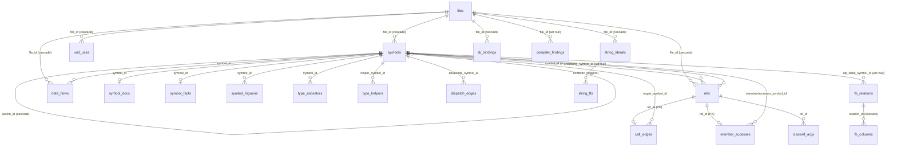

# Index DB Schema (schema 23)

Reference for the SQLite file drag-lint builds: `<project folder>\_D-RAG\<base>.sqlite`
(project DB) and `library-Win32|Win64.sqlite` (platform library). Everything here was
checked against `drag-lint schema --db <copy>` and `sql` on a copy of a real project DB,
and against `src\storage\DRagLint.Storage.Schema.pas` (the `SCHEMA_DDL` array, base
tables) and `DRagLint.Storage.SQLite.pas` `Migrate` (tables and columns added later).
Authoritative live view of any DB: `drag-lint schema --db <db> [--json]` (tables, columns,
row counts, curated value domains). Ad-hoc reads: `drag-lint sql --query "SELECT ..." --db <db>`
(one SELECT; ATTACH, PRAGMA, DDL and writes are refused by an authorizer).

Never open a real DB with a writer to "look": copy it first, or use the read-only verbs.

## 1. Overview

* **Schema version** `schema_meta.schema_version` = `23`. It is stamped LAST by `Migrate`
  (the commit point of a migration), so an interrupted upgrade keeps the old number and
  the next writable open heals it.
* **Two kinds of change.** A change that alters what the indexer WRITES bumps
  `SCHEMA_VERSION` (and the fingerprint, which forces a re-parse). An *additive* table or
  column (`member_accesses`, `dispatch_edges`, `classref_args`, `data_flows`,
  `refs.receiver_text`, `refs.external_target`, `refs.receiver_type_text`,
  `files.indexed_at_fingerprint`) is created by `Migrate` on every WRITABLE open with no
  version bump and is probed for by every reader. A read-only open never migrates, so an
  older DB simply lacks those tables/columns until the next `index`.
* **Table count.** 24 ordinary tables + 2 FTS5 virtual tables (`string_fts`,
  `string_fts_tri`, each with its own shadow tables `*_data`, `*_idx`, `*_docsize`,
  `*_config`, ignored below). Tables by group:
  * identity: `schema_meta`, `files`
  * declarations: `symbols`, `symbol_trigrams`, `symbol_docs`, `symbol_facts`,
    `type_ancestors`, `type_helpers`
  * usage and calls: `refs`, `call_edges`, `member_accesses`, `dispatch_edges`,
    `classref_args`, `data_flows`
  * structure: `unit_uses`, `di_bindings`
  * text: `string_literals` (+ FTS5)
  * external feeds: `compiler_findings`, `fb_relations`, `fb_columns`, `fb_field_info`,
    `fb_datasets`, `fb_enum_values`, `orm_links`

### ER diagram



`orm_links`, `fb_field_info`, `fb_datasets` and `fb_enum_values` are standalone (no FK):
`orm_links.*_symbol_id` are LOCAL ids into the DB named by `*_db_index`.

## 2. Which pass writes what

| Pass | Verb / stage | Writes |
|---|---|---|
| **index** (per file, one transaction) | `index`, `index --project` | `files` (incl. `indexed_at_fingerprint`, stamped in the same tx), `symbols`, `refs` (raw: `symbol_id` NULL for most), `unit_uses`, `string_literals` (+FTS via triggers), `di_bindings`, `data_flows`, `symbol_trigrams` |
| **resolve** (whole DB, after files) | end of `index` | `refs.symbol_id`, `refs.receiver_text`, `refs.receiver_type_text`, `refs.external_target`, `call_edges`, `member_accesses`, `type_ancestors` (rebuilt each run), `type_helpers`, `dispatch_edges` (wiped and rebuilt), `classref_args`, `unit_uses.target_file_id` |
| **doc / facts** | index-time doc extraction and ADP analysis | `symbol_docs`, `symbol_facts` (`effect_*` columns come from the purity stage) |
| **external feeds** | `import-log`, `fb-snapshot`, ORM link pass | `compiler_findings`, `fb_*`, `orm_links` |
| **library** | `index` of a platform library | same tables as a project DB; `schema_meta.scan_type = library` |
| **meta** | every index run | `schema_meta` (`schema_version`, `indexer_fingerprint`, `resolver_fingerprint`, `indexed_at_unix`, `scan_type`, `project_tag`, `out_of_closure_count`, `rebuild_in_progress`, `library_resolve_state`) |

Re-indexing a file deletes its rows (`DELETE ... WHERE file_id` plus the FK cascades below),
so derived tables (`call_edges`, `member_accesses`, ...) lose exactly that file's edges
until the next resolve pass.

## 3. Tables and columns

Types are the SQLite declared types. "PK" primary key; "FK" foreign key with the delete
action. Unless noted, line/col pairs are the source span of the declaration or reference.

### schema_meta
`key TEXT PK`, `value TEXT NOT NULL`. Keys seen: `schema_version`, `indexer_fingerprint`,
`resolver_fingerprint`, `indexed_at_unix`, `scan_type` (`project` | `library`),
`project_tag` (sanitised project name), `out_of_closure_count`, `rebuild_in_progress`, `library_resolve_state`
(empty when idle). `library_resolve_state` (JSON, present only for a `libraryResolve` section: `state` = `pending` when the resolve pass ran without a ready platform library, `bound` when it ran against one; absent = never opted in). See [[library-first-resolve]].

### files
| column | type | meaning |
|---|---|---|
| id | INTEGER PK | file id |
| path | TEXT NOT NULL UNIQUE | canonical absolute path (merged on open if two spellings exist) |
| mtime_unix | INTEGER | source mtime at index time; freshness check |
| sha256 | TEXT | content hash; skip-if-unchanged |
| parsed_at | INTEGER | unix time of the parse |
| language | TEXT | `delphi13`, `dfm`, SQL dialects |
| last_compiled_unix | INTEGER | written only by a compile sweep, never by indexing |
| indexed_at_fingerprint | TEXT | indexer fingerprint that produced this file's rows; NULL = unknown, re-parse (per-file resume) |

### symbols
Indexes: `idx_symbols_name`, `_qname`, `_file`, `_parent`, plus `COLLATE NOCASE` companions
`idx_symbols_name_nocase`, `idx_symbols_qname_nocase` (serve the case-insensitive retry).

| column | type | meaning |
|---|---|---|
| id | INTEGER PK | symbol id |
| file_id | INTEGER FK files (cascade) | declaring file |
| parent_id | INTEGER FK symbols (cascade) | enclosing symbol; every symbol roots at its unit, so top level = parent is the unit symbol |
| kind | TEXT | see section 4 |
| name | TEXT | bare name (generic parameters are NOT in it since v23) |
| qualified_name | TEXT | `Unit.TType.Member` |
| signature | TEXT | declaration text (parameters, result) |
| modifiers | TEXT | visibility word: `private`, `strict private`, `protected`, `public`, `published`; may carry `message`; '' = none |
| section | TEXT | `interface`, `implementation`, or '' (unit symbol, non-sectioned rows) |
| heritage | TEXT | raw ancestor list `'TBar, IBaz'` for class/interface; for a helper, the target text; for `classref`, the target |
| is_virtual | INTEGER | 1 for virtual/dynamic/override methods |
| start_line, start_col, end_line, end_col | INTEGER | declaration span |
| impl_start_line, impl_end_line | INTEGER | implementation body span (header to final `end`); 0 = no body |
| prop_access | TEXT | `ro` / `rw` / `wo` for a property leaf; NULL otherwise |
| is_helper | INTEGER | 1 for a record/class helper |
| directives | TEXT | all routine directives, lowercase, declaration order, space-joined (`virtual overload stdcall`); '' none; NULL = pre-v22 row |
| vis_explicit | INTEGER | 1 when a visibility keyword was written for the member's section, 0 for the unlabelled leading section; NULL (read as 1) on pre-v22 rows |
| generic_params | TEXT | generic parameter list as written, brackets stripped; NULL = not generic (v23) |

### refs
One row per identifier use. Raw at extraction; `symbol_id` and the resolve columns are
filled by the resolve pass. Indexes: `idx_refs_file`, `idx_refs_symbol`,
`idx_refs_enclosing`, `idx_refs_name_nocase`.

| column | type | meaning |
|---|---|---|
| id | INTEGER PK | |
| symbol_id | INTEGER FK symbols (set null) | resolved target declaration; NULL = unresolved or external |
| file_id | INTEGER FK files (cascade) | file containing the use |
| kind | TEXT | see section 4 |
| name_text | TEXT | identifier as written (generics keep their arguments) |
| start_line, start_col, end_line, end_col | INTEGER | span of the use |
| enclosing_symbol_id | INTEGER FK symbols (set null) | innermost routine whose body contains the ref; NULL outside any body |
| receiver_text | TEXT | receiver expression left of the dot, verbatim; '' for bare/`inherited`; written by resolve |
| external_target | TEXT | qualified name of a call target in ANOTHER DB (library); NULL = resolved locally or not at all. A ref never has both a local `call_edges` row and this |
| receiver_type_text | TEXT | receiver's declared type text as the resolver reached it; NULL = never resolved by a 1.16+ engine, '' = bare/untypable (added by `Migrate`, no version bump; absent on older DBs) |

### call_edges
One row per call ref resolved to a local routine. `ref_id` is the PK, so a ref has at most
one edge. Indexes: `idx_call_edges_target`, `_ref`, `_receiver`.
`ref_id INTEGER PK FK refs (cascade)`, `target_symbol_id INTEGER NOT NULL FK symbols
(cascade)`, `confidence TEXT` (`certain` | `ambiguous`: several overloads/receivers
matched), `receiver_type_symbol_id INTEGER FK symbols (set null)` (static receiver type).
Only `refs.kind = 'call'` is ever resolved here.

### member_accesses
Property/field accesses. `ref_id INTEGER PK FK refs (cascade)`, `member_symbol_id INTEGER
NOT NULL FK symbols (cascade)`, `mode TEXT` (`read` | `write`), `accessor_symbol_id INTEGER FK
symbols (set null)` (getter/setter method, which ALSO earns a `call_edges` row),
`accessor_kind TEXT` (`field` when the accessor is the backing field; NULL otherwise),
`receiver_type_symbol_id INTEGER FK symbols (set null)`. Indexes on `member_symbol_id`,
`accessor_symbol_id`.

### dispatch_edges
Derived, wiped and rebuilt by the dispatch pass. PK `(base_symbol_id, impl_symbol_id)`, both
FK symbols (cascade). `kind TEXT` (`override`, `implements`), `confidence TEXT` (`certain`).
Index `idx_dispatch_edges_impl`.

### classref_args
Class-reference arguments (a class passed to a `class of` parameter). PK `(ref_id,
arg_index)`; `ref_id` FK refs, `param_symbol_id` and `class_symbol_id` FK symbols (all
cascade); `confidence TEXT`. Indexes on `class_symbol_id`, `param_symbol_id`.

### data_flows
Per-routine data-flow facts for taint rules; written inside the file transaction.
Absent from a DB last opened writable before the taint wave. Column image of
`TDataFlowRow`. Indexes `idx_data_flows_dst (file_id, dst_line, dst_col)`,
`idx_data_flows_sym (symbol_id, dst_kind)`, `idx_data_flows_name (dst_kind, dst_name NOCASE)`.

| column | type | meaning |
|---|---|---|
| file_id | INTEGER FK files (cascade) | |
| symbol_id | INTEGER FK symbols (cascade) | enclosing routine |
| owner_id | INTEGER | owning class symbol id or 0 |
| dst_kind | TEXT | `DF_DST_*` code, section 4 |
| dst_line, dst_col | INTEGER | position; for `arg`/`write` equals `refs.start_line/start_col` of the call / member-write ref |
| dst_index | INTEGER | 0-based argument or out-parameter position; -1 unused |
| dst_name | TEXT | callee / member / field / global leaf name; parameter name for `outparam`; '' for `result` |
| dst_receiver | TEXT | text before the dot (`Q.SQL`); '' when bare |
| src_kind | TEXT | `DF_SRC_*` code, section 4 |
| src_index | INTEGER | 0-based declared position (`param`) or argument position (`argout`); -1 otherwise |
| src_line, src_col | INTEGER | feeding ref position (`ref`, `argout`); 0 otherwise |
| src_name | TEXT | leaf name of the source |
| via_local | INTEGER | 0 = source appears in the destination expression; 1 = reached through state (local, container) |
| cond | INTEGER | 1 = path crossed a differing join or used the flow-insensitive fallback (explainability only) |

Per-routine cap: 4000 rows (`DF_ROW_CAP`). No row for literals, constants, nil, or
numeric/boolean/ordinal-typed values.

### type_ancestors
Direct ancestor edges, one per heritage entry; rebuilt by `ResolveAncestry` every run.
`symbol_id INTEGER FK symbols (cascade)`, `ordinal INTEGER` (0-based position in the heritage
list), `ancestor_name TEXT`, `ancestor_kind TEXT` (`class`, `interface`, or `?` unknown),
`ancestor_symbol_id INTEGER` (NULL = external/RTL, name only), `ancestor_file_id INTEGER`,
`ancestor_type_args TEXT` (instantiation arguments, v23). Indexes: `symbol_id`, `ancestor_name`.

### type_helpers
`helper_symbol_id INTEGER FK symbols (cascade)`, `target_name TEXT`, `target_symbol_id INTEGER
FK symbols (set null)`, `target_file_id INTEGER`, `helper_kind TEXT` (`record`, `class`).
Indexes: helper, target_name.

### unit_uses
One row per uses-clause entry. Indexes: `file_id`, `unit_name_norm`, `section`, partial
`target_file_id`, partial `origin_path`.
`id PK`, `file_id FK files (cascade)`, `unit_name TEXT`, `unit_name_norm TEXT` (lowercased
trailing segment: `System.SysUtils` -> `sysutils`), `section TEXT` (`interface` |
`implementation` | `program` | `package`), `in_path TEXT` (the `in '...'` text),
`target_file_id INTEGER FK files (set null)` (resolved unit file), span columns
`start_line/start_col/end_line/end_col`, `origin_path TEXT` and `include_line INTEGER`
(entry came from an `{$I}` include: the `.inc` path and the host directive line; NULL for the
unit's own text).

### symbol_trigrams
`trigram TEXT`, `symbol_id INTEGER FK symbols (cascade)`; PK `(trigram, symbol_id)`,
`WITHOUT ROWID`. Fuzzy-name index, populated lazily on first fuzzy query for a DB lacking it.
Extra indexes on `trigram` and `symbol_id` (the latter makes the cascade a seek).

### symbol_docs
`symbol_id INTEGER PK FK symbols (cascade)`, `format TEXT` (`xmldoc`, pasdoc, oneline),
`raw_block TEXT`, `summary`, `remarks`, `returns_text`, `params_json`, `exceptions_json`,
`example_text`, `seealso_json`, `since_text` (all TEXT, NULL when absent), `deprecated INTEGER
NOT NULL DEFAULT 0`, `start_line`, `end_line`. Indexes: `format`, partial `deprecated = 1`,
`symbol_id`.

### symbol_facts
Wide analysis table, one row per analysed symbol (`symbol_id INTEGER PK FK symbols
(cascade)`): `reads_fields`, `writes_fields`, `returns_owner`, `dfm_event`, `sql_reads`,
`sql_writes`, `covered_by`, `mutates_params`, `ui_affinity`, `touches`, `wiring` (TEXT,
delimited lists), `cyclomatic INTEGER`, `body_loc INTEGER`, and the purity columns
`effect_free INTEGER` (-1 while the purity stage is writing), `effect_summary TEXT`,
`effect_witness TEXT`. NULL = not computed.

### string_literals (+ string_fts, string_fts_tri)
`id PK`, `file_id FK files (cascade)`, `symbol_id FK symbols (set null)`, `source TEXT`
(`pas` | `dfm`), `kind TEXT` (`literal`, `const`, `format`, `comment`, `doc` for pas;
`dfm-prop`, `dfm-type` for dfm), `owner_name TEXT`, `text TEXT`, span columns. Indexes:
`file_id`, `symbol_id`, `source`. `string_fts` (unicode61) and `string_fts_tri` (trigram)
are external-content FTS5 tables over `string_literals.text`, kept in sync by the triggers
`string_literals_ai/_ad/_au`. A SQLite older than 3.34 has no trigram tokenizer: then only
`string_fts` and trigger variants without `string_fts_tri` exist. Delete literals through
the normal path so the triggers fire.

### di_bindings
Spring4D registrations. `id PK`, `file_id FK files (cascade)`, `interface_name`, `impl_name`
(verbatim, nested generics kept), `lifetime` (TEXT), span columns. Indexes on both names.

### compiler_findings
Imported compiler log lines (`import-log`). `id PK`, `file_id FK files (set null)`,
`raw_path TEXT` (kept when no indexed file matches), `code TEXT`, `severity TEXT`, `line_no`,
`col_no`, `message TEXT`, `imported_at INTEGER`. Index on `code`.

### Firebird snapshot (fb_relations, fb_columns, fb_field_info, fb_datasets, fb_enum_values)
Written by `fb-snapshot`; every row carries `snapshot_at` so snapshots can coexist for drift
comparison. `fb_relations(id, name, sql_table_symbol_id FK symbols set null, owner,
system_flag, description, snapshot_at)`; `fb_columns(id, relation_id FK fb_relations cascade,
name, position, field_source, field_type, field_length, field_scale, field_precision,
nullable, default_value, sql_column_symbol_id FK symbols set null, description, snapshot_at)`;
`fb_field_info` (display label/format, visible, read_only, triggered, display_width, per
`field_name`/`table_name`); `fb_datasets` (the five SQL strings of a FIB dataset, key field,
update table); `fb_enum_values(enum_name, value_code, value_label)`. Empty in an ordinary
project DB.

### orm_links
Delphi-to-SQL bindings across DBs. `id PK`, `delphi_symbol_id`, `delphi_db_index`,
`sql_symbol_id`, `sql_db_index` (ids are LOCAL to the DB at that `--db` position),
`confidence REAL`, `link_kind TEXT` (`class_to_table`, `iface_to_table`, `field_to_column`),
`evidence TEXT`, `computed_at`. Indexes on both ends and `link_kind`.

## 4. Enumerated codes

**symbols.kind** (text of `TSymbolKind`, source `DRagLint.Core.Model.pas`; `schema` derives
the same list live): `unit program package class interface record enum enum_value procedure
function method constructor destructor property field var const type form component
sql_table sql_column sql_index sql_trigger sql_generator sql_procedure sql_view sql_exception
sql_domain sql_constraint initialization finalization local_var param classref`.
In a real index `local_var`/`param` dominate the row count (typed locals and parameters are
emitted so receivers can be typed), then `field` and `method`.

**refs.kind** (curated in `DoSchema`; every literal passed to `EmitRef`/`AddRef`):
`attribute call di-resolve di-unresolved event-binding handle handle-all member-access raise
raise-expr read reraise sql_table_ref type_use write`. Notes: a dotted call emits BOTH a
`call` and a co-located `member-access` ref at the same span; only `call` is resolved to
`call_edges`. `raise`/`raise-expr`/`reraise`/`handle`/`handle-all` are exception facts
(deep parse only; never resolved); `event-binding` is a DFM event hookup (name = handler).

**call_edges.confidence**: `certain`, `ambiguous`. **member_accesses.mode**: `read`, `write`.
**dispatch_edges.kind**: `override`, `implements`.

**data_flows.dst_kind** (`DF_DST_*`): `arg` (call argument), `write` (assignment to a member of
a non-local), `result` (`Result :=`, `Exit(e)`), `field` (field of the owner or ancestor),
`global` (unit variable), `outparam` (var/out parameter of this routine).
**data_flows.src_kind** (`DF_SRC_*`): `param` (declared parameter), `ref` (a call result or a
member/variable read that is not a local/param/field/global), `field`, `global`, `argout` (a
variable passed at position `src_index` of an earlier call).

## 5. Fingerprints

All three live in `schema_meta` and drive "is this index current".

* **schema** `schema_version` (= `SCHEMA_VERSION`, 23): structural generation of the file.
* **indexer** `indexer_fingerprint`, e.g. `v=1.25.0-alpha;schema=23;pp=1;plat=win64;cfg=debug;defs=42819f5f`:
  product/extractor version, schema, preprocessing on, platform, config, hash of the defines.
  A mismatch means rows were produced by a different extractor: re-parse. The extractor
  constant `DRAGLINT_EXTRACTOR_VERSION` changes only when extraction changes. Per file the
  same string is kept in `files.indexed_at_fingerprint`, so an interrupted run resumes
  instead of restarting.
* **resolver** `resolver_fingerprint`, e.g. `r=1.15.0-alpha;schema=23`: the resolve-pass
  generation. A mismatch re-runs resolve (without re-parsing) so `refs.symbol_id`,
  `call_edges`, `member_accesses` etc. are rebuilt.
* `indexed_at_unix` is the freshness stamp; a non-empty `rebuild_in_progress`, `library_resolve_state` means a
  `--rebuild` is mid-flight and the DB is not authoritative.

## 6. Library DB versus project DB

Same schema and the same code path; the differences are data and policy.

* `schema_meta.scan_type` = `library` vs `project`; a project DB also has `project_tag`
  and `out_of_closure_count` (rows outside the project's compile closure, which only
  `--rebuild` can remove).
* Scope: a project DB holds only that project's compile closure; the library holds the
  platform RTL/VCL/third-party units (`C:\Projects\.drag-lint\library-Win32|Win64.sqlite`,
  millions of symbols, GB-sized). "Which unit declares X" is answered by the library, "who
  calls X" only by the project DB.
* Cross-DB links are by NAME, never by id: a project call to a library routine has no
  `call_edges` row (the FK is local); it is recorded as `refs.external_target`.
  `type_ancestors.ancestor_symbol_id` NULL likewise means "outside this DB".
* Library units run neither the project, the flow nor the type-aware lint rules.
* The NOCASE and `symbol_id` cascade indexes matter far more on a library DB (a missing
  NOCASE index made one lookup 0.6 s -> 2.8 s and a property climb 2 s -> 300 s).

## 7. WAL, locking, busy timeout

* Journal mode is **WAL**, `synchronous = NORMAL`. A writer open converts a rollback-journal
  file to WAL; a reader keeps whatever mode the file header already says.
* Writer (`ConnectWriter`): one writer per DB at a time, `PRAGMA foreign_keys = ON` (the
  cascades above depend on it), private page cache, 256 MB `cache_size`, 1 GB `mmap_size`,
  `temp_store = MEMORY`. Each file is indexed in its own transaction.
* Readers (`ConnectReadOnly`) open read-write under `PRAGMA query_only = ON` (not
  `SQLITE_OPEN_READONLY`, so the last closer can checkpoint and delete `-wal`/`-shm`). A
  copy of `X.sqlite` WITHOUT its `-wal` can lose recent pages: open and close it cleanly
  first, or copy all three files.
* `busy_timeout` is armed BEFORE the connect (default `DEFAULT_BUSY_TIMEOUT_MS` = 5000 ms; the
  membership probe uses 2000 ms) so even connect-time pragmas wait. A persistent
  `database is locked` usually means an orphaned `drag-lint.exe` / `drag_lint_graph.exe`
  holding the DB: stop those first.
* `sqlite_stat1` is gathered once (`analysis_limit = 400`, `ANALYZE`) when absent; refresh
  with `PRAGMA optimize` after a large reindex.
* `Migrate` runs on every writable open; read verbs never migrate.

## 8. Example queries

Run with `drag-lint sql --db <db> --query "..."` (add `--json`, `--limit N`).

1. Who calls a routine (resolved sites, by bare name):

```sql
SELECT enc.qualified_name AS caller, f.path, r.start_line
FROM call_edges e
JOIN symbols t   ON t.id = e.target_symbol_id AND t.name = 'Create'
JOIN refs r      ON r.id = e.ref_id
JOIN files f     ON f.id = r.file_id
LEFT JOIN symbols enc ON enc.id = r.enclosing_symbol_id
WHERE e.confidence = 'certain';
```

2. Unresolved call sites (no local edge, no external target):

```sql
SELECT r.name_text, r.receiver_text, f.path, r.start_line
FROM refs r JOIN files f ON f.id = r.file_id
WHERE r.kind = 'call' AND r.external_target IS NULL
  AND NOT EXISTS (SELECT 1 FROM call_edges e WHERE e.ref_id = r.id);
```

3. external_target counts (what the project calls in other DBs):

```sql
SELECT external_target, COUNT(*) AS n FROM refs
WHERE external_target IS NOT NULL GROUP BY 1 ORDER BY n DESC;
```

4. Call-site resolution summary:

```sql
SELECT COUNT(*) AS total, SUM(external_target IS NOT NULL) AS external,
       SUM(EXISTS (SELECT 1 FROM call_edges e WHERE e.ref_id = refs.id)) AS local_edge
FROM refs WHERE kind = 'call';
```

5. Ancestors of a class, with external ones flagged:

```sql
SELECT a.ordinal, a.ancestor_name, a.ancestor_kind, a.ancestor_symbol_id IS NULL AS external
FROM type_ancestors a JOIN symbols s ON s.id = a.symbol_id
WHERE s.qualified_name = 'Unit1.TMyForm' ORDER BY a.ordinal;
```

6. Interface-section uses (candidates to move down to implementation):

```sql
SELECT f.path, u.unit_name FROM unit_uses u JOIN files f ON f.id = u.file_id
WHERE u.section = 'interface' AND u.target_file_id IS NOT NULL;
```

7. Most complex routines (analysis facts):

```sql
SELECT s.qualified_name, x.cyclomatic, x.body_loc
FROM symbol_facts x JOIN symbols s ON s.id = x.symbol_id
ORDER BY x.cyclomatic DESC LIMIT 20;
```

8. Where a message text appears (FTS5 over .pas and .dfm literals). NOTE: the read-only `sql` verb currently refuses an FTS5 `MATCH` (the authorizer rejects the PRAGMA data_version FTS5 issues); use `drag-lint query --text` for this, or run the statement with an external SQLite on a copy:

```sql
SELECT l.source, l.kind, f.path, l.start_line, l.text
FROM string_fts JOIN string_literals l ON l.id = string_fts.rowid
JOIN files f ON f.id = l.file_id WHERE string_fts MATCH 'connection';
```
